# DriverFilesHub: features at a glance

**Driver qualification, fleet compliance and trip management for trucking companies.**

| | |
|---|---|
| Version | 13 October 2026, statuses updated 23 October 2026 |
| Based on | Client use cases (DOT Doc Hub, 7 March 2023), the gap report (26 September 2026), the architecture set in [architecture/](architecture/README.md), and the code at commit `d1d4d8d` |
| PDF version | [DriverFilesHub-Features.pdf](DriverFilesHub-Features.pdf) |
| For developers | [Technical-Features-and-Workflow.md](Technical-Features-and-Workflow.md) |

> **In one sentence:** DriverFilesHub lets a trucking company hire drivers online, keep every driver, truck and trailer document in one safe place, stay ready for a DOT audit at any time, and, as it grows, run its trips, driver app, pay and payroll from the same system.

---

## How to read the status labels

| Label | Meaning |
|---|---|
| ✅ **Ready** | Works in the product today |
| 🧱 **Phase 0** | Planned for the foundation release but not built yet |
| 🟦 **Phase 1** | Quick wins: social login, folders, photo-to-PDF, ZIP downloads, licence plates |
| 🟩 **Phase 2** | Trips and loads, on the website |
| 🟧 **Phase 3** | Driver mobile app, live tracking, messaging |
| 🟪 **Phase 4** | Pay, timesheets, profit and loss, QuickBooks |
| ⏳ **PENDING** | Waiting for an answer from the client |

**Where we are today:** of the client's 52 requirements, **9 work today**, **4 work in part**, and **39 are planned** across Phases 0 to 4.

**After Phase 1 (23 October 2026):** counting the Phase 1 changes, **14 work**, **5 work in part** and **33 are planned**. The Phase 0 labels below were updated on 23 October 2026: Phase 0 is done, except the two items still marked 🧱.

---

## 1. Who uses DriverFilesHub

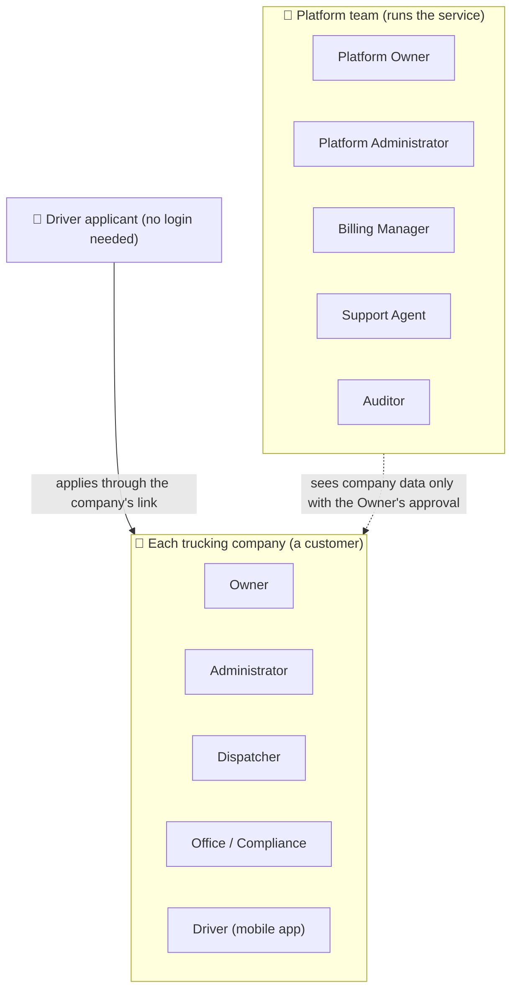

| Who | What they do | Status |
|---|---|---|
| **Platform Owner and staff** | Run the service: companies, plans, prices, subscriptions, settings. They **cannot** see a company's drivers or documents unless the company Owner approves a support session. | 🔄 Upgrading (today a single "super-admin") |
| **Company Owner** | Holds the account and pays the subscription. Has full control of the company. | ✅ Ready |
| **Administrator** | Runs the company day to day. Everything except billing. | ✅ Ready (Phase 0) |
| **Dispatcher** | Creates trips, assigns drivers and trucks, follows trips. | ✅ Ready (Phase 0; trips in Phase 2) |
| **Office / Compliance** | Drivers, documents, fleet, maintenance. | ✅ Ready (Phase 0) |
| **Driver** | Uses the mobile app: trips, inspections, fuel stops, events, time, messages. | 🟧 Phase 3 |
| **Driver applicant** | Applies online from the company's own link. Verified by an SMS code. | ✅ Ready |

A company can also **create its own roles** and choose exactly what each role may do. ✅ Ready (Phase 0)

An **owner-operator** is simply an Owner who is also a driver. One person can hold several roles, for example Dispatcher and Driver.

---

## 2. Feature map

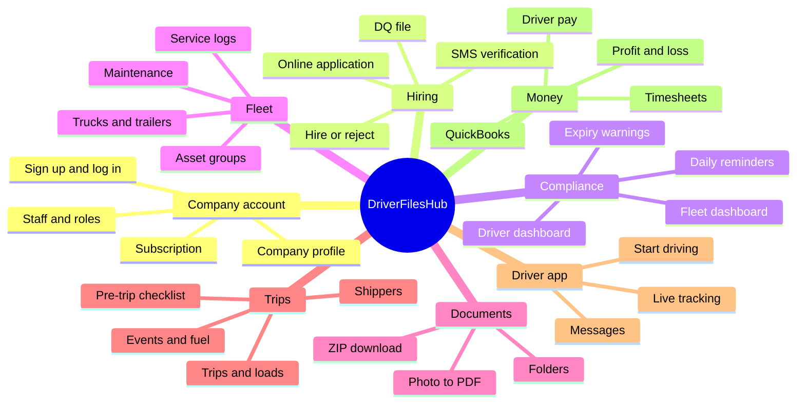

---

## 3. Features in detail

### 3.1 Company account and team

| Feature | What it means for you | Status |
|---|---|---|
| Sign up with email | Create your company account. Email verification is required. | ✅ Ready |
| Company name at sign-up | Sign-up asks for your company name and time zone, not just your own name | ✅ Ready (Phase 0; time zone since 23 Oct 2026) |
| Sign up / log in with Google or Facebook | One-click sign-in on the website | ✅ Ready (Phase 1); switched on once Google and Facebook approve the app |
| Sign in with Apple | Needed in the iPhone app if Google or Facebook sign-in is offered there | 🟧 Phase 3 |
| Log in | Secure login. Inactive users are logged out automatically. | ✅ Ready |
| Company profile | Name, address, phone, logo, time zone, DOT and MC numbers, billing email | ✅ Ready (DOT, MC, time zone and billing email: 🧱 Phase 0) |
| Company policy PDFs | Your own drug and alcohol policy and work policy, shown to applicants. A platform default is used if you have none. | ✅ Ready |
| Invite staff | Send an email invitation; the person sets a password and joins your company | ✅ Ready (Phase 0) |
| Ready-made roles | Owner, Administrator, Dispatcher, Office / Compliance, Driver | ✅ Ready (Phase 0) |
| Your own roles | Create, edit and delete roles, and pick their permissions | ✅ Ready (Phase 0; depends on your plan) |
| Permissions for one person | Give one user an extra permission without a new role | ✅ Ready (Phase 0 and Phase 1) |
| Safe role rules | Nobody can give more rights than they hold, or change their own roles | ✅ Ready (Phase 0) |
| Close account | The Owner can close the account. Nothing is deleted; the company is deactivated and the data kept. | ✅ Ready |

### 3.2 Driver hiring

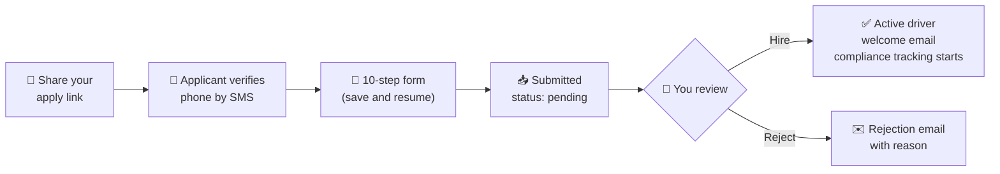

The 10 steps: **1** basic info · **2** driving licence · **3** medical card · **4** forfeitures · **5** violations · **6** drug and alcohol · **7** FMCSA consent · **8** PSP report · **9** drug policy · **10** work policy.

| Feature | What it means for you | Status |
|---|---|---|
| Your own apply link | Every company has its own web address for applications | ✅ Ready |
| SMS phone check | One-time code by text message. US and Canadian numbers only. | ✅ Ready |
| Save and resume | Applicants can stop and continue later, check their status, or withdraw | ✅ Ready |
| Hire or reject in one click | The applicant gets an email automatically | ✅ Ready |
| Add a driver yourself | Staff can enter a driver with the same step-by-step wizard | ✅ Ready |
| Driver Qualification (DQ) file | Licences, addresses, experience, accidents, violations, employers, signed consents, all in one place | ✅ Ready |
| Terminate a driver | Ends employment, switches off the driver's login, keeps the DQ file for the legal period | 🧱 Not built yet: the status exists, but there is no terminate action that switches off the login |
| Applications closed | If your plan doesn't include online applications, the link says so | 🧱 Not built yet: the `driver_applications` feature is not checked on the public link |
| Invite a driver to the app | The driver gets a login linked to their driver record | 🟧 Phase 3 |

### 3.3 Compliance (always audit-ready)

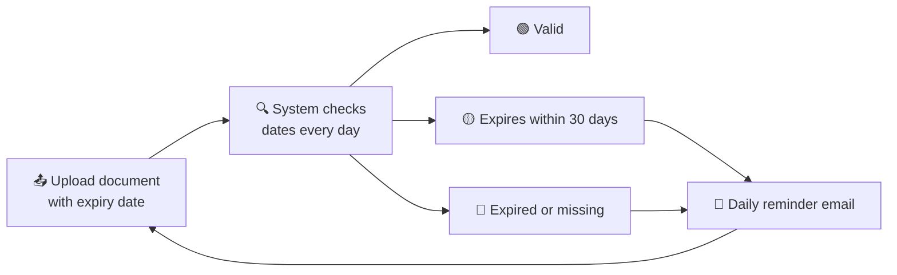

| Feature | What it means for you | Status |
|---|---|---|
| Driver compliance dashboard | Green, yellow or red for every driver, 25 per page | ✅ Ready |
| Fleet compliance dashboard | The same for every truck and trailer, paginated | ✅ Ready |
| 30-day early warning | A document is "expiring" 30 days before its expiry date | ✅ Ready |
| Upload to all | Upload one document (for example an insurance card) to every truck at once | ✅ Ready |
| Choose your document types | Switch off document types that don't apply to your company | ✅ Ready |
| Daily reminder email | One email per driver per day listing their problem documents | ✅ Ready |
| One-click reminder | Remind a driver or vehicle owner straight from the dashboard | ✅ Ready |
| Medical certificate and CDL expiry | Both now count in the compliance status (they were not tracked before) | ✅ Ready (Phase 0) |

### 3.4 Fleet and maintenance

| Feature | What it means for you | Status |
|---|---|---|
| Trucks and trailers | Add, edit, delete and restore. Type, year, make, model, VIN, unit number. | ✅ Ready |
| No duplicates | VIN and unit number are unique within your company | ✅ Ready |
| Licence plate and photo | Plate number, plate state and a picture for each truck and trailer | ✅ Ready (Phase 1) |
| Asset groups | Pair a driver with a truck and trailer | ✅ Ready |
| One group per truck | A truck or trailer can be in only one active group | ✅ Ready (Phase 0) |
| Engine hours | Kept on the truck and raised by service logs, like the odometer | ✅ Ready |
| Maintenance schedules | By date, mileage or engine hours. "Mark as completed" moves the next due date forward. | ✅ Ready |
| Service logs | Repairs with categories, costs and receipts (PDF, images, Word files) | ✅ Ready |
| Move a truck to another company | Done by the platform team, with full history copied and both Owners told | ✅ Ready (Phase 0) |

### 3.5 Documents and folders

| Feature | What it means for you | Status |
|---|---|---|
| Standard folders | Ready-made folders for each driver (DQ file), truck, trailer and trip | ✅ Ready (Phase 1); trip folder 🟩 Phase 2 |
| Your own folders | Create, rename and delete folders, inside each other (up to 5 levels) | ✅ Ready (Phase 1) |
| Upload into a folder | Put any document in the folder you choose | ✅ Ready (Phase 1) |
| Photo becomes PDF | A photo you upload is turned into a PDF automatically. The original is kept. | ✅ Ready (Phase 1) |
| ZIP download: driver or company | Everything for one driver, or the whole company, in one file | ✅ Ready (Phase 1) |
| ZIP download: trip | Everything for one trip | 🟩 Phase 2 |
| Safe downloads | Large ZIPs are built in the background; you get a notice and a link that expires | ✅ Ready (Phase 1) |

### 3.6 Trips and loads

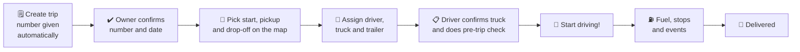

| Feature | What it means for you | Status |
|---|---|---|
| Create and edit trips | One load per trip | 🟩 Phase 2 |
| Automatic trip number and date | You confirm them before the trip goes out | 🟩 Phase 2 |
| Load details | Product, weight, unit, and the pay you get for the load | 🟩 Phase 2 (pay: 🟪 Phase 4) |
| Shippers | Add shipper details and save them for next time | 🟩 Phase 2 |
| Map picker | Choose start and drop-off from Google Maps. Pickup is optional: skip it when it is the same as the start. | 🟩 Phase 2 |
| Assign driver, truck and trailer | Filled in from the driver's asset group, so it is quick | 🟩 Phase 2 |
| Driver confirms the equipment | The driver checks the truck and trailer are the right ones | 🟩 Phase 2 (in the app: 🟧 Phase 3) |
| Pre-trip checklist | One screen, with a progress bar until it is finished. A pre-trip checklist, not a DVIR. | 🟩 Phase 2 |
| Add Stop | Record an unplanned stop and the reason | 🟩 Phase 2 |
| Police stop | Ticket yes or no. Yes: upload the ticket. No: say why you were stopped. | 🟩 Phase 2 |
| Weigh station | Weight OK yes or no. No: upload the documents. | 🟩 Phase 2 |
| Accident | Upload licence, insurance and photos of both vehicles. Feeds the accident register report. | 🟩 Phase 2 |
| Breakdown | Record a breakdown on the trip | 🟩 Phase 2 |
| Add Fuel Stop | Where, how many gallons, price, receipt, then a "Done" screen. You can see later where each fuel stop was. | 🟩 Phase 2 |
| Dashboard counts | Loads on the road and loads waiting for pickup | 🟩 Phase 2 |

### 3.7 Driver mobile app

| Feature | What it means for the driver | Status |
|---|---|---|
| Driver login | Own account, linked to their driver record. Sees only their own trips. | 🟧 Phase 3 |
| Use my current location | Start the trip from where the driver is | 🟧 Phase 3 |
| "Start driving!" | Shows "Trip Started" and opens the trip folder | 🟧 Phase 3 |
| Continue a trip | If the driver leaves the app, it brings them back to the trip in progress | 🟧 Phase 3 |
| Miles and distance | Miles driven so far and distance left to the destination | 🟧 Phase 3 |
| Camera uploads | Tickets, receipts and accident photos straight from the phone | 🟧 Phase 3 |
| Messages | Chat between office and drivers, with push notifications | 🟧 Phase 3 |

### 3.8 Live tracking

| Feature | What it means for you | Status |
|---|---|---|
| Live truck location | See every truck that is on a trip on a map | 🟧 Phase 3 |
| Live trailer location | Shown from the truck pulling it on the active trip (no trailer GPS device needed) | 🟧 Phase 3 |
| Driver privacy | Drivers are told about tracking. Location history is kept for a limited time. | 🟧 Phase 3 |

### 3.9 Pay, time and profit

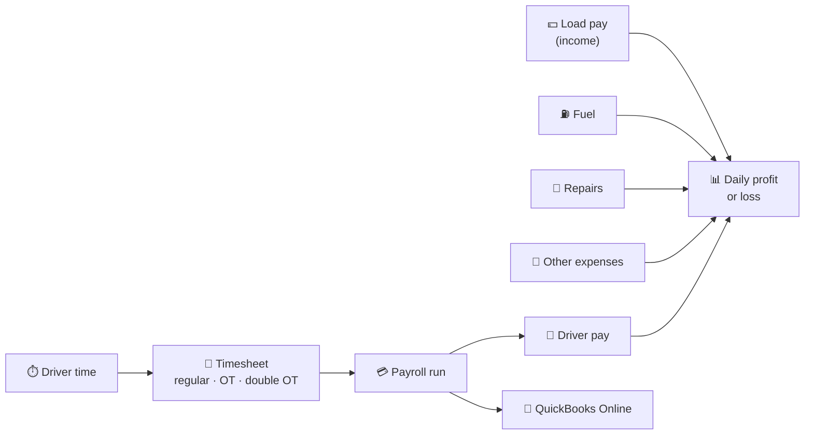

| Feature | What it means for you | Status |
|---|---|---|
| Pay per load | Enter what you are paid for each load | 🟪 Phase 4 |
| Driver pay per mile and per hour | Rates per driver, with start dates, so history never changes | 🟪 Phase 4 |
| How the two rates work together | Miles are paid per mile. Waiting and loading time (on duty, not driving) is paid per hour. A driver with only an hourly rate is paid hourly for all work. | 🟪 Phase 4 |
| Timesheets | Hours, overtime and double overtime | 🟪 Phase 4 |
| Overtime rules you control | Default: overtime after 8 hours a day, double overtime after 12. Optional weekly limit. Mark drivers who are exempt. | 🟪 Phase 4 |
| Expenses | Tolls, lumper, scale, parking, repairs and other costs. These are the starting categories; you can add, rename or remove your own. | 🟪 Phase 4 |
| Daily profit or loss | Load pay minus fuel, repairs, expenses and driver pay, day by day | 🟪 Phase 4 |
| Year-end report | Each driver's trips, load type, trip numbers, trucks, trailers, hours and miles | 🟪 Phase 4 |
| QuickBooks Online | Drivers sent as employees, approved hours sent as time records, plus a payroll summary file | 🟪 Phase 4 |
| Time-off requests | Drivers and staff ask; the Owner or an Administrator approves | 🟪 Phase 4 |

> Timesheets in DriverFilesHub are **not** hours-of-service (ELD) records.

---

## 4. Plans and subscription

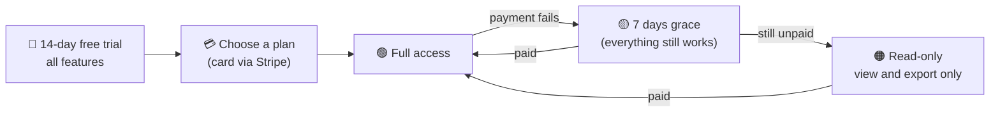

| Plan | Monthly | Yearly |
|---|---|---|
| Free trial | 14 days, all features | — |
| Starter | $29 | $290 |
| Company | $99 | $990 |
| Enterprise | $149 | $1,490 |

These are the default prices in the system today. The Platform Owner can change prices and what each plan includes.

| Feature | What it means for you | Status |
|---|---|---|
| Free trial | One per company and per verified email | ✅ Ready |
| Pay by card | Secure Stripe checkout, monthly or yearly | ✅ Ready |
| Billing portal, cancel, resume | Manage your card and invoices yourself | ✅ Ready |
| Subscription owned by the company | All your users and drivers share one subscription | ✅ Ready (Phase 0) |
| Plan limits | Each plan sets how many drivers, trucks, trailers, office users and how much storage you get. Nothing is deleted if you go over; you just can't add more until you upgrade. | ✅ Ready (Phase 0) |
| Upgrade and downgrade | Upgrades apply at once. Downgrades apply at the end of the billing period. | ⏳ PENDING: plan changes go through the Stripe billing portal; its downgrade timing has to be checked in the Stripe settings |
| Grace and read-only | 7 days of grace after a failed payment, then read-only. You can still view and export your DQ files for an audit. | ✅ Ready (Phase 0) |
| Expiry reminders | Email (and SMS) 7, 3 and 1 days before your plan ends | ✅ Ready |

**What counts toward the limits:** active hired drivers only (not applicants), office users only (not driver logins), and trucks and trailers that aren't deleted.

---

## 5. Security and privacy

| Protection | What it means for you | Status |
|---|---|---|
| Your data is yours | Every company's data is kept apart. Another company can't open your records, even by guessing a link. | ✅ Ready (Phase 0, database-enforced) |
| Private files | Documents are never public. Every download is checked. | ✅ Ready |
| SSN encrypted | Social Security numbers are stored encrypted | ✅ Ready |
| Email verification | Required before using the system | ✅ Ready |
| SMS limits | Limits on code requests stop abuse and cost | ✅ Ready |
| Platform staff can't look in | The platform team sees a company's data only in a **support session**. Your Owner and a second Platform Owner must both approve it. It is time-limited, shown on screen, can be stopped by you at any time, and every action is logged. | 🧱 Phase 0 |
| Activity log | Logins, role changes, exports, deletions and support-session actions are recorded | ✅ Ready (Phase 0) |
| Nothing lost by accident | Companies and users are deactivated, never wiped. Data is removed only after the legal keeping period. | ✅ Ready |

> There is **no** two-factor login for company users today. (The older feature sheet said there was; that was wrong.)

---

## 6. How it works: the main journeys

### 6.1 A company gets started

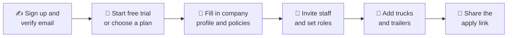

### 6.2 A driver's day (Phase 3)

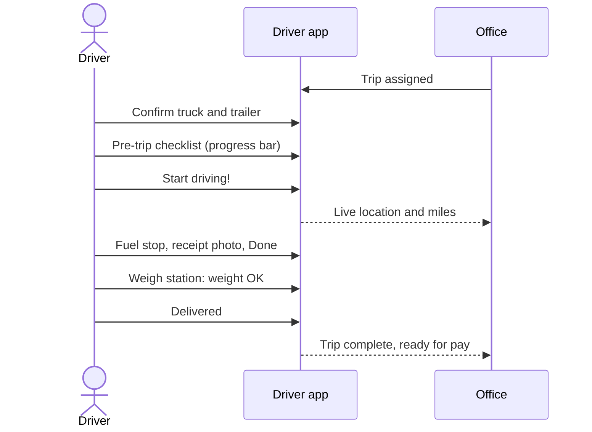

### 6.3 When the platform team needs to help

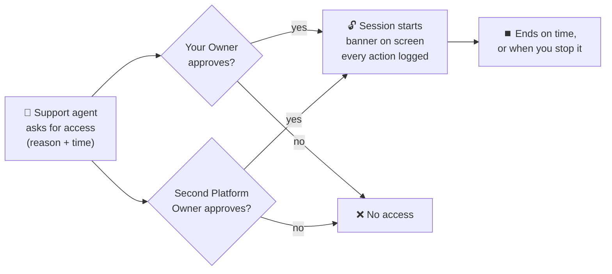

---

## 7. Delivery plan

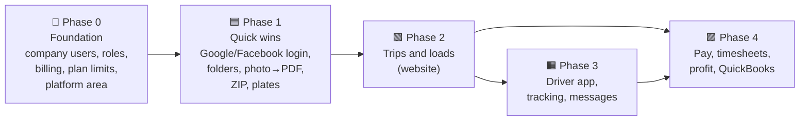

| Phase | You get |
|---|---|
| 🧱 0 Foundation (✅ done 21 Oct 2026) | Staff accounts, company roles, company billing, plan limits, read-only after non-payment, support sessions, activity log, medical card and CDL expiry tracking |
| 🟦 1 Quick wins (✅ done 23 Oct 2026) | Google and Facebook login, folders, photo-to-PDF, ZIP per driver and company, licence plates and photos, per-user permissions screen |
| 🟩 2 Trips and loads | Trips, shippers, map, assignment, pre-trip checklist, events, fuel stops, dashboard counts, ZIP per trip |
| 🟧 3 Driver app | Driver login and app, Start driving, live tracking, miles, messages and push notifications |
| 🟪 4 Money | Load pay, pay rates, timesheets and overtime, expenses, daily profit and loss, year-end report, QuickBooks, time off |

---

## 8. Still to confirm with the client

| Item | Today's default |
|---|---|
| ⏳ **How long to keep records** (DQ files, maintenance, accidents, payroll, locations, activity log) | The legal minimums are used for now (23 Oct 2026); your counsel can change them |
| **Driver overtime exemption** (confirmed 23 Oct 2026) | The company decides which drivers are exempt; the software only applies it |
