# DriverFilesHub: technical features and workflows

| | |
|---|---|
| Audience | Developers, reviewers and the product owner's technical advisers |
| Version | 13 October 2026, against commit `d1d4d8d` |
| Status | Consolidated reference for the target design. Decisions applied 13 and 23 October 2026. Phase 0 done 21 Oct 2026, Phase 1 done 23 Oct 2026. The "Status" column in §3 still describes commit `d1d4d8d`; the notes below each table say what Phase 0 and Phase 1 changed. |
| Plain-language version | [DriverFilesHub-Features.md](DriverFilesHub-Features.md) / [.pdf](DriverFilesHub-Features.pdf) |
| Source of truth | [architecture/](architecture/README.md) 01–14, [erd-proposed.md](erd-proposed.md), [testing/PRODUCT_DECISIONS.md](testing/PRODUCT_DECISIONS.md). Where this file and those documents disagree, **those documents win**. |

This document pulls the 14 architecture documents together into one technical view: what the system does, how each part is built, and how the parts work together end to end. Each section links to the detailed document.

## Labels

| Label | Meaning |
|---|---|
| **[V]** | Verified in the repository at `d1d4d8d` (file or line given, here or in the linked document) |
| **[R]** | Recommendation |
| **[A]** | Assumption, not yet verified |
| **[L]** | Legal or compliance item; the client or counsel must confirm |
| **PENDING** | Open business decision. The recommended default is used and named. |
| **P0–P4** | Delivery phase ([architecture/13](architecture/13-implementation-roadmap.md)) |
| **Today** | Exists in the code now |

## Contents

1. [System overview](#1-system-overview)
2. [Cross-cutting architecture](#2-cross-cutting-architecture)
3. [Technical feature catalogue](#3-technical-feature-catalogue)
4. [End-to-end workflows](#4-end-to-end-workflows)
5. [Data model summary](#5-data-model-summary)
6. [Mobile API](#6-mobile-api)
7. [Security controls](#7-security-controls)
8. [Performance](#8-performance)
9. [Testing and CI](#9-testing-and-ci)
10. [Migration and rollout](#10-migration-and-rollout)
11. [Roadmap and acceptance criteria](#11-roadmap-and-acceptance-criteria)
12. [Open items](#12-open-items)
13. [Document map](#13-document-map)

---

## 1. System overview

### 1.1 Stack

| Area | Today [V] | Target |
|---|---|---|
| Framework | Laravel 13, PHP 8.3+ | Same |
| Database | MySQL; tests on SQLite `:memory:` | **MySQL 8.0.16+** in production (D7a; CHECK constraints). SQLite stays for the fast suite, plus a **MySQL CI job**. |
| Authorization | Spatie Permission 8.x, `teams = false`, global roles `super-admin`, `company`, `user` | Spatie with **teams** (`team_id = company_id`, `0` = platform). **Database-first** checks. Legacy roles dropped. |
| Billing | `stripe/stripe-php` called directly, billing owned by the **user** | Same library; billing owned by the **company**; webhook inbox and queued processing |
| UI | Blade, yajra DataTables, Toastr | Same, plus `/platform` area |
| API | None (no `routes/api.php`) | `routes/api.php` v1 with **Sanctum** (P3) |
| Queue | `database` driver, queued mail | Named queues: `billing`, `notifications`, `exports`, `tracking`, `integrations`, `default` |
| SMS | Vonage (OTP, expiry SMS) | Same |
| Files | Private `local` disk for DQ, compliance and service files; public disk for logos, policy PDFs, branding | `stored_files` registry, `companies/{id}/…` paths, **S3 recommended** in production [R]. Policy PDFs move to private, served by a slug-scoped route. |
| PDF | Image-to-PDF built P1 (23 Oct 2026) | Image-to-PDF conversion (P1) |
| Social login | Google, Facebook built P1, web (23 Oct 2026) | Socialite: Google, Facebook (P1); Apple (P3) |
| Push | None | FCM / APNs via `device_tokens` (P3) |
| Maps | None | Google Maps Platform (P2 web, P3 app) [L] terms and cost |
| Accounting | None | QuickBooks Online Accounting API (P4) |
| Tests | Pest 4, 1,184 passing after the Laravel 13 upgrade | Same, plus tenancy, authorization, entitlement, limit, integrity and scale suites |

### 1.2 System context

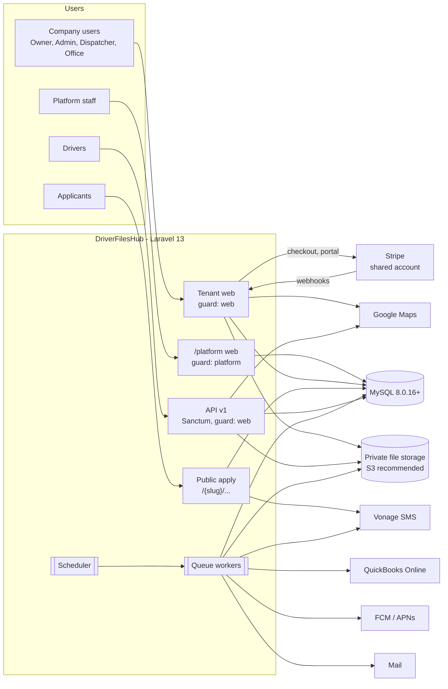

### 1.3 Request pipeline (tenant web and API)

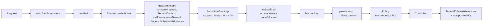

Platform routes use `auth:platform` with permission middleware on the `platform` guard, and never touch tenant models except through `withoutTenancy()` for platform-owned aggregates ([architecture/03](architecture/03-multi-tenant-architecture.md) §4, [04](architecture/04-platform-administration.md) §2).

---

## 2. Cross-cutting architecture

### 2.1 Multi-tenancy

**Decision [R]:** one shared database and schema. Every tenant row is isolated by `company_id`. Per-tenant databases were rejected (migration fan-out, cross-tenant reporting, one Stripe account). Detail: [architecture/03](architecture/03-multi-tenant-architecture.md).

**Why the change is needed [V].** Today only an owner has a tenant (`User::company()` is a `hasOne` on `companies.user_id`, `app/Models/User.php:54-57`); every other user is filtered to `company_id = -1` (`CompanyFilterTrait.php:28-31,105-106`). Isolation lives only in controllers (no global scopes, no policies), and the super-admin bypasses it silently (`CompanyFilterTrait.php:97,119`).

#### Table classes

| Class | Rule | Examples |
|---|---|---|
| Platform | No `company_id`; `platform` guard only | `platform_users`, `features`, `plans`, `plan_prices`, `plan_features`, `site_settings`, `stripe_events`, `platform_support_sessions`, `asset_transfers` |
| Platform-owned, about a company | Has `company_id`; tenants never write | `subscriptions`, `payments`, `subscription_notification_logs`, `company_feature_overrides`, `audit_logs` |
| Tenant root | `company_id NOT NULL` + `UNIQUE(company_id, id)` | `users`, `drivers`, `vehicles`, `trailers`, `trips`, `documents`, `stored_files`, … |
| Tenant child with `company_id` | Addressed by id, aggregated per company, or high volume | `driver_compliance_documents`, `vehicle_documents`, `trip_stops`, `payroll_run_lines`, … |
| Tenant detail without `company_id` | Only reached through an authorized parent | `licenses`, `accidents`, `violations`, `employment_records`, `inspection_results`, … |
| Shared reference | Global, read-only to tenants (LKP-01) | `countries`, `states`, lookups, `document_types`, `inspection_templates` |

#### Six enforcement layers

| Layer | Mechanism |
|---|---|
| 1. Context | `TenantContext` (`app()->scoped`, Octane-safe): `companyId`, `mode` (`tenant`, `public_applicant`, `support_session`, `platform`), `supportSessionId` |
| 2. Scope | `BelongsToCompany` global scope. **Fails closed:** a tenant model queried with no context throws. Auto-fills `company_id` on create and rejects a mismatch. Not applied to `User` (login, reset). `withoutTenancy()` is logged and allow-listed by an architecture test. |
| 3. Gate | One `Gate::before`: actor/guard → context matches user company → entitlement → access state → database-first permission ([§2.2](#22-roles-and-permissions)) |
| 4. Policies | Own-record rules (Driver role sees own trips; nobody edits own roles) |
| 5. Validation | `TenantRule::exists()` / `TenantRule::unique()` add `company_id`; an architecture test bans raw `exists:`/`unique:` on tenant tables |
| 6. Database | Composite tenant FKs `(company_id, x_id) → x(company_id, id)`; delete rules by class; CHECK constraints; generated "one open row" columns |

#### How each entry point sets the context

| Entry point | Set by | Source |
|---|---|---|
| Tenant web, API | `ResolveTenant` | `auth()->user()->company_id` |
| Support session | `ResolveTenant` | Active `platform_support_sessions` row; logged in as the company's system support user |
| Public application | `ResolvePublicCompany` | Slug → active company; session driver must match |
| Queued job | `TenantAware` job middleware | `companyId` serialised in the job; re-checks status and entitlement; resets in `finally` |
| Scheduler | Command | `TenantContext::run($companyId, fn)` per company |
| Stripe webhook, platform area | none (`platform` mode) | Explicit company-scoped queries |

Raw SQL services (`DB::table`, `fromSub`, yajra query builders) skip scopes, so they take `companyId` as a required argument and filter explicitly, as `FleetComplianceService.php:94-97` does today [V].

### 2.2 Roles and permissions

Detail: [architecture/06](architecture/06-roles-permissions.md).

**Decision (13 Oct 2026):** Spatie with teams for schema, management APIs, middleware and Blade. **Checks are database-first**; Spatie's global permission-with-roles cache is not used for tenant authorization.

**Evidence (load test, `architecture/spikes/permission-scale-spike.php`, MySQL 9.3, PHP 8.3):**

| Measurement | Stock Spatie teams | Database-first |
|---|---|---|
| Cache rebuild after any role edit, 2,000 companies | 86.5–90.2 s, +3.6 GB | none (catalogue of ~110 permissions, no roles) |
| Per request, load permission data | p50 145–168 ms | — |
| Resolve all permissions + 3 checks, 2,000 companies | — | p50 0.215 ms, **p95 0.293 ms** |
| Same, 5,000 companies (2.14 M role-permission rows) | not runnable (~9 GB est. [A]) | p50 0.226 ms, **p95 0.353 ms** |
| 8 workers × 5,000 resolutions | — | 14,563–15,274 /s |

**Implementation**

| Component | Role |
|---|---|
| `config/permission.php` | `teams = true`, `team_foreign_key = team_id`, **`register_permission_check_method = false`** |
| `App\Authorization\CatalogueRegistrar` | Extends `PermissionRegistrar`; `getPermissionsWithRoles()` returns permissions without roles. **Bound in `AppServiceProvider::boot()`** because Spatie binds its registrar in `boot()` (`PermissionServiceProvider.php:59`, `packageBooted()`, Spatie 8.3.0; see [06](architecture/06-roles-permissions.md) §2.7) [V]. |
| `App\Authorization\TenantPermissionResolver` | One `UNION` query over `model_has_roles → roles → role_has_permissions → permissions` and `model_has_permissions`, filtered by `team_id = users.company_id` (never request input). Memoised per request in `TenantContext`. No cross-request cache. |
| `User::hasPermissionTo()` / `PlatformUser::hasPermissionTo()` | Overridden to ask the resolver. `checkPermissionTo`, `hasAnyPermission`, `hasAllPermissions` follow [V]. |
| Architecture test | Bans reading `$permission->roles` for any authorization decision |

```php
Gate::before(function ($user, string $ability) {
    // 1. Platform staff only in platform context; tenant users only in tenant context
    // 2. TenantContext::companyId() === $user->company_id
    // 3. $permission = Permission::fromCatalogue($ability, $guard)  // unknown → null, policies decide
    // 4. Entitlements::allows($company, $permission->feature_key) or false
    // 5. ! $permission->is_write || AccessState::allowsWrite($company) or false
    // 6. return TenantPermissionResolver::has($user, $ability);
});
```

**Schema additions:** `permissions.feature_key`, `is_write`, `self_scoped`, `description`; `roles.team_id`, `system_key`, `is_system`; UK `roles(team_id, id)`; **composite FK `model_has_roles(team_id, role_id) → roles(team_id, id)`**, which the spike confirmed rejects cross-team and null-team assignments in the database.

**System roles per company** (created by `CompanyProvisioner` from `RoleTemplates`):

| Role | `system_key` | Editable | Permissions |
|---|---|---|---|
| Owner | `owner` | Locked | All tenant permissions (bounded by entitlements). Only `companies.owner_user_id`. |
| Administrator | — | Yes | All except `billing.manage` |
| Dispatcher | — | Yes | `trips.*`, `shippers.*`, `tracking.view`, `trip-events.*`, `messages.*`, views of drivers and fleet |
| Office / Compliance | — | Yes | Drivers, DQ documents, fleet, maintenance, folders, exports, reminders |
| Driver | `driver` | Locked | `*.own` permissions, `messages.view/send`, `mobile.access` |
| Support (read) | `support_read` | Locked, not assignable | Every read permission |
| Support (read/write) | `support_read_write` | Locked, not assignable | R + W minus billing, users, roles, grants, driver/document deletes |

**Escalation rules** (`RoleService`, `RoleAssignmentService`, `OwnershipService`): same company only; grant only what you hold; assign only roles that are subsets of your set; no self-edit; locked roles never edited or assigned through the UI; only the Owner changes the Owner; `max_users` on invite, accept and re-activate; every change audited. Platform side: at least **two** active Platform Owners.

**Nightly integrity queries** (must return no rows): null-team roles; guard ⇔ team-0 mismatch; role pivot team ≠ user's company; same for direct permissions; Owner role held by exactly `owner_user_id`; tenant roles hold only `web` permissions.

**Legacy roles** `super-admin`, `company`, `user` are not migrated, mapped or reused ([06](architecture/06-roles-permissions.md) §10).

### 2.3 Plans, features, entitlements and limits

Detail: [architecture/05](architecture/05-plans-features-entitlements.md).

| Question | Answered by |
|---|---|
| Does the feature exist? | `App\Features\Feature` enum, synced to `features` by `FeatureRegistrySync`; `availability` = `general`, `override_only`, `disabled` |
| Is it in the plan? | `plan_features (plan_id, feature_key, enabled, limit_value)` |
| Exception for this company? | `company_feature_overrides`, append-only, one open row per (company, feature) via generated `open_flag` |
| Is the company in good standing? | Access state ([§2.4](#24-subscription-and-billing)) |
| May this user do it? | Spatie permission in the company's team |

**Feature catalogue**

| Group | Keys |
|---|---|
| Core | `drivers`, `driver_applications`, `fleet` |
| Compliance | `driver_compliance`, `fleet_compliance`, `compliance_reminders` |
| Fleet | `maintenance` |
| Account | `custom_roles` |
| Documents | `document_folders`, `zip_export` |
| Operations | `trips`, `pre_trip_inspections`, `trip_events`, `mobile_app`, `gps_tracking` |
| Communication | `messaging`, `time_off` |
| Money | `driver_pay`, `timesheets`, `profit_loss`, `year_end_reports` |
| Integrations | `quickbooks` |
| Limits | `max_users`, `max_drivers`, `max_vehicles`, `max_trailers`, `storage_gb` |

Social login and image-to-PDF are platform capabilities, not plan features. Which plan includes what is a commercial decision; seeded tiers are placeholders [A].

**Precedence** (`Entitlements::for($company)`, first match wins): feature `disabled` → off; access `blocked` → off; effective override → its non-null values; `override_only` with no override → off; no current subscription → off; `plan_features` row → applies; no row → off. Then request-time: feature on, read-only denies `is_write`, Spatie permission, limit check.

**Cache:** `tenant:{company_id}:entitlements:{companies.entitlements_version}`. The version is bumped in the same transaction as plan-feature, price, override, subscription or company-status changes. TTL never exceeds the earliest open override `ends_at`.

**Limits**

| Limit | Counts | Excluded |
|---|---|---|
| `max_users` | Active `member` users without a linked driver | Driver logins, support users |
| `max_drivers` | Not deleted, `employment_status = active` | Applicants, drafts, rejected, terminated |
| `max_vehicles`, `max_trailers` | Not soft-deleted | — |
| `storage_gb` | `companies.storage_bytes` | — |

`Limits::assertCanCreate($company, $key, $n)` runs inside the transaction of every path that raises a count (create, restore, hire, invite accept, re-activate, import). It locks the `companies` row (`SELECT … FOR UPDATE`), counts, and throws `LimitReached` (HTTP 422 with an upgrade hint). Storage is checked **before** the file is written. `usage:recount` nightly logs drift.

**Plan changes (Q3):** plan-feature edits apply immediately (UI previews affected companies; grandfather with overrides). Upgrades immediate with proration; downgrades at period end. Over a limit: nothing deleted, creates blocked, banner shown. A lost module becomes **read-only and exportable**.

### 2.4 Subscription and billing

Detail: [architecture/07](architecture/07-subscription-billing.md).

| Object | Today [V] | Target |
|---|---|---|
| Stripe customer | `users.stripe_id` | `companies.stripe_customer_id` (UK), metadata `company_id`, `app_host` |
| Who can buy | The logged-in user | Holders of `billing.manage` (Owner by default) |
| Subscription | `subscriptions.user_id` (CASCADE) | `subscriptions.company_id` + `actor_user_id` (SET NULL); one **open** row per company (generated `open_flag`) |
| Payments | `payments.user_id` (CASCADE) | `payments.company_id` (RESTRICT) |
| Plans | One row per cycle; trial is a plan | `plans` (product) + immutable `plan_prices` (one current per plan/interval/currency via generated `current_flag`) |
| Checkout | Inline `price_data` | `price = plan_prices.stripe_price_id`; `client_reference_id = company_id` |
| Webhook | Synchronous, no event store, no ordering guard | `stripe_events` inbox → `ProcessStripeEvent` on `billing` queue; ignores foreign `app_host` (PO-18); drops events older than `last_stripe_event_at` |

**Access state** (`AccessState::for($company)`, cached with entitlements):

| Condition, in order | State | Effect |
|---|---|---|
| `companies.status` suspended or deactivated | `blocked` | Everyone refused (web 403/redirect, API 402) |
| No open subscription and none ended recently | `none` | Account, billing and pricing pages only |
| `trialing` or `active` in window | `full` | Everything entitled |
| `past_due` within `grace_days` (7, Q2) | `grace` | Full access + banner |
| Past grace, `unpaid`, canceled past end, trial ended | `read_only` | Every `is_write` permission denied; view and export allowed [L] audit access |

**Trials:** a `trialing` subscription on `site_settings.trial_plan_id` (top tier, Q5) for `trial_days` (14). Eligible only if the owner email is verified, `companies.trial_used_at IS NULL`, and no other company with the same owner email has had one (PO-15).

**Fix included:** `accessEndsAt()` today prefers `trial_ends_at` (`Subscription.php:79-84` [V]), so a converted trial that goes `past_due` loses access early [A]. Target: trialing → `trial_ends_at`; canceled → `ends_at ?? current_period_end`; else `current_period_end`. `AccessibleParityTest` (SQL and PHP agree) is kept.

**Unknown Stripe price** in a webhook: keep previous `plan_price_id`, store raw snapshot, set `needs_review`, alert platform staff.

### 2.5 Platform administration

Detail: [architecture/04](architecture/04-platform-administration.md).

| Item | Design |
|---|---|
| Identity | `platform_users` table, `PlatformUser` model. Never a `users` row (D1b). |
| Guard and area | `platform` session guard, own password broker, `/platform/*` |
| Auth | Own login and reset, no 2FA (decided 23 Oct 2026), shorter session |
| Email identity (D3a) | `EmailIdentityService::assertAvailable()` checks `users` and `platform_users` case-insensitively under a `GET_LOCK` before every email write; nightly overlap query |
| Roles | Platform Owner (≥ 2 active), Platform Administrator, Billing Manager, Support Agent, Auditor; guard `platform`, team `0` |
| Without a session | Company metadata only (name, status, owner name/email, plan, usage counts), lifecycle, plans, prices, features, overrides, subscriptions, payments, lookups, settings, audit log, asset transfer, purge |

**Support sessions (Q1).** The only path into tenant data. Approved by the company **Owner** and a **second Platform Owner** (not the requester). CHECK constraints enforce both approvals for `approved`/`active`/`ended` and four-eyes. The staff member is logged into the tenant `web` guard as the company's **system support user** (`user_type = support`, inactive outside sessions, excluded from `max_users`) with `Support (read)` or `Support (read/write)`. Max length `support_session_max_minutes` (240). Banner shown; Owner notified at start and end and can revoke; **every request audited**. No break-glass path.

**Existing decisions re-homed (D11):** PO-02 (upload to all) and PO-07 (schedule with no vehicle) run inside a `read_write` support session; PO-08 becomes **Asset Transfer**.

### 2.6 Files and storage

| Rule | Detail |
|---|---|
| Registry | Every object has a `stored_files` row: `disk`, `path`, `original_name`, `mime_type`, `size_bytes`, `checksum_sha256`, `converted_from_file_id`, `uploaded_by_user_id` |
| Paths | `companies/{company_id}/{area}/{yyyy}/{mm}/{hash}.{ext}`; listable and purgeable by prefix |
| Access | Private disk. Downloads go through a controller that loads the owning record through the tenant scope, then returns a short-lived temporary URL (S3) or a stream with `nosniff` / `no-store` [V today] |
| Storage limit | `companies.storage_bytes` changes in the same transaction as the `stored_files` insert; checked before writing |
| Image to PDF | Queued job after upload, dompdf, size cap; original kept (Q8) |
| Logos | May stay public (not sensitive) |
| Policy PDFs | Per company (`policy_pdfs.company_id NOT NULL`), platform defaults in `site_settings`, served by a slug-scoped route (PO-14) |
| Before rebuild | Wipe `storage/app/private` and `storage/app/public` on shared environments; commit `d1d4d8d` removed the migrations that moved old files to the private disk (R10) |

### 2.7 Audit

`audit_logs`: `company_id` (null for platform events), `actor_type` (`user`, `platform_user`, `system`, `stripe`), `actor_id`, `support_session_id`, `action`, `subject_type/id`, `changes` json (SSN, tokens, passwords, secrets redacted), `ip`, `user_agent`. **No FKs** (survives purges). **Append-only**; the production DB user should have no `UPDATE`/`DELETE` grant on it [R].

Always audited: auth events; user lifecycle and email changes; role/permission/assignment changes; ownership transfer; company status; plans, prices, features, overrides; every subscription change (including webhooks); the support-session lifecycle and every request in it; exports and ZIP downloads; hire, reject, terminate; deletes, restores, voids; DQ-document downloads always, views during support sessions [R]. Retention 2 years [A][L].

### 2.8 Background processing

| Job / command | Schedule | Tenant handling | Status |
|---|---|---|---|
| `subscriptions:send-expiry-reminders` | Daily 09:00 | Per company; Owner + `billing_email`; 7, 3, 1 days; mail, database, SMS | Today, re-keyed P0 |
| `compliance:send-digest-reminders` | Daily 09:30 | Only companies in `full`/`grace` with `compliance_reminders`; one job per company | Today, fixed P0 (today it emails every company [V]) |
| `subscriptions:close-expired-trials` | Daily 10:00 | Platform mode, bumps `entitlements_version` | Today, re-keyed P0 |
| `model:prune` (OTP) | Daily | Platform | Today |
| `access-state:refresh` | Hourly | grace → read-only; revoke expired overrides; bump versions | P0 |
| `integrity:check` | Nightly | All integrity queries; alerts on any row | P0 |
| `usage:recount` | Nightly | Recompute counters and storage; log drift | P0 |
| `exports:prune` | Daily | Expires ZIPs past `expires_at`; fails exports queued or running for more than 2 h | Built P1 |
| `location-pings:prune` | Daily | Chunks of 10k; 13 months [A][L] | P3 |
| `ProcessStripeEvent` | On webhook | `billing` queue, platform mode then the resolved company | P0 |
| `BuildExport`, ping ingestion, QuickBooks sync, push, `BuildTimesheets` | On demand / weekly | `TenantAware` middleware; skips write jobs when read-only | P1–P4 |

The scheduler must run every minute in production: **PENDING** confirmation (PO-20). Single server, so no `onOneServer()`. Octane: design is safe (scoped context, team reset per request and job); use still unconfirmed.

---

## 3. Technical feature catalogue

Each module lists its status, plan feature key, main tables, permissions (R = read, W = write, own = self-scoped) and phase. Requirement numbers refer to [architecture/02](architecture/02-requirement-matrix.md).

**Requirement coverage today:** 9 complete, 4 partial, 39 missing out of 52 (verified); 8 more client items covered in §11 of that document.

### 3.1 Account and access

| Module | Status | Feature | Tables | Permissions | Phase | Technical notes |
|---|---|---|---|---|---|---|
| Registration | Built P0; time zone added 23 Oct 2026 (Z1) | core | `companies`, `users`, `company_settings`, `trip_number_sequences`, roles | — | P0 | Single path: `CompanyProvisioner`. Asks for company name and time zone (`App\Support\TimeZones`). Email verification required (PO-15). |
| Social login | Built P1 (23 Oct 2026), web | platform capability | `social_accounts (provider, provider_user_id)` | — | P1 (web), P3 (Apple) | Verified provider email counts as verified. Never joins an existing company. [L] App Store 4.8, Facebook app review. |
| Login | Today (`LoginRequest.php:53-82`, `EnsureUserIsActive`) | core | `users.last_login_at` | — | P0 | Company status checked on **every** request by `ResolveTenant`. **No 2FA** for tenant users. |
| Company profile | Built P0 (`CompanyController`); the owner edits the time zone, the platform edits DOT, MC and billing email | core | `companies` (+ `dot_number`, `mc_number`, `billing_email`, `timezone`, `status`) | `company.view` R, `company.edit` W | P0 | `companies.email` no longer synced from the owner login (D3b). Policy PDFs per company. |
| Invitations | Missing | core | `company_invitations (token_hash, role_id, driver_id, expires_at)` | `users.create` W | P0 | Inviter only sees "invitation sent" (no account disclosure). `max_users` checked on send and accept. |
| Users | Super-admin only, global (R3) | core | `users (company_id, user_type, status)` | `users.view/create/edit/deactivate` | P0 | Deactivate, never hard-delete while owning records. |
| Roles | Super-admin only, global (R2) | `custom_roles` | Spatie teams tables | `roles.view/create/edit/delete` | P0 | Without `custom_roles`: system roles only. |
| Per-user grants | Built P1 (23 Oct 2026) | `custom_roles` | `model_has_permissions` with `team_id` | `permissions.grant` W | P0 backend, P1 UI | Same escalation rules |
| Ownership transfer | Missing | core | `companies.owner_user_id` | Owner only / platform on verified request | P0 | `OwnershipService::transfer()` moves the locked Owner role |
| Close account | Today (PO-17: deactivate, owners only) | core | `companies.status` | Owner | P0 | Deactivates company and users; data kept (PO-13) |

### 3.2 Hiring and DQ file

| Module | Status | Feature | Tables | Permissions | Phase | Technical notes |
|---|---|---|---|---|---|---|
| Public application | Today (`ApplicationFormController.php`) | `driver_applications` | `drivers`, detail tables, `driver_documents`, `otp_verifications` | public | P0 | Slug + session + `source` + status checks on every step (`:1172-1197`) [V]. `verifyOtp` should read the company from `otp_company_slug` in the session [R]. Closed when the feature or access state disallows it (`EnsureApplicationsOpen`, built 23 Oct 2026); status, files and withdraw stay open. |
| OTP / SMS | Today | `driver_applications` | `otp_verifications` | public | — | US and Canada only; Caribbean NANP blocked (PO-11); 200 sends/hour global cap (PO-12); rate-limited routes |
| Drivers (staff) | Today (`DriverController`, wizard) | `drivers` | `drivers` (+ `created_by_user_id`, `user_id` login, split status, `worker_type`, overtime fields) | `drivers.view/create/edit/delete` | P0 | Status split into `application_status` and `employment_status` (F15). Child rows: switch delete-and-reinsert to upserts [R] (`DriverCrudService.php:96-118`). Unique `(company_id, email)` (APP-07). |
| Hire / reject | Today (`DriverHireService`) | `drivers` | `drivers.hired_at`, `decided_by_user_id` | `drivers.hire` W | P0 | Hire runs `max_drivers` under the company lock; emails sent |
| Terminate | Built 23 Oct 2026 | `drivers` | `terminated_at`, `termination_date`, `termination_reason` | `drivers.hire` W | P0 | Deactivates the linked login, ends active asset groups; DQ file kept [L] 391.51 |
| DQ detail | Today | `drivers` | `licenses` (`is_current` + generated unique `current_driver_id`), `accidents`, `violations`, `experiences`, `forfeitures`, `residence_addresses`, `employment_records`, `driver_documents` (unique per driver, `*_file_id`, `has_accidents`, `has_violations`) | via driver | P0 | Booleans instead of `enum('yes','no')`; `state_code` / `country_code`; "no accident/violation" rows replaced by flags |
| Driver login | Missing | `mobile_app` | `company_invitations.driver_id`, `drivers.user_id` (unique) | system Driver role | P0 model, P3 app | One login maps to at most one driver |

### 3.3 Compliance

| Module | Status | Feature | Tables | Permissions | Phase | Technical notes |
|---|---|---|---|---|---|---|
| Driver compliance | Today (SQL statuses, 25/page) | `driver_compliance` | `driver_compliance_documents` (+ `company_id`, `file_id`, soft deletes) | `drivers.dashboard` R, `driver-documents.upload/delete` W | P0 | 30-day expiring window (`DriverComplianceService.php:16`) [V]. Indexes `(driver_id, document_type_id, expiry_date)`, `(company_id, expiry_date)`. Fix dashboard columns that don't exist (`:58-61,141-144`). |
| Medical certificate and CDL | **Not tracked** (R9) | `driver_compliance` | system document type `medical_examiner_certificate` (`requires_expiry`); `licenses.expires` of the current licence | — | P0 | [L] 49 CFR 391.41, 391.51. `drivers.medical_certificate_expiration_date` dropped. |
| Fleet compliance | Today (paginated, PO-01) | `fleet_compliance` | `vehicle_documents`, `trailer_documents` (+ `file_date`, `file_id`, SoftDeletes trait fix F11) | `fleets.dashboard` R, `fleets.edit` W | P0 | "Upload to all": one scoped id query + chunked bulk insert; file stored once and referenced by `file_id` |
| Document types | Today (global, platform-edited, LKP-01) | core | `document_types` (+ `system_key`, `requires_expiry`, UK `(module, name)`), `company_document_type` opt-out | `document-types.toggle` W | P0 | Model gets `SoftDeletes` |
| Reminders | Today (digest 09:30, one email per driver per day) | `compliance_reminders` | — | `reminders.send` W | P0 | Digest limited to entitled companies in `full`/`grace` |

### 3.4 Fleet and maintenance

| Module | Status | Feature | Tables | Permissions | Phase | Technical notes |
|---|---|---|---|---|---|---|
| Vehicles, trailers | Today; plates Built P1 (23 Oct 2026) | `fleet` | `vehicles`, `trailers` (+ `plate_number`, `plate_state_code`, `photo_file_id`; `equipment_type_id` rename) | `vehicles.*`, `trailers.*` | P0, plates P1 | UK `(company_id, unit_no)`, `(company_id, vin)` (PO-10). `company_id` CASCADE → RESTRICT. `engine_hours` on vehicles (PO-05). |
| Asset groups | Today | `fleet` | `asset_groups` (`driver_id`, generated `active_vehicle_id` / `active_trailer_id` unique) | `asset-groups.*` | P0 | Free-text driver columns dropped (F1–F3). One active group per asset (F7). UK `(company_id, group_name)`. No co-driver (decided 23 Oct 2026). |
| Maintenance | Today (PO-04–PO-07) | `maintenance` | `maintenance_schedules` (drop `is_active`, `last_service_*`), `service_logs` (+ `maintenance_schedule_id`), `service_log_category`, `service_documents` (`file_id`) | `maintenance.*`, `scheduled.*` | P0 | Mileage / engine-hour schedules require a vehicle (PO-06); completing rolls due dates forward (PO-04); `.doc/.docx` accepted (PO-03). N+1 fix on categories. |
| Lookups | Today (platform-only writes, LKP-01) | — | `vehicle_types`, `fuel_types`, `equipment_types`, `vehicle_groups`, `maintenance_categories` (+ `is_active`, unique `name`) | platform `settings.manage` | P0 | FKs RESTRICT [V] |
| Asset transfer | Super-admin edit of `company_id` (FLT-03) | platform | `asset_transfers` | `platform.assets.transfer` | P0 | Copy to target, retire at source ([§4.17](#417-asset-transfer)) |

### 3.5 Documents, folders and exports

| Module | Status | Feature | Tables | Permissions | Phase | Technical notes |
|---|---|---|---|---|---|---|
| Folders | Built P1 (23 Oct 2026); trip folders P2 (26 Oct 2026) | `document_folders` | `folders` (`parent_id`, generated `parent_key`, `system_key`, one entity binding via CHECK) | `folders.view` R, `folders.manage` W | P1 | System folders per driver, vehicle, trailer, trip (Q8); not renamable/deletable. Depth ≤ 5 [R]. UK `(company_id, parent_key, name)`. |
| Documents | Built P1 (23 Oct 2026) | `document_folders` | `documents` (`folder_id` + at most one **subject**: driver, vehicle, trailer, trip, trip event, fuel purchase, expense, service log, inspection) | `documents.upload/delete` W | P1 | Subject (what it is about) and folder (where it is filed) are independent (F18); consistency checked in the service and by an integrity query. Compliance documents appear as virtual entries in standard folders. |
| Image to PDF | Built P1 (23 Oct 2026) | platform capability | `stored_files.converted_from_file_id` | — | P1 | Queued; original kept |
| ZIP export | Built P1 (23 Oct 2026), driver and company; trip P2 (28 Oct 2026) | `zip_export` | `exports (type, parameters, status, file_id, expires_at)` | `exports.create`, `exports.download` (R, allowed when read-only) | P1 driver/company, P2 trip | Queued `BuildExport`, streamed, size and time cap, one build at a time per company (`WithoutOverlapping`), authorized streaming download route (local disk; S3 temporary URLs come with the S3 move), audited |

### 3.6 Operations (trips)

| Module | Status | Feature | Tables | Permissions | Phase | Technical notes |
|---|---|---|---|---|---|---|
| Shippers | Built P2 (26 Oct 2026) | `trips` | `shippers` | `shippers.view` R, `shippers.manage` W | P2 | Saved for reuse; geo and `google_place_id` |
| Trips | Built P2 (26 Oct 2026) | `trips` | `trips`, `trip_number_sequences` | `trips.view/create/edit/delete/assign/confirm-number`; own `trips.view.own`, `trips.drive.own` | P2 | One load per trip (Q6). Number from the sequence row under `FOR UPDATE`. UK `(company_id, trip_number)`. Generated unique `active_driver_id` / `active_vehicle_id` (one in-progress trip each). CHECK: assigned+ needs driver and vehicle. Unit-number snapshots at start. |
| Stops | Built P2 (26 Oct 2026) | `trips` | `trip_stops` (`start`, `pickup`, `drop_off`, `also_pickup`, `arrived_at`, `departed_at`) | via trip | P2 | "Pending pickup" = assigned/in-progress trip whose pickup (or start with `also_pickup`) has no `departed_at` |
| Pre-trip inspection | Built P2 (28 Oct 2026, web) | `pre_trip_inspections` | `inspection_templates` (versioned, platform-managed), `inspection_template_items`, `inspections`, `inspection_results` (`item_label` snapshot) | `inspections.view` R, own `inspections.perform.own` | P2 web, P3 app | Progress = answered ÷ items. **Not a DVIR** (C10). |
| Trip events | Built P2 (28 Oct 2026, web) | `trip_events` | `trip_events` (`stop`, `police_stop`, `weigh_station`, `accident`, `breakdown`, `fuel`) | `trip-events.view/manage`; own `trip-events.create.own` | P2 | CHECKs: stop needs reason; police stop needs `ticket_issued` and (ticket or reason); weigh station needs `weight_ok`; accident needs injuries, fatalities, hazmat (C9 register). Evidence voided, never deleted. |
| Fuel | Built P2 (28 Oct 2026, web) | `trip_events` | `fuel_purchases` (unique `trip_event_id`, gallons, `price_per_gallon`, `total_amount`, lat/lng, `confirmed_at`) | own `fuel.create.own` | P2 | "Done" screen = `confirmed_at` set after receipts uploaded |
| Dashboard counts | Built P2 (28 Oct 2026) | `trips` | index `trips(company_id, status)` | `trips.view` | P2 | Loads on the road, pending pickup; cached 60 s |

### 3.7 Mobile, tracking and communication

| Module | Status | Feature | Tables | Permissions | Phase | Technical notes |
|---|---|---|---|---|---|---|
| API v1 | Missing | `mobile_app` | `personal_access_tokens` | `mobile.access` | P3 | Same middleware stack as web ([§6](#6-mobile-api)) |
| GPS tracking | Missing | `gps_tracking` | `location_pings` (no FKs, high volume), `vehicle_last_locations` (one row per vehicle) | `tracking.view` R, own `tracking.report.own` | P3 | Batch ingestion; `trips.actual_distance_miles` running total; trailer location from the truck on its active trip (C5). [L] tracking notice and consent. |
| Messaging | Missing | `messaging` | `conversations` (`direct`, `group`, `trip`), `conversation_participants`, `messages` | `messages.view/send/broadcast` | P3 | Cursor pagination on `(conversation_id, id)` |
| Push | Missing | `messaging` | `device_tokens` | — | P3 | FCM / APNs, queued on `notifications` |
| Time off | Missing | `time_off` | `time_off_requests` | own `time-off.request.own`; `time-off.view` R; `time-off.approve` W | P4 | Drivers and staff submit; Owner or Administrator approves (C6) |

### 3.8 Money and integrations

| Module | Status | Feature | Tables | Permissions | Phase | Technical notes |
|---|---|---|---|---|---|---|
| Load pay | Missing | `driver_pay` | `trips.load_pay`, `currency`, `paid_miles` | `pay.view` R, `pay.manage` W | P4 | Locked at completion (snapshot) |
| Pay rates | Missing | `driver_pay` | `driver_pay_rates` (`per_mile` / `hourly`, effective-dated, no overlap) | `pay.manage` W | P4 | Contractors (`worker_type = contractor`) excluded from payroll |
| Time entries, timesheets | Missing | `timesheets` | `time_entries` (`driving`, `on_duty_not_driving`, `break`; generated unique `open_driver_id`), `timesheets` | `timesheets.view/approve`; own `timesheets.view.own`, `time-entries.create.own` | P4 | Daily thresholds from `company_settings` (C3). [L] Not HOS records. |
| Payroll | Missing | `timesheets`, `driver_pay` | `payroll_runs`, `payroll_run_lines` (rates and quantities snapshotted) | `pay.manage` W | P4 | Regular-rate overtime premium [L] 29 CFR 778.111 |
| Expenses | Missing | `profit_loss` | `expenses` (category enum [A]) | `pay.manage` / `reports.*` | P4 | Fuel and service costs are not copied here |
| Profit and loss | Missing (old `/profit` removed, ACL-04) | `profit_loss` | report query; rollup table only if slow | `reports.view`, `reports.export` | P4 | Variable costs only (C2), company time-zone days |
| Year-end report | Missing | `year_end_reports` | `exports.type = year_end_report` | `reports.export` | P4 | Load type = product (C8); unit-number snapshots |
| QuickBooks Online | Missing | `quickbooks` | `integration_connections` (encrypted tokens), `external_references`, `integration_sync_logs` | `integrations.manage`, `payroll.export` | P4 | Employees + TimeActivity (regular/OT/DT lines) + payroll summary export (C4). Idempotent via `external_references`. [A] Payroll API gated. |

### 3.9 Platform

| Module | Status | Tables | Permission | Phase |
|---|---|---|---|---|
| Platform staff | Super-admin on a `users` row that also owns a company | `platform_users`, `platform_password_reset_tokens` | `platform.staff.manage` | P0 |
| Companies | `CompanyController` (super-admin) | `companies` metadata | `platform.companies.view/manage/lifecycle/purge` | P0 |
| Plans, prices, features | `SubscriptionAdminController` (loads every subscription in memory, `:29` [V]) | `plans`, `plan_prices`, `plan_features`, `features` | `platform.plans.manage`, `platform.features.manage` | P0 |
| Overrides | Missing | `company_feature_overrides` | `platform.overrides.manage` | P0 |
| Subscriptions, payments | By user | `subscriptions`, `payments` | `platform.subscriptions.view/manage`, `platform.payments.view` | P0 |
| Settings and lookups | `SiteSettingController`, lookup controllers | `site_settings` (+ trial, grace, support session, default policy PDFs) | `platform.settings.manage` | P0 |
| Audit viewer | Missing | `audit_logs` | `platform.audit.view` | P0 |
| Support sessions | Missing | `platform_support_sessions` | `platform.support.request`, `platform.support.approve` | P0 |
| Asset transfer | Missing | `asset_transfers` | `platform.assets.transfer` | P0 |

---

## 4. End-to-end workflows

Each flow lists the tables written, the checks that run and the background work triggered. Full versions: [architecture/10](architecture/10-workflows.md).

### 4.1 Registration and tenant provisioning

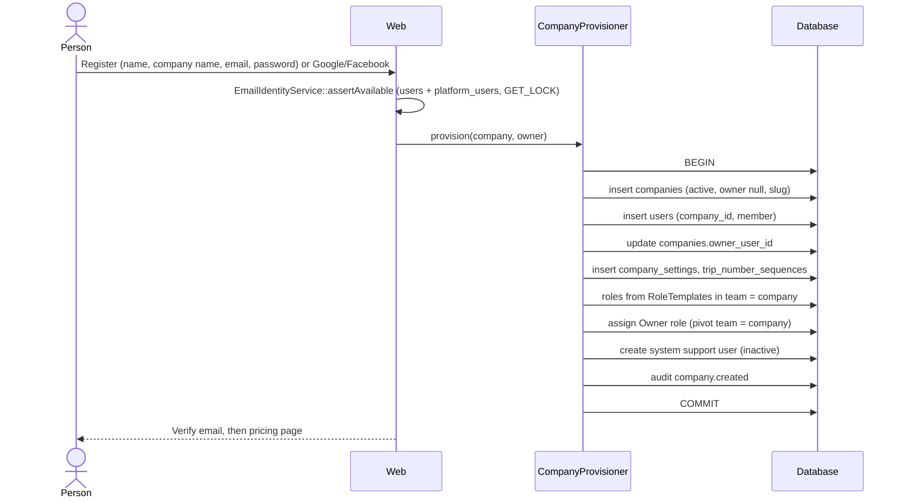

- `CompanyProvisioner` is the **only** creator of companies: registration, platform "create company", seeders and test factories. This fixes the missing-role bug in `CompanyController::store` (`:136-187`) [V].
- `companies (id, owner_user_id) → users (company_id, id)` enforces that the owner belongs to the company.
- Social sign-up never joins an existing company; a verified provider email counts as verified.

### 4.2 Subscription purchase and activation

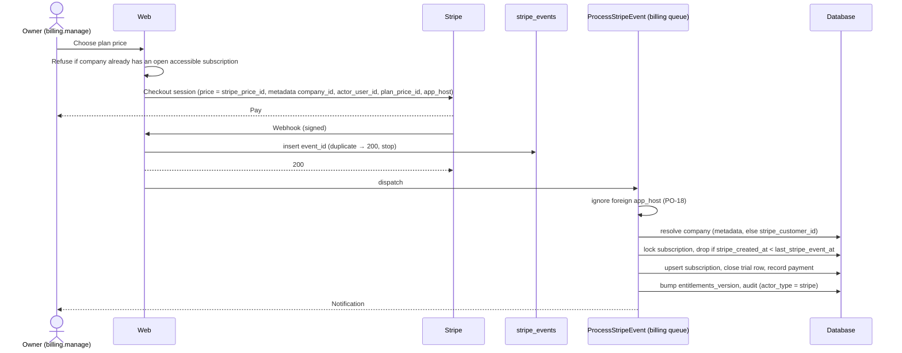

- **Trial path:** eligibility check → insert `subscriptions` (`trialing`, `source = trial`, `ends_at = now + trial_days`) → set `trial_used_at` → bump version.
- **Success page** syncs only if `metadata.company_id` = the user's company **and** the user holds `billing.manage`.
- Failures mark the event `failed` and retry with backoff; platform staff can re-queue.

### 4.3 Access state lifecycle

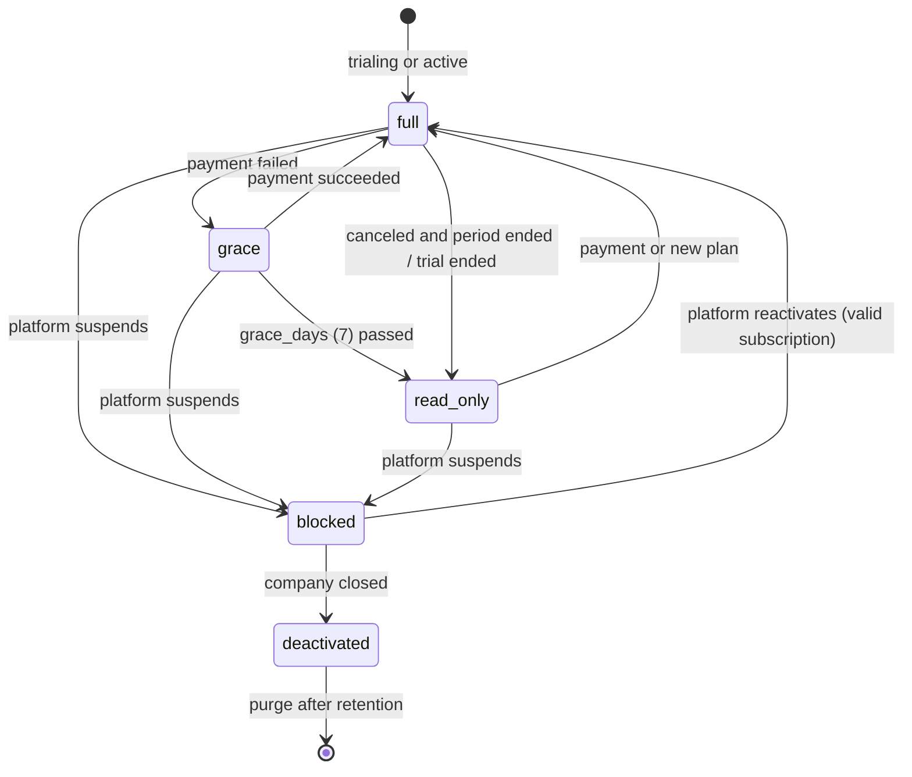

| Event | Trigger | Effect |
|---|---|---|
| Renewal paid | Webhook | Stays or returns to `full` |
| Payment failed | Webhook | `grace`; Owner and `billing_email` notified |
| Grace over / canceled | `access-state:refresh` (hourly) | `read_only`; banner for every user |
| Suspend | Platform (`platform.companies.lifecycle`), reason required | `blocked` for every user |
| Close (PO-17) / deactivate (PO-13) | Owner or platform | `deactivated`, users inactive, data kept |

### 4.4 Inviting a user and assigning a role

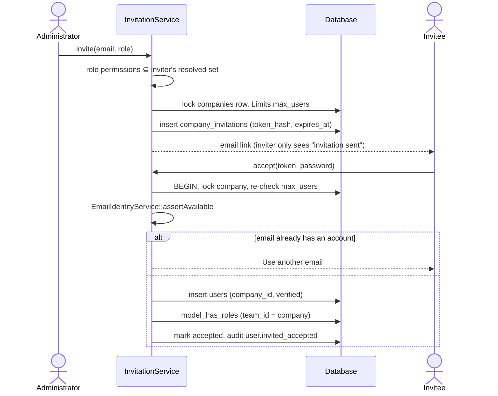

Deactivation sets `status = inactive`, frees the seat and logs the user out on the next request.

### 4.5 Company-specific roles

1. User with `roles.create` and the `custom_roles` feature submits a role.
2. `RoleService` validates: unique name in team, `web` guard only, every permission in the actor's resolved set, role not locked.
3. Saved with `team_id = company_id`. No cache to clear; the next request of every user in that company sees it; no other company is affected (tested at 2,000 companies, same-name roles across companies).
4. Audit `role.created` / `role.permissions_changed`; resolver memo cleared.

### 4.6 Public application to hire

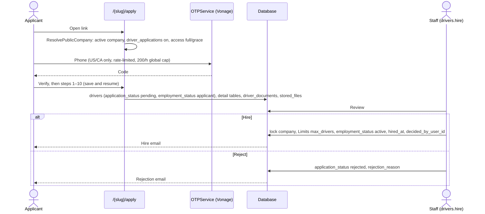

Every step re-checks the session driver, slug, company, `source` and status [V]. Staff can also create a driver directly with the wizard (`created_by_user_id` set).

### 4.7 Giving a driver a login (P3)

Staff click "Invite to app" (needs `mobile_app`) → `company_invitations` with `driver_id` and the system Driver role → on accept, `drivers.user_id` is linked (unique) → the driver signs in to the app with a Sanctum token. Driver logins don't count toward `max_users`. Termination deactivates the login.

### 4.8 Compliance documents and reminders

1. Upload → storage-limit check → file under `companies/{id}/drivers/{driver_id}/…` → `stored_files` + `storage_bytes` → `driver_compliance_documents` (or vehicle/trailer documents). Images into folders are converted to PDF (original kept).
2. Medical examiner certificate and current CDL expiry are part of the status calculation (P0).
3. Dashboard status computed in SQL: missing or expired = danger, expiring within 30 days = warning, else compliant [V].
4. `compliance:send-digest-reminders` (09:30) loops entitled companies in `full`/`grace` and dispatches one tenant job each; one email per driver per day.

### 4.9 Limit enforcement

| Path | Limit |
|---|---|
| Create driver, hire applicant, restore driver | `max_drivers` |
| Create or restore vehicle / trailer | `max_vehicles` / `max_trailers` |
| Invite, accept, re-activate user | `max_users` |
| Any upload | `storage_gb` |

All inside the transaction, after locking the `companies` row. Two parallel creates at `limit − 1` → exactly one succeeds (MySQL CI test). Reached → 422 with upgrade link; platform can raise it with an override.

### 4.10 Exports and ZIP downloads

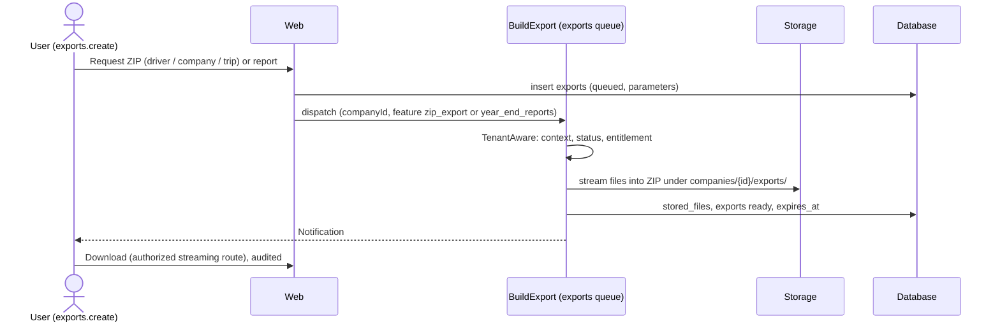

`exports:prune` expires old exports daily. Exports stay allowed in `read_only`.

### 4.11 Trip lifecycle (P2)

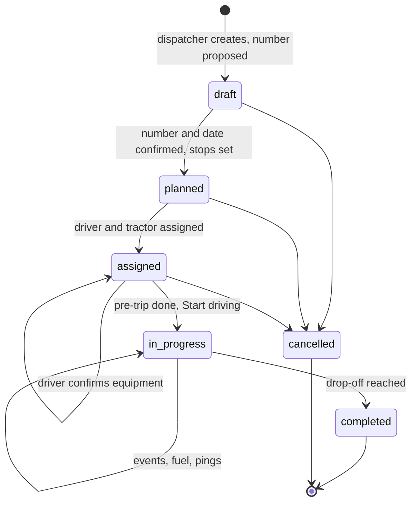

1. **Create:** number from `trip_number_sequences` under `FOR UPDATE` in the same transaction; owner confirms (`number_confirmed_at/_by`); shipper chosen or saved; start and drop-off from the map; pickup optional (`also_pickup`).
2. **Assign:** driver, vehicle, trailer validated by `TenantRule` and composite FKs; defaults from the driver's active asset group.
3. **Start:** equipment confirmed, inspection completed, `status = in_progress`, `started_at`, unit-number snapshots, trip folder opened. Unique `active_driver_id` / `active_vehicle_id` prevent a second in-progress trip.
4. **Complete:** `completed_at`; `load_pay` locked; feeds P&L, payroll and year-end.

### 4.12 Driver app trip execution (P3)

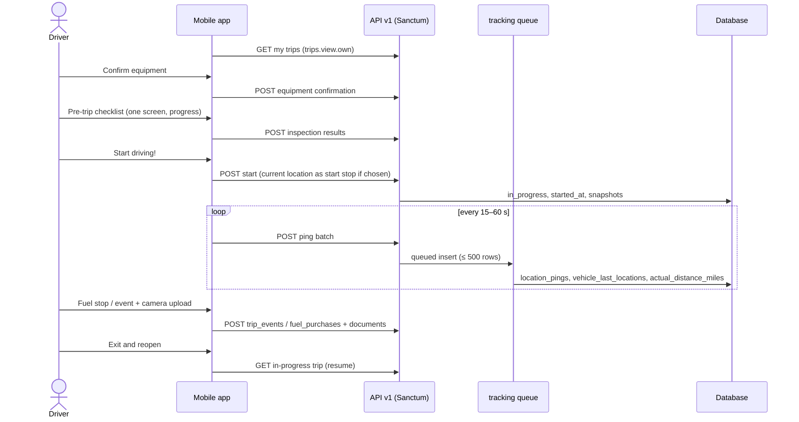

Remaining distance is computed in the app from the Maps API; miles travelled come from `actual_distance_miles`.

### 4.13 Timesheets, overtime, payroll and QuickBooks (P4)

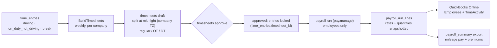

**Classification (C3).** Per workday `w` minutes: regular = min(w, OT threshold); OT = w beyond OT up to DT threshold; DT = beyond DT threshold. Defaults 480 / 720 minutes, ×1.5 / ×2.0. Optional weekly threshold moves remaining regular minutes to OT without double counting (higher of daily and weekly). Exempt drivers: minutes classified, no premium. California 7th-day rule not built [L].

**Pay (C1).**
- Mileage pay = Σ `trips.paid_miles` (completed in period) × per-mile rate in force at completion.
- Hourly pay = `on_duty_not_driving` minutes × hourly rate when the driver has a per-mile rate; **all** work minutes when the driver is hourly-only. A driving hour is never paid twice.
- Overtime premium: hourly-only → OT h × rate × (m_OT − 1) + DT h × rate × (m_DT − 1). With mileage pay → `regular_rate` = (mileage + hourly pay) ÷ total hours, then the same formula [L] 29 CFR 778.111.
- `gross_amount` = mileage + hourly + premium.

### 4.14 Profit and loss (P4)

Per company time-zone day: **income** `trips.load_pay` (completed that day) **minus** `fuel_purchases.total_amount`, `service_logs.total_cost`, `expenses.amount` and driver pay (approved payroll lines, otherwise estimated with the same formulas and flagged "estimated"). Variable costs only (C2). Indexes: `trips(company_id, completed_at)`, `fuel_purchases(company_id, purchased_at)`, `service_logs(company_id, service_date)`, `expenses(company_id, incurred_on)`.

### 4.15 Support session

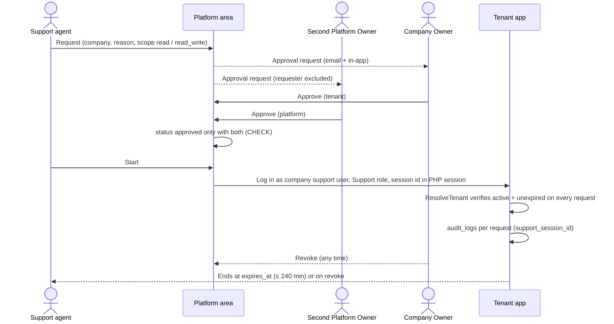

Rejected or not fully approved before expiry → never starts. Fewer than two active Platform Owners → cannot be approved.

### 4.16 Deactivation, retention and purge

| Action | Result |
|---|---|
| Remove a user | `inactive`; ids and actor pointers stay valid |
| Remove a driver | Soft delete, or termination for hired drivers; DQ file kept |
| Close / deactivate a company | No data deleted |
| Purge (platform, `companies:purge {company} --confirm`) | Only when every retention period has passed. Deletes children in dependency order, then roles in its team, then the company; files deleted after commit; audit entry with counts only. |

Retention defaults [L]: DQ file employment + 3 years (391.51); maintenance 1 year and 6 months after disposal (396.3); accident events 3 years (390.15); financial and payroll 7 years [A]; pings 13 months [A]; audit 2 years [A].

### 4.17 Asset transfer

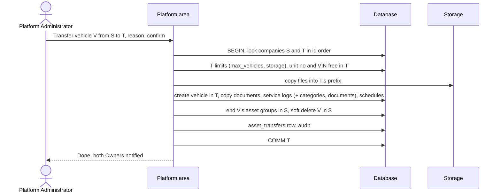

Copy-then-retire, because composite FKs forbid changing a parent's `company_id` in place, and the source must keep maintenance records [L] 396.3. On failure, copied files are deleted.

---

## 5. Data model summary

Full table definitions: [architecture/08](architecture/08-database-schema.md). Diagrams: [erd-proposed.md](erd-proposed.md). Problems in today's schema and their fixes: [architecture/09](architecture/09-erd-audit.md) (F1–F29).

### 5.1 Conventions

| Topic | Rule |
|---|---|
| Keys | bigint auto-increment; `features` uses a string key |
| Tenant FKs | Composite `(company_id, x_id) → x(company_id, id)`; every tenant parent has `UNIQUE(company_id, id)` |
| Optional links | RESTRICT (SET NULL on a composite FK would null `company_id`) |
| Actor pointers | Single-column FK, SET NULL |
| Money | `decimal(12,2)` + `currency char(3)`; unit prices `decimal(8,3)` / `decimal(10,4)` |
| Places | `state_code`, `country_code` char(2), US and Canada (PO-11) |
| Booleans | `boolean` everywhere (no `enum('yes','no')`) |
| Generated columns | `CASE WHEN … THEN … END` (MySQL and SQLite) for "one open/current row" uniqueness |
| CHECK | MySQL 8.0.16+; FKs on CHECK columns use RESTRICT |
| Soft deletes | Only where restore or audit history is needed |

### 5.2 Delete rules

| Class | ON DELETE |
|---|---|
| Tenant root → `companies` | RESTRICT (purge job only) |
| Detail → parent in same aggregate | CASCADE (RESTRICT if in a CHECK or base of a generated column) |
| Cross-aggregate | RESTRICT |
| Actor pointers | SET NULL |
| Financial, lookups | RESTRICT |

### 5.3 One-row guarantees enforced by the database

| Relationship | Enforced by |
|---|---|
| Company → one open subscription | `subscriptions.open_flag` unique with `company_id` |
| Company + feature → one open override | `company_feature_overrides.open_flag` |
| Plan + interval + currency → one current price | `plan_prices.current_flag` |
| Driver → one current licence | `licenses.current_driver_id` |
| Vehicle / trailer → one active asset group | `asset_groups.active_vehicle_id` / `active_trailer_id` |
| Driver / vehicle → one in-progress trip | `trips.active_driver_id` / `active_vehicle_id` |
| Driver → one running time entry | `time_entries.open_driver_id` |
| Login → one driver | `drivers.user_id` unique |
| Trip event → one fuel purchase | `fuel_purchases.trip_event_id` unique |
| Driver → one attestation record | `driver_documents.driver_id` unique |

### 5.4 Legitimate snapshots (stay as text/values)

Licence name as printed, previous employers, applicant-declared violations, signatures and dates, Stripe amounts, `trips.load_pay` and unit-number snapshots, payroll line rates and quantities, fuel receipt values, `inspection_results.item_label`.

---

## 6. Mobile API

**Decided rules** ([architecture/03](architecture/03-multi-tenant-architecture.md) §5, [07](architecture/07-subscription-billing.md) §8, [12](architecture/12-performance-plan.md) §3):

| Rule | Detail |
|---|---|
| Location | `routes/api.php`, versioned `v1` |
| Auth | Sanctum personal access tokens; tokenable is always `App\Models\User`, so a token belongs to one company |
| Middleware | `auth:sanctum` → `ResolveTenant` → `subscribed` → `feature:mobile_app` (+ module feature) → `permission:` → policies |
| Access state | `blocked` / `none` → **402** with a JSON reason; `read_only` → **403** on writes |
| Isolation | Foreign ids → 404; nested resources use scoped bindings; Driver role limited to own records by policies |
| Lists | Cursor pagination for trips, events and messages |
| Pings | Batched POST, queued insert of up to 500 rows on the `tracking` queue; integrity checked per batch (token's company, driver's active trip) |
| Push | `device_tokens` registered per device |

**Endpoint list [R]:** not yet specified in the architecture set. It should be written at the start of Phase 3 from the flows in [§4.12](#412-driver-app-trip-execution-p3): auth/token, me, my trips, trip detail, equipment confirmation, inspection, start, stops, events, fuel, documents upload, ping batch, resume, conversations and messages, device tokens, time entries, time-off.

---

## 7. Security controls

| Surface | Control |
|---|---|
| Ids in URLs | Route-model binding through the tenant scope returns **404** for foreign ids (today the trait returns 403, which leaks existence) |
| Nested ids | `->scopeBindings()` + composite FKs |
| Ids in bodies | `TenantRule::exists` + composite FKs |
| Relationships | Scope on every tenant model; no polymorphic links (exclusive-arc FKs with CHECK) |
| Roles and grants | Role ids validated against `roles.team_id`; composite FK on `model_has_roles`; resolver reads only the user's team; nightly integrity query |
| Feature and billing | `Gate::before` + `feature:` + `subscribed` + job middleware |
| Exports | Tenant job with fixed company id; authorized streaming download; audited |
| Files | Private disk under `companies/{id}/`; controller-authorized downloads |
| Cache | Keys prefixed `tenant:{id}:`, versioned |
| Jobs | `TenantAware` sets and resets context and Spatie team in `finally` |
| Platform | Separate guard, table and area; tenant data only via support sessions |
| Email identity | Exclusive between `users` and `platform_users` (lock + unique + nightly check) |
| Personal data | SSN `encrypted` cast [V]; secrets redacted from audit `changes`; QuickBooks tokens encrypted |
| Public application | Slug + session + `source` + status checks; OTP rate limits and global cap |
| Audit | Append-only, no FKs, DB-level grant restriction [R] |

---

## 8. Performance

Detail: [architecture/12](architecture/12-performance-plan.md).

**P1 (Phase 0)**

| # | Item | Action |
|---|---|---|
| 1 | N+1 on service-log categories (`ServiceLogController.php:43`) | Eager load; `withCount('documents')` |
| 2 | Drivers list loads every licence, sorts in PHP (`DriverController.php:35-37,82`) | `currentLicense()` on `is_current` |
| 3 | Compliance subqueries lack composite indexes | `(owner_id, document_type_id, expiry_date)`, `(company_id, expiry_date)` |
| 4 | "Upload to all" is one select + insert per asset | One scoped query + chunked bulk insert |
| 5 | Admin subscription dashboard loads everything (`SubscriptionAdminController.php:29`) | SQL `COUNT`/`SUM` |
| 6 | Tenant-leading indexes | Every tenant table indexed from `company_id`; redundant single-column indexes dropped (F22) |
| 7 | Permission checks | Database-first resolver (measured p95 0.29–0.35 ms) |
| 8 | Entitlements per request | Memoised in `TenantContext`; versioned cache |
| 9 | Synchronous webhooks | Inbox + `billing` queue |

**P2 (with new modules):** server-side pagination everywhere; cursor pagination for messages and API lists; ping batching, `vehicle_last_locations` for the live map, monthly partitions past ~50 M rows (P3); streamed ZIPs with caps; SQL aggregates for reports (rollup only if measured slow); company-row-first locking order; separate queues; `Model::preventLazyLoading()` outside production; S3 with temporary URLs [R].

**Targets [A]**

| Metric | Target |
|---|---|
| p95 tenant list page | < 300 ms |
| Queries per list request | Constant (`tests/Support/Perf.php` budgets [V]) |
| Permission resolution p95 | < 5 ms (`PermissionScaleTest`, 2,000 companies) |
| Ping ingestion | 1,000 pings/s sustained on staging |
| 200-driver company export | < 5 min, flat memory |

---

## 9. Testing and CI

Detail: [architecture/11](architecture/11-migration-strategy.md) §5–6.

**Tests that flip by design:** `UserAuthorizationTest`, `RoleManagementTest`, `PermissionSeederSafetyTest`, `SuperAdminCompanyAttributionTest`, `SuperAdminRoleNameTest`, `RouteGuardMatrixTest`, `FleetComplianceDecisionsTest` (PO-02), `MaintenanceDecisionsTest` (PO-07), `FleetAssetsUpdateTest` (PO-08), the `Billing/*` suite, `DashboardGateTest`, `ExpiryReminderTest`, `CompanyDestroyTest`, `AuthModuleTest` (AUTH-04).

**New suites**

| Suite | Proves |
|---|---|
| `Tenancy/IsolationMatrixTest` | Route-generated: company B gets 404 on every company A id (web and API) |
| `Tenancy/ScopeFailClosedTest` | Tenant model without context throws |
| `Tenancy/JobContextTest` | Back-to-back jobs for A then B leak nothing |
| `Authorization/EscalationTest` | Grant-only-what-you-hold, subsets, no self-edit, locked roles |
| `Authorization/ResolverTest` | Resolver matches role definitions; foreign pivots never grant; composite FK rejects null-team; architecture ban on `$permission->roles` |
| `Authorization/PermissionScaleTest` | MySQL nightly, 2,000 companies, p95 < 5 ms |
| `Entitlements/*` | Precedence, override history, downgrade read-only, cache invalidation |
| `Limits/ConcurrencyTest` | MySQL: parallel creates at limit − 1 → exactly one success |
| `Platform/SupportSessionTest` | Approvals, expiry, revoke, per-request audit, deny list |
| `Platform/AssetTransferTest` | Copies within limits, read-only source, file rollback |
| `Platform/EmailIdentityTest` | Email exclusivity from both sides |
| `Payroll/OvertimeTest` | Daily thresholds, midnight split, weekly reclassification, exempt drivers, regular-rate premium |
| `Integrity/QueriesTest` | Nightly integrity queries return no rows on seeded data |

**Test actors** (`tests/Support/Actors.php`): `platformOwner()`, `platformSupport()`, `company()` (via `CompanyProvisioner`), `companyOwner()`, `companyAdmin()`, `dispatcher()`, `officeUser()`, `driverUser()`, `withPlan()`, `readOnly()`, `suspended()`, `actingAsTenant()`.

**CI:** keep the SQLite suite; **add a MySQL job** for migrations, CHECK/generated-column behaviour, integrity, concurrency and scale tests (today MySQL behaviour is only checked by hand on staging, PO-21 [V]).

---

## 10. Migration and rollout

Detail: [architecture/11](architecture/11-migration-strategy.md).

- **No real data** (PO-19). Until the first production deploy: edit the create-table migrations and rebuild with `migrate:fresh --seed`. After it: additive, reversible migrations only (PRODUCT_DECISIONS rule 1.6 returns), expand/contract for risky changes.
- **Before any rebuild:** back up DB and both storage folders; wipe old files; MySQL 8.0.16+.

**Migration order (FK dependencies):** A framework → B reference → C platform (`features` before `permissions`) → D tenancy core (`companies`, then `users` moved out of `0001`, then the owner FK) → E authorization (teams on first) → F `stored_files` → G drivers → H fleet → I maintenance → J billing → O audit and support (all **Phase 0**) → M documents (P1) → K operations (P2–P3) → L money (P4) → N communication and integrations (P0–P4, per table).

**Seeders:** `FeatureRegistrySync`, rewritten `PermissionSeeder` (no legacy roles), `PlatformRoleSeeder`, `PlatformOwnerBootstrap` command (two Owners), rewritten `PlanSeeder` + `plans:sync-stripe` (test keys outside production), lookups, `DocumentTypeSeeder` (+ medical examiner certificate), `InspectionTemplateSeeder` (P2), `DemoSeeder` built through `CompanyProvisioner`.

**Code move order (green suite after each):**
1. `TenantContext`, `ResolveTenant`, `users.company_id`; `CompanyFilterTrait` reads from the context; per-instance memo removed.
2. `BelongsToCompany` model by model, each with its isolation test.
3. Policies replace `authorizeCompanyAccess` (foreign ids → 404).
4. Spatie teams, `Gate::before`, permission renames, per-company Users and Roles screens.
5. Company billing.
6. `platform` guard and `/platform`; delete super-admin branches from tenant code.
7. `feature:` middleware and `Limits`.

---

## 11. Roadmap and acceptance criteria

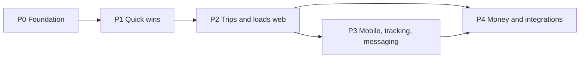

| Phase | Scope | Acceptance criteria |
|---|---|---|
| **P0 Foundation** | Remaining spike (CHECK and generated columns on MySQL 8.0.16+ and SQLite; owner FK on SQLite); schema rebuild with F1–F29; provisioner; tenancy layers; Spatie teams database-first; company users and roles; platform area, `EmailIdentityService`, asset transfer; company billing; entitlements and limits; support sessions; audit; bug fixes and P1 performance; medical certificate and CDL in compliance; test suites and MySQL CI | Isolation matrix 404 everywhere; platform staff blocked without session and every session request audited; Owner can invite, create and assign roles with escalation tests passing; two users share one subscription and a second trial is refused; disabling `maintenance` in a plan blocks routes, menus and jobs within one request; parallel creates at limit − 1 → one success; integrity queries empty; suite green on SQLite and MySQL; `PermissionScaleTest` p95 < 5 ms |
| **P1 Quick wins** (done 23 Oct 2026) | Google/Facebook (web), folders and documents, image to PDF, ZIP per driver/company, plates and photos, per-user grants UI | Nested folders; JPG → PDF with original kept; 200-driver company ZIP within target; plates on lists and details |
| **P2 Trips (web)** | Shippers, trips with numbering and map, assignment and confirmation, inspections, events and fuel, dashboard counts, trip ZIP | Lifecycle works end to end; no driver with two in-progress trips; event CHECKs enforced; counts match states |
| **P3 Mobile** | API v1 and driver login, app flows, pings and live map, events and fuel with camera, messaging and push, Sign in with Apple | Driver sees only own trips via API; ping ingestion meets target; push arrives for new messages |
| **P4 Money** | Load pay and rates, time entries and timesheets, expenses and P&L, reports and year-end, payroll and QuickBooks, time off | P&L equals a hand calculation; rate changes don't alter past lines; `OvertimeTest` passes; QuickBooks sync idempotent |

**Known bugs fixed in Phase 0** ([architecture/01](architecture/01-current-architecture-assessment.md) §5): owner created without a role by `CompanyController::store`; `verified` missing on `/admin`; compliance dashboard reads non-existent driver columns; broken `MaintenanceSchedule::serviceLogs()`; unscoped `scopeForVehicle`; missing `SoftDeletes` on `DocumentType`, `VehicleDocument`, `TrailerDocument`; N+1 on service logs; drivers-list licence sort in PHP; admin dashboard loads all subscriptions; `accessEndsAt()` trial precedence; orphan `SubscriptionExpired` / `SubscriptionExpiringSoon` events.

---

## 12. Open items

### PENDING (business)

| Item | Default in the design |
|---|---|
| Google Maps Platform terms and cost (map picker) | The client wants free use; see [14](architecture/14-open-questions.md) §3 |

Decided 23 Oct 2026 ([14](architecture/14-open-questions.md) §2): no co-driver; C7 closed (nothing missing); scheduler runs every minute and Octane is not planned; no emergency support access; no platform 2FA; Stripe Price ids entered by hand; expense categories are a per-company CRUD list seeded with toll, lumper, scale, parking, repair, other (X1).

### Legal and compliance [L]

Retention periods (391.51, 396.3, 390.15, financial, pings, audit); read-only access after lapse for audits; medical certificate and CDL tracking (391.41, 391.51); per-driver overtime exemption (FLSA §13(b)(1) Motor Carrier Act exemption, small-vehicle exception, state daily-overtime rules); regular-rate method (29 CFR 778.111); timesheets are not HOS/ELD records (Part 395); employee location-tracking notice and consent; App Store 4.8, Facebook app review, Google Maps terms.

### Assumptions [A] to verify

| Assumption | When |
|---|---|
| MySQL CHECK, generated-column and referential-action behaviour on 8.0.16+ (composite FKs already confirmed on 9.3) | Phase 0 spike / MySQL CI |
| Owner FK addable on SQLite after both tables exist | Phase 0 |
| Breeze password-reset response reveals account existence | Phase 0 |
| `submitted`, `under_review`, `approved` driver statuses have no transition | Before the status split |
| `driver_documents.document_path`, `permission.*`, `asset-histories.*` unused | Phase 0 grep |
| Plan contents and limits per tier | Platform Owner decision |

---

## 13. Document map

| Need | Read |
|---|---|
| What exists today, risks R1–R14 | [architecture/01](architecture/01-current-architecture-assessment.md) |
| Requirement-by-requirement status | [architecture/02](architecture/02-requirement-matrix.md) |
| Tenancy layers and attack surface | [architecture/03](architecture/03-multi-tenant-architecture.md) |
| Platform area, support sessions, asset transfer | [architecture/04](architecture/04-platform-administration.md) |
| Features, plans, overrides, limits | [architecture/05](architecture/05-plans-features-entitlements.md) |
| Roles, permissions, load test | [architecture/06](architecture/06-roles-permissions.md), [spike script](architecture/spikes/permission-scale-spike.php) |
| Billing, Stripe, access state | [architecture/07](architecture/07-subscription-billing.md) |
| Every table | [architecture/08](architecture/08-database-schema.md), [erd-proposed.md](erd-proposed.md) |
| Schema problems F1–F29 | [architecture/09](architecture/09-erd-audit.md) |
| Full workflows | [architecture/10](architecture/10-workflows.md) |
| Migrations, seeders, tests, rollback | [architecture/11](architecture/11-migration-strategy.md) |
| Performance | [architecture/12](architecture/12-performance-plan.md) |
| Phases and acceptance | [architecture/13](architecture/13-implementation-roadmap.md) |
| Decisions and open questions | [architecture/14](architecture/14-open-questions.md) |
| Earlier product decisions PO-01 … PO-22 | [testing/PRODUCT_DECISIONS.md](testing/PRODUCT_DECISIONS.md) |
| Current-state ERD | [erd.md](erd.md) |
