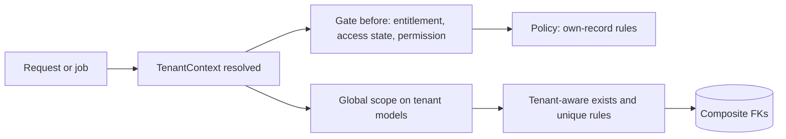

# 03 · Multi-tenant architecture

## 1. Isolation strategy

**Decision [R]: one shared database and schema. Every tenant row is isolated by `company_id`.**

| Option | Verdict | Reason |
|---|---|---|
| Shared database, `company_id` column | **Chosen** | Tenants are small: one carrier is tens to hundreds of drivers and assets. The platform needs cross-tenant reporting (plans, billing, usage). Billing runs through one Stripe account (PO-18). There is one deployment and one migration path. The code already scopes by `company_id`. |
| Schema or database per tenant | Rejected | Every migration would fan out per tenant. Platform reports would need cross-database queries. Connection management, backups and tests all get harder. Tenant size doesn't justify it. |
| Hybrid (large tenants on their own database) | Not now | Revisit only if a single tenant outgrows the shared database. [A] There is no evidence of that today. |

Adding a `company_id` column alone is not enough. Isolation rests on six layers (section 4), and the database itself enforces it wherever it can (section 3).

## 2. Table classification

| Class | Rule | Tables |
|---|---|---|
| **Platform** | No `company_id`. Only platform staff can reach these, through the `platform` guard. | `platform_users`, `platform_password_reset_tokens`, `features`, `plans`, `plan_prices`, `plan_features`, `site_settings`, `stripe_events`, `platform_support_sessions` (refers to a company but is owned by the platform) |
| **Platform-owned, about a company** | Has `company_id`. Tenants may read some of it but never write it. | `subscriptions`, `payments`, `subscription_notification_logs`, `company_feature_overrides`, `audit_logs` (company rows) |
| **Tenant root** | `company_id NOT NULL` + `UNIQUE(company_id, id)` | `companies`, `company_settings`, `company_invitations`, `users`, `drivers`, `vehicles`, `trailers`, `asset_groups`, `shippers`, `trips`, `inspections`, `trip_events`, `fuel_purchases`, `expenses`, `folders`, `documents`, `stored_files`, `service_logs`, `maintenance_schedules`, `policy_pdfs`, `driver_pay_rates`, `time_entries`, `timesheets`, `payroll_runs`, `conversations`, `messages`, `time_off_requests`, `exports`, `integration_connections`, `external_references`, `integration_sync_logs`, `device_tokens`, `location_pings`, `vehicle_last_locations`, `trip_number_sequences` |
| **Tenant child carrying `company_id`** | Directly addressed by id (URL or API), aggregated per company, or high volume | `driver_compliance_documents`, `vehicle_documents`, `trailer_documents`, `service_documents`, `trip_stops`, `payroll_run_lines`, `conversation_participants` |
| **Tenant child without `company_id`** | Only ever reached through an authorized parent | `residence_addresses`, `licenses`, `experiences`, `accidents`, `violations`, `forfeitures`, `employment_records`, `driver_documents` (via drivers), `inspection_results` (via inspections), `service_log_category` (via service_logs) |
| **Shared reference** | Global and read-only to tenants (LKP-01) | `countries`, `states`, `vehicle_types`, `fuel_types`, `equipment_types`, `vehicle_groups`, `maintenance_categories`, `document_types`, `inspection_templates`, `inspection_template_items` |
| **Tenant opt-out of a reference** | Has `company_id` | `company_document_type` |
| **Authorization (Spatie)** | `team_id` = company id, or `0` for platform | `roles`, `model_has_roles`, `model_has_permissions`; `permissions` and `role_has_permissions` are global |
| **Framework** | No tenant column, or a generic owner column | `sessions`, `cache`, `cache_locks`, `jobs`, `job_batches`, `failed_jobs`, `notifications`, `personal_access_tokens`, `password_reset_tokens`, `otp_verifications` |

**Why some children carry `company_id` and others don't.** A child gets `company_id` when at least one of these is true:
- something refers to it by id outside its parent screen (for example, a document download URL or an API call on a trip stop);
- a report counts it per company without joining through the parent (for example, compliance summaries or fuel totals);
- it is high volume (pings, messages).

Pure form-detail rows, such as an applicant's previous accidents, are only ever loaded with their driver, so they don't carry it.

## 3. Integrity enforced by the database

1. **Composite tenant foreign keys.**
   - Each tenant parent has `UNIQUE(company_id, id)`.
   - Children reference `(company_id, parent_id)` → `parent(company_id, id)`.
   - The database therefore rejects a trip whose driver belongs to another company, whatever the application code does.
   - MySQL checks a composite foreign key only when every column in it is non-null (MATCH SIMPLE). An optional parent (`trailer_id` null) is allowed.
2. **No `SET NULL` on a composite key.** It would null `company_id` as well. Optional links therefore use `RESTRICT`. Parents are soft-deleted, so `RESTRICT` rarely fires.
3. **Delete rules are applied by class** (full table in [08-database-schema.md](08-database-schema.md)):
   - tenant roots → `companies`: `RESTRICT`;
   - a detail row → its parent within the same aggregate: `CASCADE`;
   - links between aggregates: `RESTRICT`;
   - actor pointers (`created_by_user_id` and the like): single-column FK with `SET NULL`;
   - financial records: `RESTRICT`.
4. **A company is never hard-deleted by a cascade.** It is deactivated (PO-13). Removal happens only through the purge job after the retention period, which deletes children in order and removes their files ([10-workflows.md](10-workflows.md) §11).
5. **Owner integrity.** `companies (id, owner_user_id)` → `users (company_id, id)`. The owner must belong to the company.

## 4. Enforcement layers

### 4.1 `TenantContext`

A request-scoped service (`app()->scoped(TenantContext::class)`), so it is safe under Octane. It holds:
- `companyId`;
- `mode`: `tenant`, `public_applicant`, `support_session` or `platform`;
- `supportSessionId` (nullable).

How the context is set in each entry point:

| Entry point | Who sets it | Source |
|---|---|---|
| Web tenant routes, API | `ResolveTenant` middleware | `auth()->user()->company_id` |
| Support session | `ResolveTenant` | Active `platform_support_sessions` row; logged in as the company's system support user ([04](04-platform-administration.md)) |
| Public application `/{slug}/...` | `ResolvePublicCompany` middleware | Slug → active company; the session's driver must match (today's `applicationDriver()` rule) |
| Queued job | `TenantAware` job middleware | `companyId` serialized into the job |
| Scheduler | The command loops companies with `TenantContext::run($companyId, fn)` | Explicit |
| Stripe webhook, platform area | none (`platform` mode) | Tenant models refuse to query without an explicit `withoutTenancy()` |

What `ResolveTenant` also does on every request:
- **Company status:** refuses every user of a `suspended` or `deactivated` company, not just the owner (fixes R1/C6 in [01](01-current-architecture-assessment.md)).
- **Spatie team:** calls `setPermissionsTeamId($companyId)`.
- **Ordering:** it must be registered **before** `SubstituteBindings` in the middleware priority list. Otherwise route-model binding runs without a tenant.

### 4.2 `BelongsToCompany` trait (global scope)

- **Fail closed.** If there is no tenant context and the call is not wrapped in `withoutTenancy()`, a query on a tenant model throws. It does not return everything.
- **Auto-fill.** `creating` fills in `company_id` from the context and refuses a mismatching value.
- **Not applied to `User`.** Login and password reset must find users across companies; user queries use explicit scopes instead.
- **Platform-wide work** (platform reports, scheduler loops) uses `Model::withoutTenancy()`. The trait logs which class and method called it, and an architecture test lists the allowed callers.

### 4.3 Authorization: Gate and policies

- One app-level `Gate::before` ([06-roles-permissions.md](06-roles-permissions.md)) checks, in order:
  1. tenant mode,
  2. feature entitlement,
  3. access state,
  4. permission, resolved **database-first** in the user's own team. One indexed query per request; no global cache ([06](06-roles-permissions.md) §2, load-tested at 2,000 and 5,000 companies).
- Spatie's `permission:` middleware, `@can` and `$user->can()` all pass through it.
- Policies add rules about whose record it is. A Driver role user may only touch their own trips and events. A user may not change their own roles.

### 4.4 Validation

- `TenantRule::exists('drivers')` and `TenantRule::unique('drivers', 'email')` add `where company_id = ?` automatically.
- An architecture test fails on raw `exists:` / `unique:` strings that name a tenant table.

### 4.5 Queries the scope cannot see

`DB::table`, `fromSub`, raw SQL and yajra query-builder sources skip Eloquent scopes. Rules:
- Prefer Eloquent builders.
- Where SQL is required (compliance services), the query takes `companyId` as a required argument and filters on it explicitly. This is today's pattern in `FleetComplianceService.php:94-97`.
- Code review and a test check that each such service filters by `company_id`.

### 4.6 Jobs

Every tenant job:
- implements `TenantAwareJob`;
- carries `companyId`;
- uses the `TenantAware` middleware.

The middleware:
1. sets the context and the Spatie team id;
2. re-checks the company status and access state, and drops the job with a log line if the company is suspended or out of entitlement;
3. clears cached `roles` / `permissions` relations;
4. resets everything in a `finally` block, so state never leaks to the next job in the same worker.

## 5. Attack-surface checklist

| Surface | Control |
|---|---|
| Direct URLs with ids | Route-model binding through the scope returns **404** for foreign ids, not 403 (today's trait returns 403, which reveals that the id exists) |
| Nested ids (`/trips/{trip}/stops/{stop}`) | Scoped bindings (`->scopeBindings()`), plus composite foreign keys |
| Ids in request bodies | `TenantRule::exists`; composite foreign keys |
| API (Sanctum) | Same middleware stack: `auth:sanctum`, `ResolveTenant`, `feature:`. Tokens belong to a user, so to one company. |
| Relationship loading | Every tenant model has the scope, so eager loads are filtered too. Polymorphic links are avoided (exclusive-arc foreign keys instead). |
| Users, roles, permissions | Role ids are validated against `roles.team_id = companyId`. `model_has_roles` has a composite FK `(team_id, role_id)`. The resolver only reads the user's own team (`users.company_id`, never request input). Nightly integrity query ([06](06-roles-permissions.md) §4.4). |
| Subscription and feature checks | `Gate::before` + `feature:` middleware + job middleware ([05](05-plans-features-entitlements.md)) |
| Reports and exports | Generated by tenant jobs, with the company id fixed in the job. Files are written under `companies/{id}/exports/`. Downloads are authorized and use a signed, expiring URL. |
| Files | Private disk under `companies/{id}/…`. Every download goes through a controller that loads the owning record through the scope. Policy PDFs are served by a slug-scoped route. Logos may stay public: they are not sensitive. |
| Cache | Tenant keys always start with `tenant:{id}:`. Versioned keys handle invalidation. |
| Background notifications | Recipients are resolved inside the tenant job (for example, the digest only for active and entitled companies) |
| Platform operations | A separate guard and area. Tenant data is reachable only through a support session ([04](04-platform-administration.md)). |
| Public application | Today's slug + session + `source` + status checks stay. `verifyOtp` should read the company from the session's `otp_company_slug`, not from the URL (low-risk finding). |

## 6. Where these mechanisms can conflict with legitimate operations

| Case | Risk | Handling |
|---|---|---|
| Login, password reset, email verification | A tenant scope on `User` would break them | `User` is not scoped |
| Stripe webhook | No authenticated user | Platform mode. Resolves the company from metadata or customer, then works through explicit company-scoped queries. |
| Scheduler and cross-company commands | The scope throws without a context | Loop with `TenantContext::run()` per company; `withoutTenancy()` only to list the companies |
| Platform reports (MRR, usage) | Need cross-tenant aggregates | Read only from platform-owned tables (subscriptions, payments, counters), never tenant detail rows |
| Unique email checks for `users` | Global by design (one company per user) and exclusive with platform staff (D3a) | `EmailIdentityService` checks `users` and `platform_users` under a named lock |
| Moving an asset between companies (PO-08) | Breaks isolation by definition | The platform **Asset Transfer** operation (decided D11): copy to the target, retire at the source, audited ([04](04-platform-administration.md) §7) |
| Seeders and tests | No context | `TenantContext::run()` in factories. Tests get a `actingAsTenant()` helper. |
| Octane (PO-20 unanswered) | Static or memoized state leaks | Scoped context, team reset per request and per job; the per-instance memo in `CompanyFilterTrait` is removed |

## 7. What happens to `CompanyFilterTrait`

It is replaced step by step ([11-migration-strategy.md](11-migration-strategy.md)):
- `applyCompanyFilter` becomes redundant once models carry the scope.
- `authorizeCompanyAccess` becomes policies.
- `getOwningCompanyId` becomes the context.

Its super-admin branches are deleted. Platform staff never reach tenant controllers except through a support session, where they act as a tenant user.
