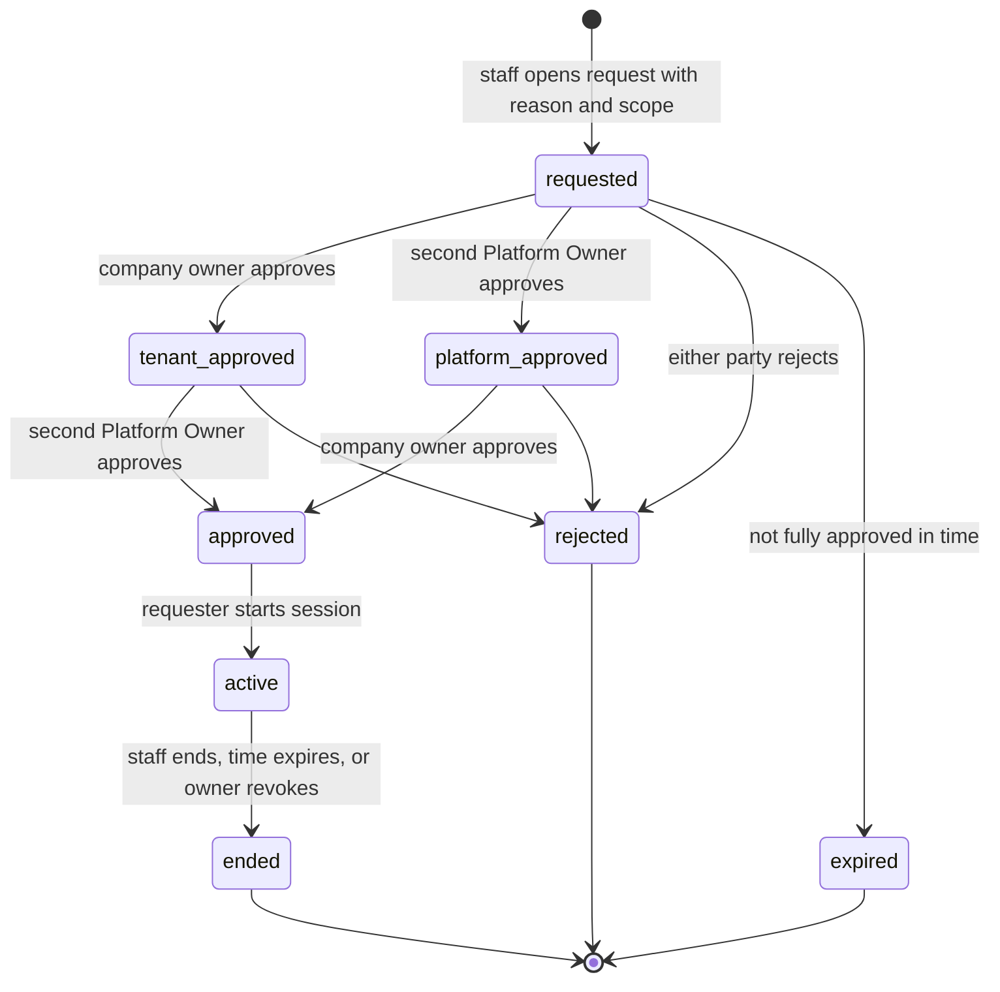

# 04 · Platform administration

The **platform** is the SaaS operator. It manages:

- companies and their lifecycle,
- plans, prices and features,
- subscriptions and overrides,
- platform staff,
- platform settings and the audit log,
- asset transfers between companies.

It is separate from every tenant. Being platform staff never grants access to a tenant's private data on its own.

## 1. Today [V]

- Platform administration is the `super-admin` role on an ordinary `users` row that **also owns a company** (`tests/Support/Actors.php:59-68`).
- The super-admin bypasses every tenant filter (`CompanyFilterTrait.php:97,119`) and the `Subscribed` middleware (`Subscribed.php:19`).
- Platform screens live under `/admin`, next to tenant screens, guarded by `role:super-admin` (`routes/web.php:194-212`).

## 2. Target: separate identity, guard and area

**Decided D1b.**

| Item | Design |
|---|---|
| Identity | A `platform_users` table (`App\Models\PlatformUser`). Platform staff are never `users` rows. |
| Guard | `platform` (session), with its own password broker (`platform_password_reset_tokens`) |
| Area | `/platform/*` routes, protected by `auth:platform` plus the permission middleware on the `platform` guard |
| Authentication | Login, reset and verification of its own. **2FA required** for every platform user [R]. Shorter session lifetime. |
| Authorization | Spatie with guard `platform`, roles in reserved team `0`. Checks are database-first ([06](06-roles-permissions.md) §4). |
| Tenant data | Not reachable from `/platform`, except company metadata (name, status, owner name and email, plan, usage counts). Anything more needs a support session (section 4). |

### Email identity rule (decided D3a)

The same email address can never be both a platform login and a tenant login.

- `EmailIdentityService::assertAvailable($email)` runs before every email write: registration, invitation acceptance, email change, social sign-up, and platform staff invite or edit.
  - It checks both `users.email` and `platform_users.email`, case-insensitively.
  - It takes a short named lock on the normalised email (`GET_LOCK`), so two simultaneous sign-ups can't both pass.
  - The lock must cover the check **and** the insert, so writes go through `EmailIdentityService::claim($email, $write)`: lock, check, write in its own transaction, release after commit (WP8a).
- Each table also has its own unique index.
- The nightly `integrity:check` runs `SELECT u.email FROM users u JOIN platform_users p ON p.email = u.email` and alerts on any row.
- A single shared "email registry" table was considered and rejected. It would make every email change a two-table cascade, for a race that the lock already closes.

## 3. Platform roles and permissions

All platform permissions use guard `platform` and the `platform.` prefix.

| Permission | Owner | Admin | Billing | Support | Auditor |
|---|:-:|:-:|:-:|:-:|:-:|
| `platform.staff.manage` (invite, disable, assign roles) | ✓ | | | | |
| `platform.companies.view` (metadata only) | ✓ | ✓ | ✓ | ✓ | ✓ |
| `platform.companies.manage` (create, edit profile, transfer ownership) | ✓ | ✓ | | | |
| `platform.companies.lifecycle` (suspend, reactivate, deactivate) | ✓ | ✓ | | | |
| `platform.companies.purge` (hard delete after retention) | ✓ | | | | |
| `platform.assets.transfer` (section 7) | ✓ | ✓ | | | |
| `platform.plans.manage` (plans, prices, plan features) | ✓ | ✓ | | | |
| `platform.features.manage` | ✓ | ✓ | | | |
| `platform.overrides.manage` | ✓ | ✓ | ✓ | | |
| `platform.subscriptions.view` | ✓ | ✓ | ✓ | ✓ | ✓ |
| `platform.subscriptions.manage` | ✓ | | ✓ | | |
| `platform.payments.view` | ✓ | | ✓ | | ✓ |
| `platform.settings.manage` (site settings, platform policy PDFs, lookups per LKP-01) | ✓ | ✓ | | | |
| `platform.audit.view` | ✓ | ✓ | | | ✓ |
| `platform.support.request` | ✓ | ✓ | | ✓ | |
| `platform.support.approve` (second, four-eyes approval) | ✓ | | | | |

| Role | Purpose |
|---|---|
| Platform Owner | Accountable for the platform. **At least two active Platform Owners must exist** (decided Q1). The system refuses to demote or disable an Owner that would leave fewer than two. Support sessions can't be approved until there are two. |
| Platform Administrator | Catalogue, company lifecycle, asset transfers. Cannot manage staff or purge. |
| Billing Manager | Money and subscriptions |
| Support Agent | Company metadata; requests support sessions |
| Auditor (optional) | Read-only audit and billing |

Platform roles are system-defined and seeded. A Platform Owner may create extra platform roles from platform permissions, under the same escalation rules as tenants ([06](06-roles-permissions.md) §8).

## 4. Support sessions: the only way into tenant data

**Decided Q1:** both parties authorize every session, and the platform side is four-eyes.

| Approval | By | Rule |
|---|---|---|
| Tenant approval | The company **Owner** | Required for every session |
| Platform approval | A **Platform Owner who is not the requester** | Required for every session |

- The session can start only after both approvals.
- There is **no break-glass path** that skips the tenant's approval.
- If emergency access without the tenant's consent is ever needed (for example, a legal request while the owner can't be reached), that is a new decision to make. It is not built.

### 4.1 Lifecycle

### 4.2 Data (`platform_support_sessions`)

| Column | Notes |
|---|---|
| `company_id`, `platform_user_id` | Who asks, for which company |
| `reason` | Required |
| `scope` | `read` or `read_write` |
| `status` | `requested`, `approved`, `rejected`, `expired`, `active`, `ended` |
| `tenant_approved_by_user_id`, `tenant_approved_at` | The company Owner |
| `platform_approved_by_platform_user_id`, `platform_approved_at` | The second Platform Owner |
| `rejected_by_type`, `rejected_by_id`, `rejection_reason` | |
| `requested_at`, `started_at`, `expires_at`, `ended_at`, `end_reason` | `expires_at` is at most `site_settings.support_session_max_minutes` (default 240) after start |
| `revoked_by_user_id` | The company Owner can revoke at any time |

**CHECK constraints** (MySQL 8.0.16+, decided D7a):
- `status NOT IN ('approved','active','ended') OR (tenant_approved_by_user_id IS NOT NULL AND platform_approved_by_platform_user_id IS NOT NULL)`
- `platform_approved_by_platform_user_id IS NULL OR platform_approved_by_platform_user_id <> platform_user_id` (four-eyes)

Rules the service enforces in addition:
- the tenant approver must be the company's current Owner;
- the platform approver must hold `platform.support.approve` (Platform Owner).

Every FK on a column used in a CHECK is `RESTRICT`, because MySQL forbids referential actions on those columns.

### 4.3 How a session works

- Each company has one **system support user**:
  - a `users` row with `user_type = 'support'`;
  - `status = 'inactive'` outside sessions, and an unusable password;
  - excluded from `max_users`.
- Starting an approved session logs the staff member into the tenant `web` guard **as that support user** and gives it the locked role `Support (read)` or `Support (read/write)`. The platform login stays active. The session id is kept in the PHP session.
- Tenant code needs no special cases: it sees an ordinary user with a narrow role.
- `ResolveTenant` checks on every request that the session is active and unexpired, and ends it otherwise.
- **`read`** = every entitled tenant permission with `is_write = false`.
- **`read_write`** adds write permissions, **except**:
  - billing,
  - users, roles and permissions,
  - ownership transfer,
  - closing the company,
  - deleting drivers or documents.
- A banner shows "Support session by {staff name}, ends {time}".
- The Owner is notified when the session starts and when it ends.
- As built (WP8b):
  - A request, and an approval not yet started, is valid for **24 hours** from `requested_at` [A]. The Owner approves on `/support-access`; the second Platform Owner on `/platform/support-sessions`.
  - **One active session per company**, because each company has one support user: `UNIQUE(company_id, active_flag)`.
  - A started session always lasts `support_session_max_minutes`.
  - It ends when the requester ends it, the Owner revokes it, it expires (scheduled `support-sessions:expire`, and lazily on the next request), the requester logs out of the platform or is disabled, or the company is suspended.
  - The support user can never log in with a password.

### 4.4 Audit

Every request made during a session writes an `audit_logs` row with:
- `actor_type = platform_user`, `actor_id`,
- `support_session_id`,
- `company_id`, the action, the subject, and the changes.

Inside a session, DQ file and document **views** are audited too ([08](08-database-schema.md) §10).

As built (WP8b):
- The per-request row is `action = support_session.request`, subject the session. `changes` holds `{method, route, path, status}`; request bodies and query strings are never stored.
- Tenant-side audit rows written by the support user are attributed to the staff member (`actor_type = platform_user`).

## 5. What the platform can do without a support session

| Area | Allowed | Not allowed |
|---|---|---|
| Companies | List and search; view profile, status, owner name and email, plan, usage counts; suspend, reactivate, deactivate; transfer ownership on a verified request | Viewing drivers, documents, trips or any other tenant record |
| Plans and features | Everything ([05](05-plans-features-entitlements.md)) | — |
| Subscriptions and payments | View, grant, cancel or resume, move to another price, refunds through Stripe | — |
| Overrides | Create and revoke, with reason and expiry | — |
| Asset transfer | Section 7 | — |
| Lookups (LKP-01) | Create, edit, deactivate | — |
| Audit log | View and search | Edit or delete |

## 6. Existing product decisions under this design

**Decided D11.**

| Decision | Under this design |
|---|---|
| PO-02: "upload to all" for a chosen company | Done inside an approved `read_write` support session for that company. The upload acts on the session's company only. |
| PO-07: schedule with no vehicle, for a chosen company | Same: done inside a `read_write` support session |
| PO-08: moving a vehicle or trailer between companies | The platform operation **Asset Transfer** (section 7) |
| Super-admin dashboard company statistics | The platform dashboard, which reads platform-owned tables only |

Tests that flip: `AccessControl/SuperAdminCompanyAttributionTest`, `FleetComplianceDecisionsTest` (PO-02), `MaintenanceDecisionsTest` (PO-07), `FleetAssetsUpdateTest` (FLT-03 / PO-08), and the super-admin cases across the module suites ([11-migration-strategy.md](11-migration-strategy.md) §5).

## 7. Asset Transfer (PO-08 as a platform operation)

**What it is.** Moves a vehicle or trailer, with its history, from company S (source) to company T (target). It needs `platform.assets.transfer`, a reason, and a confirmation step. Both company Owners are notified, and the whole operation is audited.

**How it works [R].** It is **copy to the target, then retire at the source**, not an in-place update of `company_id`.

1. In one transaction:
   - create the asset in T (unit no and VIN must be free in T, per PO-10);
   - copy its compliance documents (the files are copied into T's storage prefix, and T's `storage_bytes` is checked against T's limit);
   - copy its service logs with their documents and categories;
   - copy its maintenance schedules;
   - record the mapping in `asset_transfers`.
2. At the source:
   - the asset is soft-deleted. Its `asset_transfers` row records where it went, so `vehicles` and `trailers` need no extra column;
   - its active asset groups are ended, as PO-08 option A required;
   - its history stays with S, **read-only**.
3. T's `max_vehicles` / `max_trailers` limit is checked under T's company lock.

**Why copy rather than move:**
- **Integrity.** Every child row of the asset references `(company_id, asset_id)` through composite FKs ([03](03-multi-tenant-architecture.md) §3). Changing the parent's company in place would mean disabling FK checks.
- **Retention.** [L] 49 CFR 396.3(c) requires a carrier to keep maintenance records for 1 year, and for 6 months after the vehicle leaves its control. Under the copy approach the source carrier keeps its records.
- **PO-08 compatibility.** The target receives the full history (the intent of option A), and the source keeps what the law requires.

`asset_transfers` table: see [08-database-schema.md](08-database-schema.md) §3.

## 8. Platform settings

- `site_settings` stays the single-row platform configuration [V].
- It gains:
  - `default_alcohol_drug_test_policy_pdf` and `default_general_work_policy_pdf`, which replace the `policy_pdfs` row with a null `company_id` ([09](09-erd-audit.md) F12);
  - `trial_plan_id`, `trial_days` and `grace_days`;
  - `support_session_max_minutes`.
- It also gains the platform owner's basic settings [R], all managed with `platform.settings.manage`:
  - identity: `legal_name`, `support_email`, `support_phone`, `footer_text`, `terms_url`, `privacy_url`, `timezone`;
  - theme: `primary_color`, `accent_color`, `default_color_mode`, `logo_dark`, `email_logo`;
  - SEO defaults: `og_image`, `twitter_card`, `canonical_base_url`, `robots_noindex_default`, `search_console_verification`;
  - mail sender: `mail_from_name`, `mail_from_address` (PENDING: replaces `.env` or not).
- Together with the existing site name, logo, favicon, contact, social, meta and analytics fields, the full column list is in [08](08-database-schema.md) §`site_settings`.
- The PO-14 fallback is unchanged: the company's own file first, then the platform default.
