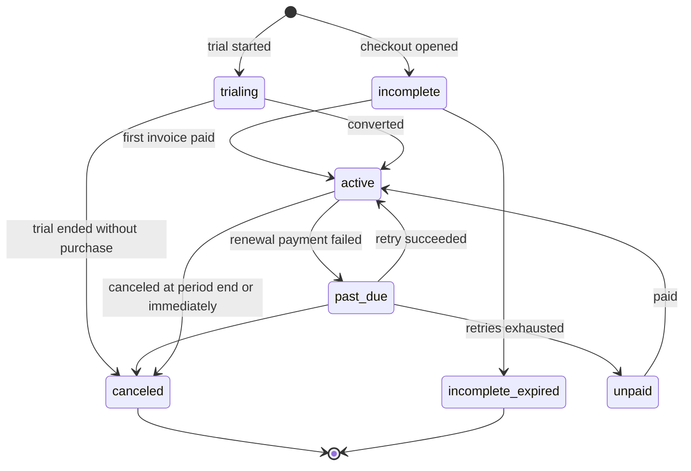

# 07 · Subscription and billing

## 1. Today [V]

Every billing object belongs to a **user**:

| Object | Today | Evidence |
|---|---|---|
| Stripe customer | `users.stripe_id` | `CheckoutService.php:18-57` |
| Checkout session | inline `price_data` built from the plan; metadata `user_id`, `plan_id`, `plan_slug`, `billing_cycle`, `app_host`; `client_reference_id = user id` | `CheckoutService.php:87-129` |
| Success page | syncs only if `metadata.user_id` and `client_reference_id` equal the logged-in user | `CheckoutController.php:70-107` |
| Webhook | synchronous, maps events to a user by `metadata.user_id` or `users.stripe_id`, ignores a foreign `app_host` (PO-18) | `StripeWebhookController.php`, `WebhookProcessor.php:26-90,98-103,336-366` |
| Access check | `Subscribed` middleware → `$request->user()->hasActiveSubscription()` | `Subscribed.php:23`, `User.php:73-84` |
| Trial | a local `subscriptions` row (`source = trial`), one per user (= per verified email, PO-15) | `TrialActivationService.php:13-58` |
| Admin | grant, expire, suspend and reactivate by **user** | `SubscriptionAdminController.php:104-192` |
| Plans | one row per billing cycle ("Starter Monthly", "Starter Yearly"); "Free Trial" is a plan of its own | `PlanSeeder.php` |

## 2. Target: the company owns billing [R]

| Object | Target |
|---|---|
| Stripe customer | `companies.stripe_customer_id` (unique). Created at first checkout with the company name and `billing_email`. Metadata: `company_id`, `app_host`. |
| Who can buy | Users holding `billing.manage`: the Owner by default |
| Subscription | `subscriptions.company_id`. Plus `actor_user_id` for who started it (`SET NULL` if that user is deleted). |
| Payments | `payments.company_id` (`RESTRICT`). Financial history is never deleted by a cascade. |
| Notifications | Sent to the Owner and `companies.billing_email`. `subscription_notification_logs.recipient_user_id` records who received each one. |
| Access | Resolved per company and shared by all its users, drivers included |

### Tables

Full columns are in [08-database-schema.md](08-database-schema.md).

| Table | Change |
|---|---|
| `companies` | Add `stripe_customer_id` (UK), `billing_email`, `trial_used_at`, `entitlements_version`, `storage_bytes` |
| `users` | Drop `stripe_id`, `pm_type`, `pm_last_four`, `trial_ends_at`. Their Cashier-style use has ended [V]. |
| `plans` | Becomes the product only. `price`, `billing_cycle`, `duration_days` and the Stripe ids move to `plan_prices`. `features` becomes `marketing_bullets`. `trial_days` moves to the trial setting (section 5). |
| `plan_prices` | New (section 3) |
| `subscriptions` | `user_id` becomes `company_id` + `actor_user_id`. Add `plan_price_id` and the snapshot columns `stripe_price_id`, `interval`, `amount`, `currency`. Add `status` (renamed from `stripe_status`), `ended_at`, the generated `open_flag`, `last_stripe_event_at` and `needs_review`. |
| `payments` | `user_id` becomes `company_id`. The rest is unchanged. |
| `subscription_notification_logs` | `user_id` becomes `recipient_user_id`. Add `company_id`. |
| `stripe_events` | New. `event_id` (UK), `type`, `stripe_created_at`, `payload` json, `received_at`, `processed_at`, `status` (`pending` / `processed` / `ignored` / `failed`), `error`. |

## 3. Prices and historical integrity

**Rule:** a `plan_prices` row is **immutable** once any subscription references it. A price change inserts a new row and sets `archived_at` on the old one.

| Column | Notes |
|---|---|
| `plan_id` | FK, RESTRICT |
| `interval` | `month` or `year` |
| `amount`, `currency` | |
| `stripe_price_id` | UK, NOT NULL for paid prices |
| `archived_at` | |
| `current_flag` | Generated column: `CASE WHEN archived_at IS NULL THEN 1 END` |

- Unique index on `(plan_id, interval, currency, current_flag)`. This allows **one current price** per combination and unlimited archived history, because MySQL allows repeated NULLs in a unique index. It replaces the earlier `(…, is_active)` draft, which broke on the second archive.
- Existing subscriptions keep `plan_price_id` pointing at the archived row. Stripe keeps charging the old Stripe Price, which is Stripe's normal behaviour. Existing subscribers keep their archived **price** until a Billing Manager moves them on purpose [R]. Entitlement (feature and limit) edits, by contrast, apply immediately (decided Q3), and overrides can grandfather specific companies. The move goes through the Stripe subscription update API, and the webhook then changes `plan_price_id`.
- Checkout uses `price: plan_prices.stripe_price_id` instead of inline `price_data` (today `CheckoutService.php:107-122` [V]). This is what lets every Stripe subscription item map back to exactly one local price.
- New Stripe Prices are created through the API when the Platform Owner adds a price, tagged with `metadata.app_host` (the account is shared, PO-18).
- **Unknown prices.** If a webhook carries a `stripe_price_id` that `plan_prices` doesn't know (for example, changed in the Stripe dashboard):
  - the subscription keeps its previous `plan_price_id`;
  - the snapshot stores the new raw values;
  - `needs_review = true`;
  - platform staff are alerted.

  Entitlements stay on the last known plan until someone resolves it.

## 4. Subscription lifecycle and access state

### 4.1 One open subscription per company

- `subscriptions.ended_at` is set when a subscription is finished: canceled and past its period end, replaced, or a trial that has ended.
- The generated `open_flag = CASE WHEN ended_at IS NULL THEN 1 END`, with a unique index on `(company_id, open_flag)`, guarantees **at most one open subscription per company**. Ended rows are kept as history.
- Upgrades and downgrades change the price on the open Stripe subscription. They never create a second row.
- Checkout is refused while an open, accessible subscription exists. That check exists per user today (`CheckoutController.php:45` [V]) and becomes per company.

### 4.2 Status

`status` mirrors Stripe: `trialing`, `active`, `past_due`, `unpaid`, `canceled`, `incomplete`, `incomplete_expired`. Local admin grants and trials use `trialing` or `active` with `source` set to `admin` or `trial`.

### 4.3 Access state

Evaluated in `AccessState::for($company)` and cached with the entitlements.

| Condition, checked in order | Access state |
|---|---|
| `companies.status` is `suspended` or `deactivated` | **blocked** |
| No open subscription, and no ended subscription in the last N days | **none**: only account, billing and pricing pages |
| `trialing` or `active` within the access window | **full** |
| `past_due` and less than `grace_days` since the failed renewal | **grace**: full access plus a banner |
| `past_due` beyond grace, `unpaid`, `canceled` past `ends_at`, or a trial past its end | **read_only** (decided Q2) |

- `grace_days` is 7 (decided Q2: keep the default unless new requirements change it). It lives in `site_settings`.
- **Read-only** means every permission with `is_write = true` is denied, while viewing and exporting still work. The reason for this default: [L] carriers must be able to produce DQ files during an audit even if they stop paying. The client should confirm.

### 4.4 Fixing `accessEndsAt()`

Today the access end is `ends_at ?? trial_ends_at ?? current_period_end` (`Subscription.php:79-84` [V]). A converted trial keeps `trial_ends_at`, so a later `past_due` uses the old trial date. Target:

- trialing → `trial_ends_at`
- canceled or cancel at period end → `ends_at ?? current_period_end`
- otherwise → `current_period_end`

The `AccessibleParityTest` approach (the database answer and the PHP answer must agree) is kept.

## 5. Trials

- **Trial plan:** a trial is a `trialing` subscription on a real plan. The plan is set in `site_settings.trial_plan_id`. Decided Q5: it is the highest tier (Enterprise), because today's seeded trial promises "Access to all features" for 14 days (`PlanSeeder.php:18-28` [V]). The length is in `site_settings.trial_days` (seeded value: 14).
- **Eligibility** (keeps PO-15):
  - the owner's email is verified;
  - `companies.trial_used_at IS NULL`;
  - no other company whose owner has the same email has ever had a trial.

  `trial_used_at` is set when the trial starts.
- **Paid conversion:** checkout opens a Stripe subscription. When the webhook confirms it, the trial row is closed (`ended_at = now`) and the Stripe row becomes the open one.
- **Expired trials:** `subscriptions:close-expired-trials` stays [V], now acting per company.

## 6. Stripe integration

### 6.1 Checkout

1. A user with `billing.manage` picks a plan and an interval.
2. `CheckoutService` gets or creates the company's Stripe customer.
3. It creates a session with `price = stripe_price_id`.
   - Metadata: `company_id`, `actor_user_id`, `plan_price_id`, `app_host`.
   - `client_reference_id = company_id`.
4. **Success page:** syncs only if `metadata.company_id` equals the user's company **and** the user holds `billing.manage`. This replaces the user-id check (`CheckoutController.php:82-87`).

### 6.2 Webhooks

1. `StripeWebhookController` verifies the signature (as today) and inserts into `stripe_events`. A duplicate `event_id` returns 200 without further work.
2. It answers 200 and dispatches `ProcessStripeEvent` on a dedicated `billing` queue.
3. The job:
   - ignores events with a foreign `metadata.app_host` (PO-18) and marks them `ignored`;
   - resolves the company from `metadata.company_id`, otherwise from `companies.stripe_customer_id`;
   - locks the subscription row;
   - **ignores the event if `stripe_created_at` is older than `subscriptions.last_stripe_event_at`.** This fixes the ordering gap at `WebhookProcessor.php:373-384`;
   - applies the change, bumps `entitlements_version` and writes `audit_logs` with `actor_type = stripe`.
4. A failure marks the event `failed` and retries with backoff. An admin can re-queue it.

Events handled: today's set [V] — `checkout.session.completed`, `customer.subscription.created/updated/deleted`, `invoice.paid`, `invoice.payment_failed`. `customer.subscription.deleted` now sends a notification; today it sends none.

### 6.3 Billing portal, cancel, resume

Same as today, but per company and gated by `billing.manage`. Today these routes need only `auth` (`routes/web.php:175-178` [V]).

## 7. Platform billing operations

All of these are keyed by **company** and need the platform permissions in [04](04-platform-administration.md).

| Action | Effect |
|---|---|
| Grant | Creates a local `source = admin` subscription with an explicit `ends_at` (PO-19 lesson: never open-ended), only if the company has no accessible subscription |
| Expire now, suspend, reactivate | As today, keyed by company. Note that company suspension (`companies.status`) is separate from subscription state. |
| Move to price | Stripe subscription update to another `plan_price_id` |
| Override | `company_feature_overrides` ([05](05-plans-features-entitlements.md)) |
| View payments | Paginated SQL. Today's dashboard loads every subscription into memory (`SubscriptionAdminController.php:29` [V]). |

## 8. Enforcement in every entry point

| Entry point | Check |
|---|---|
| Web tenant routes | `ResolveTenant` (company status) → `subscribed` middleware (access state ≠ none or blocked, else redirect to pricing) → `Gate::before` (read-only denies writes) |
| Billing and pricing routes | Reachable in every state except blocked-by-suspension, so a company can pay |
| API (mobile) | The same middleware. Blocked or none → 402 with a JSON reason. Read-only → 403 on writes. |
| Queued jobs | The `TenantAware` middleware drops tenant jobs for blocked companies, and skips write-type jobs (sync to QuickBooks, ping ingestion) when read-only |
| Scheduler | Per-company loops include only companies whose access state allows the job (the compliance digest needs full or grace; today it emails every company's drivers [V]) |
| Public application | The apply link works only in full or grace state with `driver_applications` entitled |

## 9. Notifications

| Event | Recipients | Channel |
|---|---|---|
| Expiring soon (7, 3, 1 days) | Owner and `billing_email` | mail and database. SMS to `companies.phone` as today. |
| Payment failed (grace starts) | Same | mail, database |
| Entered read-only or blocked | Same, plus a banner for every user | mail, database |
| Subscription canceled (Stripe deleted) | Same | mail |

Deduplication stays per subscription, type, channel and days-before [V]. The orphan `SubscriptionExpired` and `SubscriptionExpiringSoon` events either get listeners or are removed [R].
