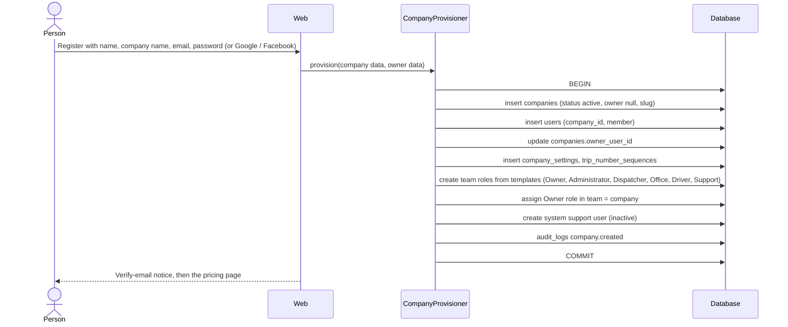
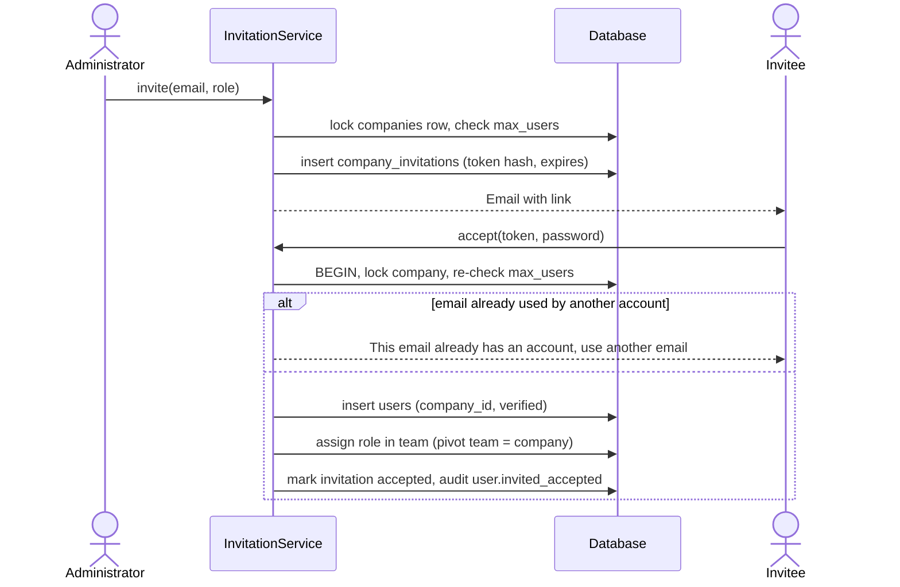
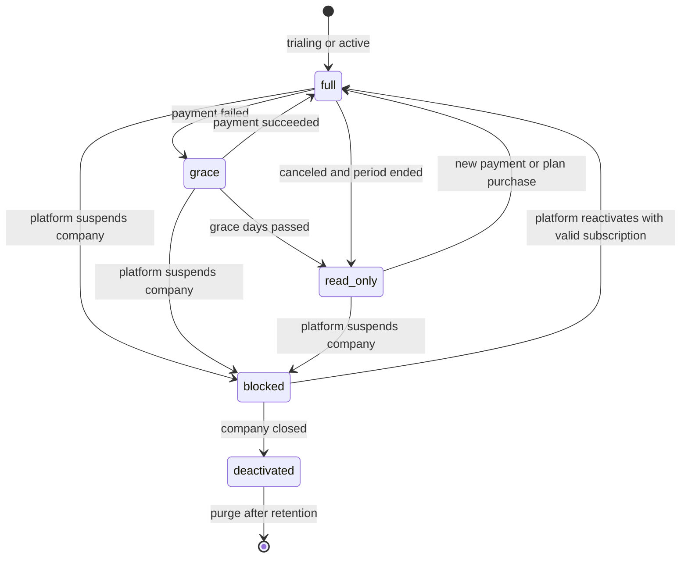
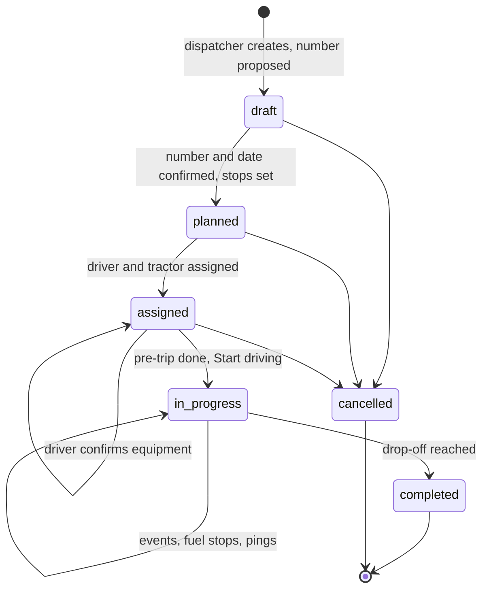
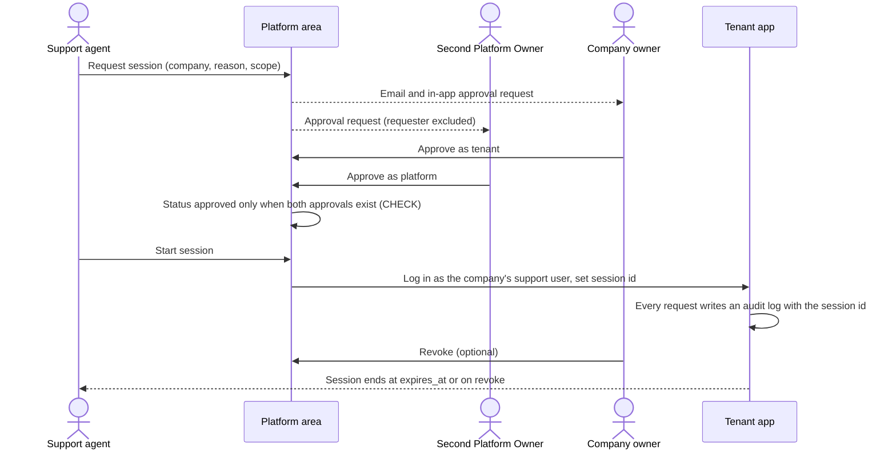
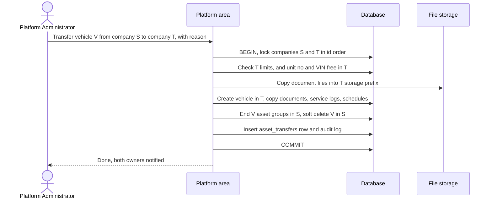

# 10 · End-to-end workflows

This document describes how existing and new modules work together under the target design. Each flow names:

- the tables it writes,
- the checks that run,
- the background work it triggers.

The flows use the product owner's decisions of 13 October 2026 ([14-open-questions.md](14-open-questions.md)). The few items still PENDING are marked.

## 1. Company registration and tenant provisioning

**Rules**
- Registration asks for the **company name** separately. Today the company is named after the person (`RegisteredUserController.php:66` [V]).
- With social sign-up (`social_accounts`), the provider's verified email counts as verified.
- Social sign-up never joins an existing company.
- A super-admin creating a company for a customer (today's `CompanyController::store`) becomes the platform action "create company". It calls the same provisioner, which fixes the missing-role bug ([01](01-current-architecture-assessment.md) §5).

## 2. Subscription purchase and activation

1. The Owner (or a holder of `billing.manage`) opens the pricing page.
2. **Free trial**, if eligible (one per company and per verified owner email, PO-15):
   - insert `subscriptions` (`status = trialing`, `source = trial`, plan = trial plan, `ends_at = now + trial_days`);
   - set `companies.trial_used_at`;
   - bump `entitlements_version`.
3. **Paid plan:**
   - checkout uses the current `plan_prices.stripe_price_id`, with metadata `company_id`, `actor_user_id`, `plan_price_id`, `app_host`;
   - the user pays in Stripe;
   - the success page syncs the result, but only for the same company and a holder of `billing.manage`.
4. Webhook path: `stripe_events` insert → queued `ProcessStripeEvent`. The job:
   - upserts the subscription (and closes the trial row);
   - records the payment;
   - bumps `entitlements_version`;
   - sends a notification;
   - writes an audit log entry.
5. Access state becomes `full`. The entitlements now follow the plan ([05](05-plans-features-entitlements.md) §4).

## 3. Company administrator setup

1. The Owner completes the company profile: DOT and MC numbers, address, time zone, logo, policy PDFs (PO-14).
2. The Owner reviews document types and opts out of any that don't apply (`company_document_type`, LKP-01).
3. The Owner invites staff (flow 5) and can hand admin work to an Administrator.

## 4. Company-specific roles and permissions

1. A user with `roles.create` (and the `custom_roles` feature) creates or edits a role in their team.
2. `RoleService` validates:
   - the name is unique within the team;
   - the permissions are `web` guard;
   - every permission is in the actor's own effective set;
   - the role isn't locked.
3. The role is saved with `team_id = company_id`. Permission checks read the database directly, so there is no role cache to clear: the change applies on the next request for every user of that company, and no other company is affected ([06](06-roles-permissions.md) §2).
4. An audit log entry is written: `role.created` or `role.permissions_changed`.

Without the `custom_roles` feature, companies use the system roles only.

## 5. User creation and role assignment

**Rules**
- The inviter only ever sees "invitation sent", so accounts in other companies aren't revealed (D3).
- The role must be assignable by the inviter: its permissions must be a subset of the inviter's.
- Deactivating a user sets `status = inactive`. The seat is freed and the user is logged out on their next request (`EnsureUserIsActive` [V]). Users are never hard-deleted while they own records; actor pointers use SET NULL.

## 6. Driver creation and management

There are two entry points; today's flows stay [V]:

1. **Staff create a driver** with the wizard. The driver gets `employment_status = applicant` or `active`, and `created_by_user_id` is set.
2. **Public application** at `/{slug}/apply`:
   - OTP, then 10 steps, then `application_status = pending`;
   - staff review and **hire** (`DriverHireService`), which sets `employment_status = active` and `hired_at`, sends the hire email, and runs the `max_drivers` check under the company lock; or **reject**, which sends the rejection email.

**Giving a driver a login** (needs the `mobile_app` feature):
1. Staff click "Invite to app" on the driver.
2. A `company_invitations` row is created with `driver_id` set and the system Driver role.
3. When the invitation is accepted, `drivers.user_id` is linked.

**Termination:** `employment_status = terminated`, `terminated_at` and `termination_date` are set. If the driver has a login, it is deactivated. The DQ file is kept for the retention period [L].

## 7. Driver documents and compliance

1. Uploads go to the private disk under `companies/{id}/drivers/{driver_id}/…`.
   - Each upload creates `stored_files` (and increases `storage_bytes` after the storage-limit check) plus a `driver_compliance_documents` row.
   - An image uploaded into a folder is converted to PDF; the original is kept and linked through `converted_from_file_id` (decided Q8).
2. The medical examiner certificate and the current CDL expiry join the compliance engine ([09](09-erd-audit.md) F17).
3. The compliance dashboard computes status in SQL, as today [V], with the new indexes.
4. The daily digest runs per company, only for companies with access state `full` or `grace` and the `compliance_reminders` feature.

## 8. Enforcing subscription limits

Every path that adds to a counted total goes through `Limits::assertCanCreate()` inside its transaction ([05](05-plans-features-entitlements.md) §5):

| Path | Limit |
|---|---|
| Create a driver, hire an applicant, restore a driver | `max_drivers` |
| Create or restore a vehicle or trailer | `max_vehicles`, `max_trailers` |
| Invite, accept, or re-activate a user | `max_users` |
| Any file upload | `storage_gb` |

When the limit is reached, the user gets a 422 with an upgrade link. Platform staff can raise a limit for one company with an override.

## 9. Tenant-scoped search, reports and exports

- **Lists** use scoped Eloquent queries, server-side pagination and tenant-leading indexes ([12](12-performance-plan.md)).
- **Export** (ZIP per driver, trip or company; year-end report):
  1. The user requests it (permission `exports.create`, feature `zip_export` or `year_end_reports`).
  2. An `exports` row is inserted (`queued`) and a `BuildExport` tenant job is dispatched.
  3. The job streams the files into a ZIP under `companies/{id}/exports/`, creates `stored_files`, and marks the export `ready` with `expires_at` (for example 7 days).
  4. The user is notified.
  5. Download goes through an authorized route, and is audited. On the local disk the route streams the file (P1-6); a short-lived temporary URL comes with S3 ([12](12-performance-plan.md) §3).
  6. A nightly job expires and deletes old exports.
- **Profit and loss** is a report query for one company, using the company's time zone ([08](08-database-schema.md) §11).

## 10. Expiry, renewal, suspension and deactivation

| Event | Who | Effect |
|---|---|---|
| Renewal paid | Stripe webhook | Stays or returns to `full` |
| Payment failed | Stripe webhook | `grace` for `grace_days` (7, decided Q2). Owner and billing contact notified. |
| Grace ends or subscription canceled | Scheduled job | `read_only` (decided Q2). Writes denied, exports allowed. |
| Suspend | Platform (`platform.companies.lifecycle`) | `companies.status = suspended`, everyone blocked. Reason and audit required. |
| Close account (PO-17) or deactivate (PO-13) | Owner, or platform | `companies.status = deactivated`, all users inactive, data kept, owner notified |
| Reactivate | Platform | Status back to active. Access follows the subscription. |

## 11. User removal, company deletion and retention

| Action | Result |
|---|---|
| Remove a user | Set to inactive. Records keep their ids, and actor pointers stay valid. A hard delete is possible only through the purge job. |
| Remove a driver | Soft delete (today's rule [V]), or termination for hired drivers. The DQ file is kept. |
| Close or deactivate a company | No data deleted (PO-13, PO-17) |
| Purge a company (platform only) | `companies:purge {company} --confirm`, allowed only when every retention period has passed ([08](08-database-schema.md) §15). Deletes children in dependency order (documents, files, operations, money, fleet, drivers, users, roles in its team, company), then deletes the stored files after commit. Writes an audit entry with a summary (counts only). |

## 12. Background jobs, notifications and scheduled processing

| Job | Schedule | Tenant handling |
|---|---|---|
| `subscriptions:send-expiry-reminders` | Daily 09:00 [V] | Loops subscriptions with a company context. Recipients are the Owner and `billing_email`. |
| `compliance:send-digest-reminders` | Daily 09:30 [V] | Loops companies in state `full` or `grace` that have `compliance_reminders`. Dispatches one job per company. |
| `subscriptions:close-expired-trials` | Daily 10:00 [V] | Platform mode, bulk update, bumps `entitlements_version` per company |
| `access-state:refresh` | Hourly (new) | Moves companies from grace to read-only, revokes expired overrides, bumps versions |
| `exports:expire` | Daily (new) | Per company |
| `integrity:check` | Nightly (new) | The integrity queries in [06](06-roles-permissions.md) §4.4, [11](11-migration-strategy.md) §6, and the platform/tenant email overlap check ([04](04-platform-administration.md) §2). Alerts on any rows found. |
| `location-pings:prune` | Daily (new) | Retention: 13 months by default, until counsel confirms [L] |
| `usage:recount` | Nightly (new) | Recomputes counters and storage, logs drift |
| `model:prune` (OTP) | Daily [V] | Platform |
| `ProcessStripeEvent` | On webhook | Platform mode, then the resolved company |
| Ping ingestion, ZIP builds, QuickBooks sync, push notifications | On demand | `TenantAware` job middleware ([03](03-multi-tenant-architecture.md) §4.6) |

The scheduler must run every minute in production (PO-20 says "not sure" — confirm before go-live). It runs on one server, so `onOneServer()` isn't needed (PO-20).

## 13. Trip lifecycle (new)

1. **Create.** A dispatcher creates the trip, and the trip number comes from `trip_number_sequences` under a lock. The owner confirms the number and date (`number_confirmed_at`). Shipper chosen or saved; start and drop-off chosen on the map; the pickup is optional (`also_pickup`).
2. **Assign.** `driver_id`, `vehicle_id` and `trailer_id` are validated in the same company. Defaults come from the driver's active asset group.
3. **In the driver app** (Sanctum token, `mobile_app` feature):
   1. the driver confirms the equipment;
   2. completes the pre-trip inspection on one screen, with progress shown;
   3. taps "Start driving!". `status = in_progress` and `started_at` are set, the unit-number snapshots are taken, and the trip folder opens.
4. **While driving:**
   - pings are sent in batches (`gps_tracking`), and `actual_distance_miles` and `vehicle_last_locations` are updated;
   - events and fuel stops are recorded with documents, then the "Done" screen;
   - a driver who exits the app is taken back to the in-progress trip (one in-progress trip per driver is enforced by a unique index).
5. **Completion.** `completed_at` is set and `load_pay` is locked. The trip feeds profit and loss, payroll lines and the year-end report.

## 14. Platform support session

Both parties approve, and the platform side is four-eyes (decided Q1).

- If either party rejects, or the full approval doesn't arrive before the request expires, the session never starts.
- There is no break-glass path. If fewer than two active Platform Owners exist, sessions can't be approved.

## 15. Timesheets, overtime and payroll (Phase 4)

1. Drivers record time in the app: driving, on duty not driving, and breaks. Staff can add manual entries, which are audited.
2. At the end of each workweek (`company_settings.week_starts_on`), a `BuildTimesheets` tenant job creates draft timesheets.
   - It splits entries at midnight in the company time zone.
   - It classifies minutes into regular, OT and DT using the daily thresholds (default 8 h and 12 h), plus the weekly threshold if one is set ([08](08-database-schema.md) §11).
3. A user with `timesheets.approve` reviews and approves each timesheet. Approved entries are locked (`time_entries.timesheet_id`).
4. A user with `pay.manage` creates a payroll run for the period. For each employee driver (`worker_type = employee`), the job:
   - snapshots the rates;
   - computes mileage pay from `trips.paid_miles`, hourly pay, the regular rate and the overtime premium (no premium for `overtime_exempt` drivers);
   - writes `payroll_run_lines`.
5. Once approved, the run can be:
   - synced to QuickBooks Online: drivers become Employees, and the approved hours become TimeActivity records split into regular, OT and DT;
   - exported as a payroll summary (`exports.type = payroll_summary`) with the mileage pay and premiums for the payroll administrator (decided C4).
6. Profit and loss uses the approved payroll lines, or estimates where none exist yet ([08](08-database-schema.md) §11).

## 16. Asset transfer between companies (PO-08)

- If the transaction fails, the files already copied are deleted, so no orphan files are left.
- Company S keeps the original records read-only for the retention period [L] 49 CFR 396.3 ([04](04-platform-administration.md) §7).
