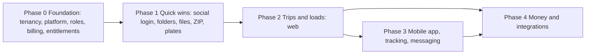

# 13 · Implementation roadmap

Phase 0 is the foundation. Phases 1–4 match the delivery order in the gap report (quick wins, then trips, then mobile, then money), and each one depends on the phase before it.

## Phase 0: Foundation

**Goal:** a company becomes a full tenant, with users, roles, billing and entitlements, while every existing feature keeps working.

**Status: done 21 Oct 2026** (`67bb97c`). Not built and carried over: the driver Terminate action and closing the public application link when `driver_applications` is off (Technical-Features §3). The MySQL 8.0.16 run is still open (14 §3).

| # | Task | Depends on | Docs |
|---|---|---|---|
| 0.1 | Spike. **Permission scale: done** 13 Oct 2026 (06 §2; database-first chosen; composite FK isolation confirmed on MySQL 9.3). **SQLite and MySQL 9.3: done** in WP1 (08 §1: CHECK helper, SQLite alter rule, owner FK placement). Remaining: one run on MySQL 8.0.16 (CI or staging). | — | 06 §2, 08 §1 |
| 0.2 | Schema rebuild of groups A–J and O, plus `stored_files` ([11](11-migration-strategy.md) §3), with the ERD fixes F1–F29 | 0.1 | 08, 09 |
| 0.3 | `CompanyProvisioner`, the registration change (company name), and the platform "create company" | 0.2 | 10 §1 |
| 0.4 | `TenantContext`, `ResolveTenant` (middleware priority before bindings), `BelongsToCompany` scope, `TenantRule`, `TenantAware` job middleware; refactor `CompanyFilterTrait` | 0.2 | 03 |
| 0.5 | Spatie teams with database-first checks: config, extended models, `CatalogueRegistrar` (bound in `AppServiceProvider::boot`), `TenantPermissionResolver`, `hasPermissionTo` overrides, `Gate::before`, permission catalogue, role templates, `RoleService`, `RoleAssignmentService`, `OwnershipService` | 0.4 | 06 |
| 0.6 | Company user management: invitations, users screen, roles screen, per-user grants | 0.5 | 06 §7, 10 §5 |
| 0.7 | Platform guard and `/platform` area: companies, plans, prices, features, overrides, subscriptions, lookups, settings, staff (two-Owner minimum), `EmailIdentityService` (D3a), audit viewer, **Asset Transfer** (PO-08) | 0.5 | 04 |
| 0.8 | Company billing: Stripe customer per company, Prices, checkout, webhook inbox and job, access state, trials, notifications, admin actions | 0.2, 0.7 | 07 |
| 0.9 | Entitlements: feature registry, `Entitlements` service, `feature:` middleware, `@feature`, limits with locking, read-only mode | 0.5, 0.8 | 05 |
| 0.10 | Support sessions: request, **tenant + four-eyes platform approval**, support user, banner, audit, revoke. PO-02 and PO-07 actions run inside a `read_write` session. | 0.7 | 04 §4, §6 |
| 0.11 | Audit log writer and the events in [08](08-database-schema.md) §10 | 0.2 | 08 §10 |
| 0.12 | Fix the bugs found ([01](01-current-architecture-assessment.md) §5) and the P1 performance items ([12](12-performance-plan.md) §2) | 0.2 | 01, 12 |
| 0.13 | Medical certificate and CDL expiry added to the compliance engine (F17) | 0.2 | 09 |
| 0.14 | Test suite: new actors, flipped tests, the new isolation, escalation, entitlement, limit and support suites, and the MySQL CI job | throughout | 11 §5 |

**Acceptance criteria**
- **Isolation.** A route-generated isolation matrix shows that a user of company B gets 404 on every company A id, across every tenant route (web and API).
- **Platform separation.** Platform staff cannot open any tenant route without an approved support session, and every request during a session is audited.
- **Company roles.** A company Owner can invite users, create roles and assign them. Escalation tests pass (grant only what you hold; no self-edit; locked roles).
- **Per-company billing.** Two users of one company share one subscription. A second trial in the same company, or with the same owner email, is refused.
- **Entitlements.** Disabling `maintenance` in a plan blocks the maintenance routes, menus and jobs for every company on that plan within one request, through version invalidation.
- **Limits.** Parallel creates at `max_drivers − 1` produce exactly one success (MySQL CI).
- **Integrity.** The integrity queries return no rows. The full suite passes on SQLite and MySQL. `PermissionScaleTest` (2,000 companies) keeps the resolver p95 under 5 ms.

**Risks**
- **Large refactor of a heavily tested codebase.** Mitigation: the step order in [11](11-migration-strategy.md) §5, with a green suite after each step.
- **Permission scale.** Resolved by measurement: database-first checks ([06](06-roles-permissions.md) §2). The remaining risk is a future change reintroducing global-cache reads; an architecture test and `PermissionScaleTest` guard against it.
- **Open items.** The co-driver question and C7 were closed on 23 Oct 2026 ([14](14-open-questions.md) §2).

## Phase 1: Quick wins

**Status: done 23 Oct 2026** (P1-1 to P1-6 merged by `2331008`, accepted in P1-7; MySQL 9.3: full suite 2,425 passed, `--group=mysql` and `--group=scale` green). Tasks 1.1–1.6 are built; trip folders and the trip ZIP stay in Phase 2 (2.7).

| # | Task | Requirement |
|---|---|---|
| 1.1 | Google and Facebook login and registration, web (Socialite) | 1.4 |
| 1.2 | Folders (system and custom), documents, upload to folder | 2.1–2.3 |
| 1.3 | Image to PDF (queued, keeps the original) | 2.4 |
| 1.4 | ZIP export per driver and per company; the `exports` table and jobs | 2.5 |
| 1.5 | Plate number, plate state and photo on vehicles and trailers | 3.5 |
| 1.6 | Per-user permission grants in the UI (backend done in 0.6) | 1.8 |

**Depends on:** Phase 0.

**Acceptance criteria**
- ✅ A user can create nested custom folders. (`FolderTest`: "nests custom folders inside a DQ file … (acceptance)", "refuses a sixth level")
- ✅ A JPG uploaded to a folder becomes a PDF, and the original is kept. (`ImageToPdfTest`: "converts the photo when the job runs, keeping the image and counting both files")
- ✅ A company ZIP of 200 drivers builds within the target time ([12](12-performance-plan.md) §5). (`ExportScaleTest`, group `scale`, MySQL 9.3: 2,500 entries in 0.8 s, 4.9 MB peak memory growth, 82 queries)
- ✅ Plates appear on the asset lists and details. (`FleetAssetsPlateTest` › "lists and details", vehicles and trailers)

**Risks**
- Facebook app review lead time [L].
- Apple sign-in becomes required once the iOS app ships (Phase 3) [L].

## Phase 2: Trips and loads (web)

| # | Task | Requirement |
|---|---|---|
| 2.1 | Shippers | 4.4 |
| 2.2 | Trips, trip numbers with confirmation, details, stops with the map picker (web), optional pickup | 4.1–4.3, 6.1, 6.3 |
| 2.3 | Assignment and equipment confirmation | 4.5, 4.6 |
| 2.4 | Inspection templates and inspections (web form) | 5.1–5.3 |
| 2.5 | Trip events and fuel purchases with documents (web) | 7.1–7.6 |
| 2.6 | Dashboard counts: on the road, pending pickup | 9.2 |
| 2.7 | ZIP per trip | 2.5 |

**Depends on:** Phase 0; Phase 1 (folders and documents for trip folders and attachments).

**Before it starts:** the open questions and the hooks into P1-4 and P1-6 are listed in [14](14-open-questions.md) §3 ("Before Phase 2").

**Acceptance criteria**
- The trip lifecycle ([10](10-workflows.md) §13) works end-to-end on the web.
- A driver cannot have two in-progress trips.
- Event CHECK rules are enforced.
- Dashboard counts match the trip states.

**Risks**
- Trip vs load resolved: one load per trip (decided Q6).
- Maps API cost and terms [L].

## Phase 3: Mobile app, tracking, messaging

| # | Task | Requirement |
|---|---|---|
| 3.1 | API v1 (Sanctum, `routes/api.php`) with the same middleware stack; driver invitation and login | 1.2 |
| 3.2 | Driver app flows: current location as start, confirm equipment, one-screen pre-trip with progress, "Start driving!", trip folder, continue a trip | 6.2, 6.4, 6.6, 5.2–5.3 |
| 3.3 | Location pings, live map, miles travelled and remaining distance | 6.5, 6.7 |
| 3.4 | Events and fuel from the app, with camera uploads | 7.x |
| 3.5 | Messaging and push notifications (`device_tokens`, FCM/APNs) | 10.2, 10.3 |
| 3.6 | Sign in with Apple (if social login is in the iOS app) | 1.4 [L] |

**Depends on:** Phase 2. The mobile app itself is a separate client workstream [A].

**Acceptance criteria**
- A driver with the Driver role sees only their own trips, through the API as well.
- Ping ingestion meets the target load.
- Push arrives for new messages.

**Risks**
- [L] Notice and consent for employee location tracking.
- App store review.
- Battery and background-location limits on phones.

## Phase 4: Money and integrations

| # | Task | Requirement |
|---|---|---|
| 4.1 | Load pay on trips; driver pay rates (effective-dated) | 8.1, 8.2 |
| 4.2 | Time entries (driving, on duty not driving, break) and timesheets. Overtime uses **daily thresholds** (decided C3): company settings default 8 h → ×1.5 and 12 h → ×2.0, optional weekly threshold, per-driver exemption flag ([08](08-database-schema.md) §11) | 8.4 |
| 4.3 | Expenses; daily profit and loss report | 8.3 |
| 4.4 | Reports and year-end export | 8.5, 8.6 |
| 4.5 | Payroll runs (mileage pay on `paid_miles` + hourly pay on non-driving time; regular-rate overtime premium; employees only). QuickBooks Online: Employees + TimeActivity, plus a payroll summary export (decided C4). | 10.1 |
| 4.6 | Time-off requests | 10.4 |

**Depends on:** Phase 2 (trips, fuel), Phase 3 (time entries from the app).

**Engineering decisions for Phase 4** (product owner instruction: decide after review; evidence in [14](14-open-questions.md) §5)
- **Pay combination (C1).** Mileage pay plus hourly pay on non-driving on-duty time. Hourly-only drivers are paid hourly for all work time. Contractors are excluded from payroll. *Why:* it avoids paying driving time twice, and the existing W-9 fields show contractor drivers exist [V].
- **Overtime (C3).** Configurable daily thresholds and a per-driver exemption. *Why:* daily overtime is state law (California, Alaska, Colorado, Nevada), and many interstate drivers are FLSA Motor Carrier Act exempt, so a single fixed rule would be wrong for many carriers.
- **QuickBooks (C4).** Accounting API for Employees and TimeActivity, plus a payroll summary export. *Why:* Intuit's pay data is in a gated Payroll API.
- **Profit and loss (C2).** Variable costs only.

**Acceptance criteria**
- Profit and loss for a sample day equals a hand calculation over the fixture data.
- Rate changes don't alter past payroll lines.
- `Payroll/OvertimeTest` passes, covering daily thresholds, the midnight split, weekly reclassification without double counting, exempt drivers and the regular-rate premium.
- QuickBooks sync is idempotent (`external_references`).

**Risks**
- [L] Overtime exemption and regular-rate method: client or counsel to confirm.
- [A] Intuit Payroll API terms: re-check at the start of the phase.
- Expense categories still need the client's confirmation.

## Cross-phase work

- Run the `integrity:check` job and its alerting from Phase 0 onwards.
- Update `docs/erd.md` from `erd-proposed.md` once Phase 0 lands, so the current-state diagram matches the code again.
- Feed every new PENDING answer back into [14-open-questions.md](14-open-questions.md) and the decision log in [README.md](README.md).
