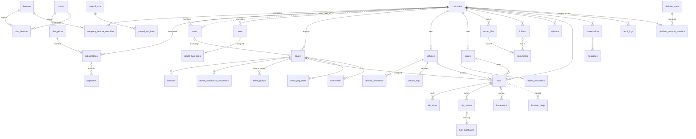
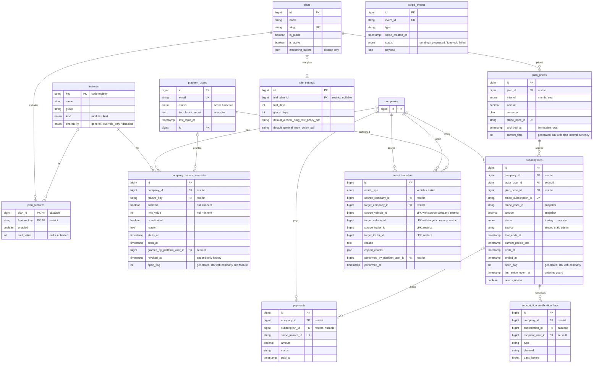
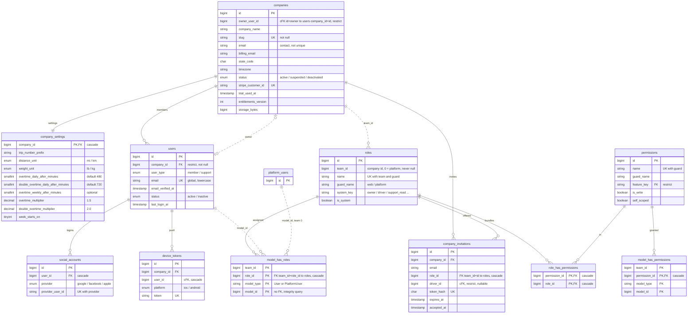
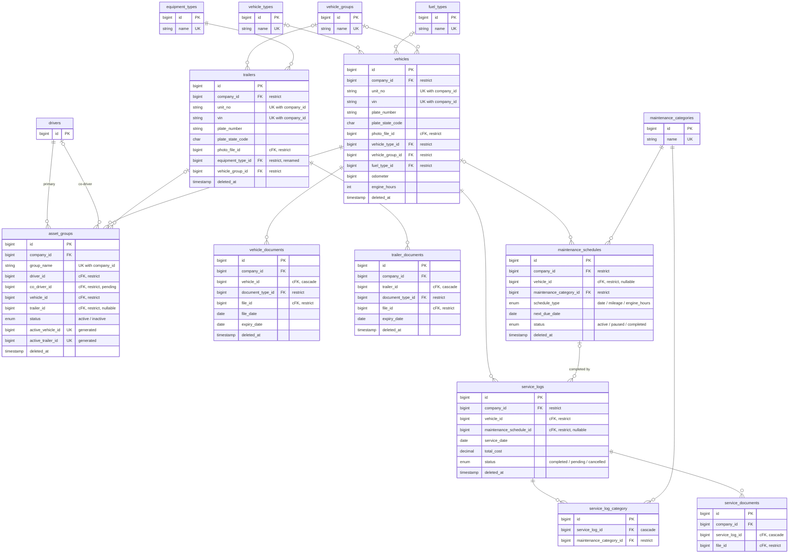
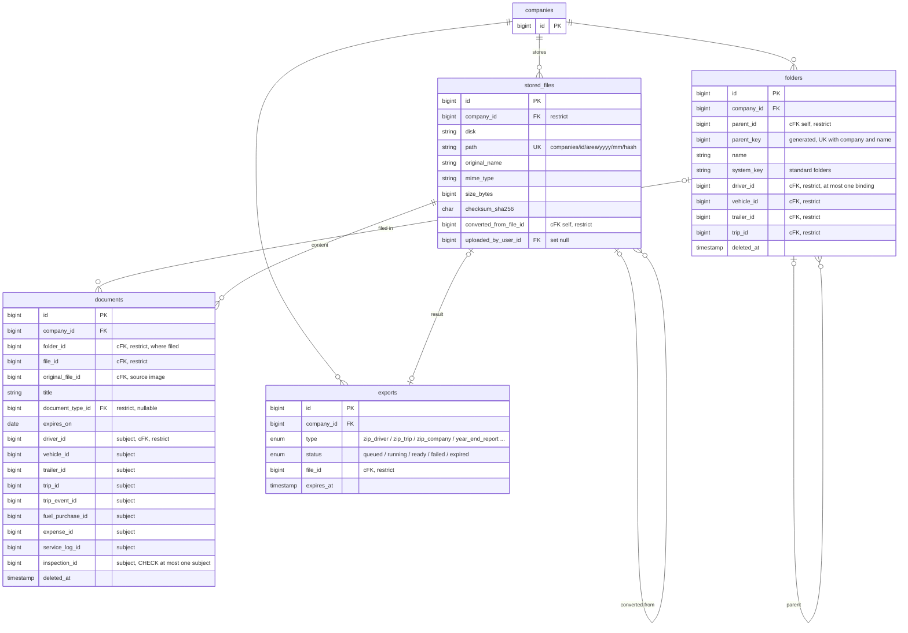
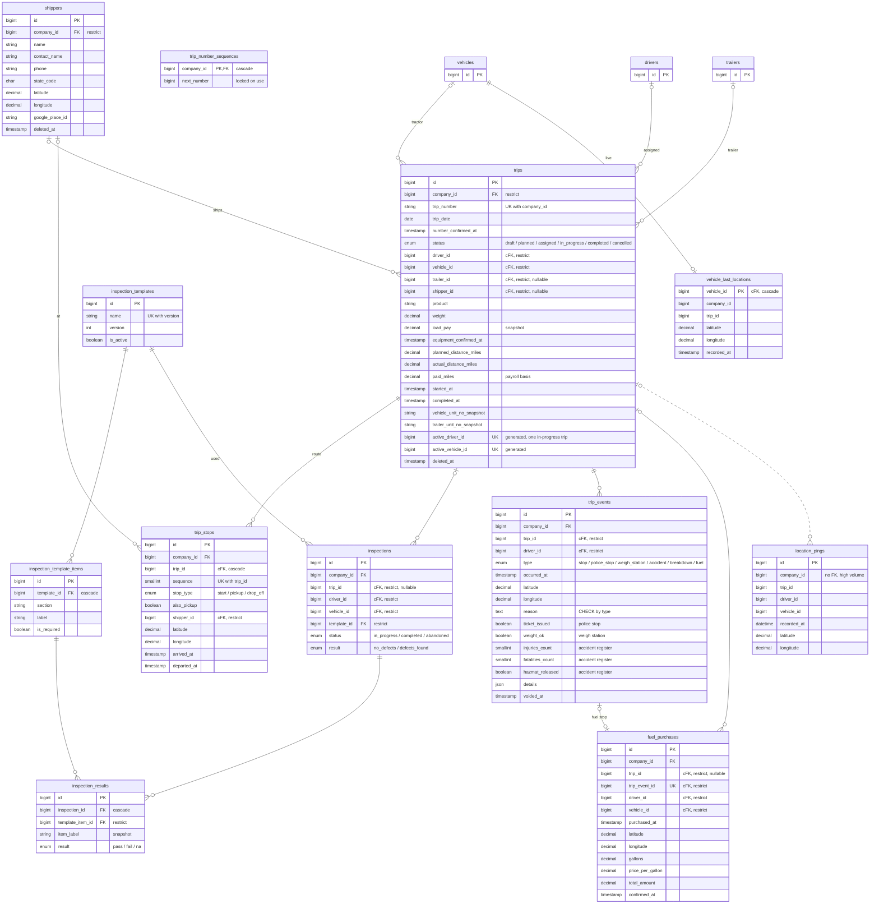
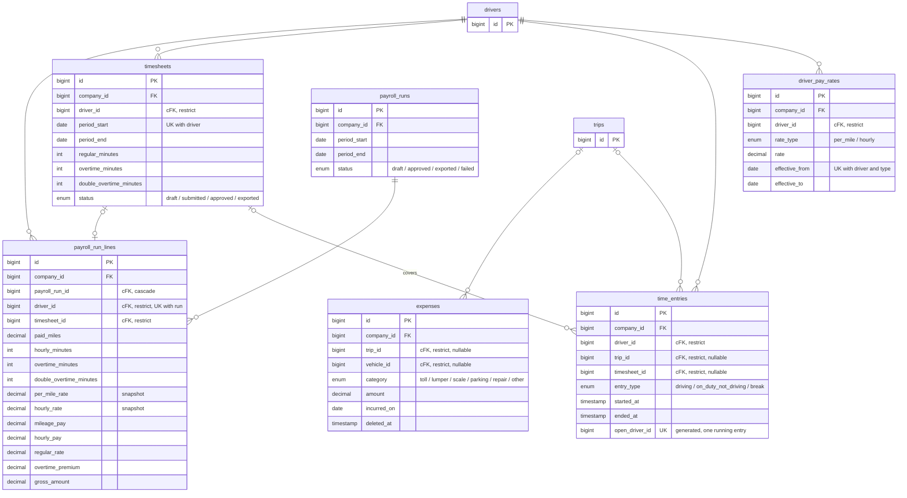
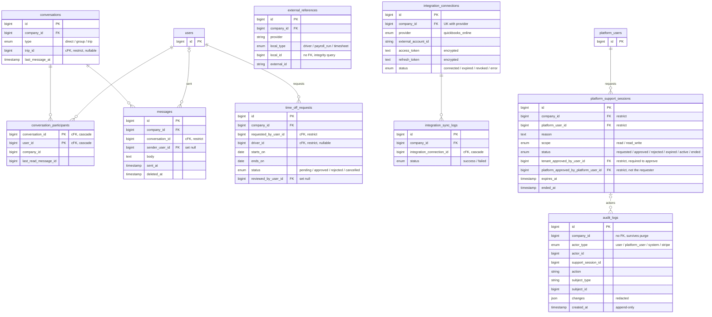

# DriverFilesHub: proposed data model

These diagrams show the **target** schema for the multi-tenant redesign. The built schema is documented in [erd.md](erd.md), so the two can be compared side by side.

- Full column, constraint and index specifications are in [architecture/08-database-schema.md](architecture/08-database-schema.md).
- The reason for each change to an existing table is in [architecture/09-erd-audit.md](architecture/09-erd-audit.md).
- Status: decisions applied 13 October 2026. The Phase 0 tables are built (15 October 2026, see [erd.md](erd.md)); the tables of later phases are not.

## How it fits together

- **Platform tables.** These belong to the SaaS operator, not to any tenant: platform staff, features, plans, prices, Stripe events, support sessions, audit.
- **The company is the tenant.** Every user, driver, asset, trip, file and financial record belongs to exactly one company.
- **Billing belongs to the company:** subscription, payments and feature overrides. The plan's features and limits decide what the company can use.
- **Roles are Spatie roles in the company's team** (`team_id = company_id`). Platform roles live in team 0. Permission checks query these tables directly in the user's own team, with no global role cache.
- **Same-company references are enforced by the database.** References between tenant tables use composite foreign keys `(company_id, x_id)`, so a row cannot point at another company's record.

## Reading the diagrams

| Notation | Meaning |
|---|---|
| `\|\|--o{` | one to zero-or-many (FK required) |
| `\|o--o{` | optional parent (FK nullable) |
| `\|\|--o\|` | one to zero-or-one |
| solid line | enforced by a foreign key |
| dotted line | logical link only (polymorphic, generated column, or no FK on purpose) |
| `cFK` in a comment | composite tenant FK `(company_id, x_id)` to `x(company_id, id)` |
| `PK` `FK` `UK` | primary, foreign, unique key |

Every table also has `created_at` / `updated_at` unless its diagram says otherwise. Every tenant parent has `UNIQUE(company_id, id)`. Neither is drawn.

## Overview

The main business tables, relationships only.

## Platform, plans and billing

## Accounts, tenancy and authorization

## Drivers and the DQ file

```mermaid
erDiagram
  drivers {
    bigint id PK
    bigint company_id FK "restrict"
    bigint created_by_user_id FK "set null"
    bigint user_id UK "cFK login, restrict"
    string first_name
    string last_name
    date date_of_birth
    string ssn "encrypted"
    string main_phone
    string email "UK with company_id"
    bigint photo_file_id "cFK stored_files, restrict"
    char state_code
    enum application_status "draft ... withdrawn"
    enum employment_status "applicant / active / inactive / terminated"
    enum worker_type "employee / contractor"
    boolean overtime_exempt "company decides"
    string source "admin / public_application"
    timestamp hired_at
    date hire_date
    timestamp terminated_at
    bigint decided_by_user_id FK "set null"
    timestamp deleted_at
  }
  licenses {
    bigint id PK
    bigint driver_id FK "restrict"
    string first_name "snapshot as printed"
    string last_name "snapshot as printed"
    date expires
    char state_code
    string class
    string license_number
    boolean is_current
    bigint current_driver_id UK "generated"
  }
  residence_addresses {
    bigint id PK
    bigint driver_id FK "cascade"
    char state_code
    boolean is_current
  }
  experiences {
    bigint id PK
    bigint driver_id FK "cascade"
    string equipment_class
    int approx_miles
  }
  accidents {
    bigint id PK
    bigint driver_id FK "cascade"
    date accident_date
    smallint number_of_injuries
    smallint number_of_fatalities
  }
  violations {
    bigint id PK
    bigint driver_id FK "cascade"
    date violation_date
    string vehicle_type "snapshot text"
  }
  forfeitures {
    bigint id PK
    bigint driver_id FK "cascade"
    boolean denied_license
    boolean license_revoked
  }
  employment_records {
    bigint id PK
    bigint driver_id FK "cascade"
    string employer_name "external, snapshot"
  }
  driver_documents {
    bigint id PK
    bigint driver_id UK "FK cascade, one per driver"
    bigint license_front_file_id FK "restrict"
    bigint medical_card_file_id FK "restrict"
    boolean has_accidents
    boolean has_violations
    string applicant_signature
    date date_signed
  }
  driver_compliance_documents {
    bigint id PK
    bigint company_id FK
    bigint driver_id "cFK, cascade"
    bigint document_type_id FK "restrict"
    bigint file_id "cFK stored_files, restrict"
    date file_date
    date expiry_date
    timestamp deleted_at
  }
  document_types {
    bigint id PK
    string name "UK with module"
    string module "driver / vehicle / trailer"
    string system_key UK
    boolean requires_expiry
  }
  company_document_type {
    bigint id PK
    bigint company_id FK "cascade"
    bigint document_type_id FK "cascade"
  }
  policy_pdfs {
    bigint id PK
    bigint company_id UK "FK restrict, not null"
    bigint alcohol_drug_test_policy_file_id "cFK"
    bigint general_work_policy_file_id "cFK"
  }
  companies {
    bigint id PK
  }
  users {
    bigint id PK
  }
  companies ||--o{ drivers : "employs"
  users |o--o| drivers : "login"
  users |o--o{ drivers : "created by"
  drivers ||--o{ licenses : "holds"
  drivers ||--o{ residence_addresses : "lived at"
  drivers ||--o{ experiences : ""
  drivers ||--o{ accidents : "declared"
  drivers ||--o{ violations : "declared"
  drivers ||--o{ forfeitures : ""
  drivers ||--o{ employment_records : ""
  drivers ||--o| driver_documents : "signed"
  drivers ||--o{ driver_compliance_documents : "files"
  document_types ||--o{ driver_compliance_documents : "typed"
  companies ||--o{ company_document_type : "opts out"
  document_types ||--o{ company_document_type : ""
  companies ||--o| policy_pdfs : "policies"
```

## Fleet and maintenance

## Files, folders and documents

## Trips, inspections, events and tracking

## Money

## Communication, integrations and audit

## Foreign keys and delete rules

What the database does when a parent row is hard-deleted. In normal use tenant data is soft-deleted or deactivated, so most of these rules only matter to the retention purge job. `cFK` is a composite tenant FK.

| Domain | Column | References | Null | On delete |
|---|---|---|---|---|
| Platform | `plan_prices.plan_id` | `plans.id` | required | restrict |
| Platform | `plan_features.plan_id` | `plans.id` | required | cascade |
| Platform | `plan_features.feature_key` | `features.key` | required | restrict |
| Platform | `permissions.feature_key` | `features.key` | nullable | restrict |
| Platform | `site_settings.trial_plan_id` | `plans.id` | nullable | restrict |
| Billing | `company_feature_overrides.company_id` | `companies.id` | required | restrict |
| Billing | `company_feature_overrides.feature_key` | `features.key` | required | restrict |
| Billing | `company_feature_overrides.granted_by_platform_user_id` / `revoked_by_platform_user_id` | `platform_users.id` | nullable | set null |
| Billing | `subscriptions.company_id` | `companies.id` | required | restrict |
| Billing | `subscriptions.plan_price_id` | `plan_prices.id` | required | restrict |
| Billing | `subscriptions.actor_user_id` | `users.id` | nullable | set null |
| Billing | `payments.company_id` | `companies.id` | required | restrict |
| Billing | `payments.subscription_id` | `subscriptions.id` | nullable | restrict |
| Billing | `subscription_notification_logs.subscription_id` | `subscriptions.id` | required | cascade |
| Billing | `subscription_notification_logs.company_id` | `companies.id` | required | restrict |
| Billing | `subscription_notification_logs.recipient_user_id` | `users.id` | nullable | set null |
| Accounts | `companies (id, owner_user_id)` | `users (company_id, id)` | nullable | restrict |
| Accounts | `company_settings.company_id` | `companies.id` | required | cascade |
| Accounts | `users.company_id` | `companies.id` | required | restrict |
| Accounts | `company_invitations (company_id, role_id)` | `roles (team_id, id)` | required | cascade |
| Accounts | `company_invitations` cFK `driver_id` | `drivers` | nullable | restrict |
| Accounts | `company_invitations.invited_by_user_id` / `accepted_user_id` | `users.id` | nullable | set null |
| Accounts | `social_accounts.user_id` | `users.id` | required | cascade |
| Accounts | `device_tokens` cFK `user_id` | `users` | required | cascade |
| Authorization | `model_has_roles (team_id, role_id)` | `roles (team_id, id)` | required | cascade |
| Authorization | `model_has_permissions.permission_id` | `permissions.id` | required | cascade |
| Authorization | `role_has_permissions.role_id` / `permission_id` | `roles.id` / `permissions.id` | required | cascade |
| Drivers | `drivers.company_id` | `companies.id` | required | restrict |
| Drivers | `drivers` cFK `user_id` | `users` | nullable | restrict |
| Drivers | `drivers.created_by_user_id` / `decided_by_user_id` | `users.id` | nullable | set null |
| Drivers | `drivers` cFK `photo_file_id` | `stored_files` | nullable | restrict |
| Drivers | `licenses.driver_id` | `drivers.id` | required | restrict (generated-column base) |
| Drivers | `residence_addresses`, `experiences`, `accidents`, `violations`, `forfeitures`, `employment_records`, `driver_documents` `.driver_id` | `drivers.id` | required | cascade |
| Drivers | `driver_documents.*_file_id` | `stored_files.id` | nullable | restrict |
| Drivers | `driver_compliance_documents` cFK `driver_id` | `drivers` | required | cascade |
| Drivers | `driver_compliance_documents` cFK `file_id` | `stored_files` | required | restrict |
| Drivers | `driver_compliance_documents.document_type_id` | `document_types.id` | required | restrict |
| Drivers | `company_document_type.company_id` / `document_type_id` | `companies.id` / `document_types.id` | required | cascade |
| Drivers | `policy_pdfs.company_id` | `companies.id` | required | restrict |
| Drivers | `policy_pdfs` cFK `*_file_id` | `stored_files` | nullable | restrict |
| Fleet | `vehicles.company_id`, `trailers.company_id` | `companies.id` | required | restrict |
| Fleet | `vehicles.vehicle_type_id` / `vehicle_group_id` / `fuel_type_id` | lookups | nullable | restrict |
| Fleet | `trailers.equipment_type_id` | `equipment_types.id` | required | restrict |
| Fleet | `trailers.vehicle_group_id` | `vehicle_groups.id` | nullable | restrict |
| Fleet | `vehicles` / `trailers` cFK `photo_file_id` | `stored_files` | nullable | restrict |
| Fleet | `asset_groups` cFK `driver_id`, `co_driver_id`, `vehicle_id`, `trailer_id` | `drivers` / `vehicles` / `trailers` | per column | restrict |
| Fleet | `vehicle_documents` cFK `vehicle_id`, `trailer_documents` cFK `trailer_id` | `vehicles` / `trailers` | required | cascade |
| Fleet | `vehicle_documents` / `trailer_documents` cFK `file_id` | `stored_files` | required | restrict |
| Fleet | `vehicle_documents` / `trailer_documents` `.document_type_id` | `document_types.id` | required | restrict |
| Maintenance | `service_logs.company_id` | `companies.id` | required | restrict |
| Maintenance | `service_logs` cFK `vehicle_id` | `vehicles` | required | restrict |
| Maintenance | `service_logs` cFK `maintenance_schedule_id` | `maintenance_schedules` | nullable | restrict |
| Maintenance | `service_log_category.service_log_id` | `service_logs.id` | required | cascade |
| Maintenance | `service_log_category.maintenance_category_id` | `maintenance_categories.id` | required | restrict |
| Maintenance | `service_documents` cFK `service_log_id` | `service_logs` | required | cascade |
| Maintenance | `service_documents` cFK `file_id` | `stored_files` | required | restrict |
| Maintenance | `maintenance_schedules.company_id` | `companies.id` | required | restrict |
| Maintenance | `maintenance_schedules` cFK `vehicle_id` | `vehicles` | nullable | restrict |
| Maintenance | `maintenance_schedules.maintenance_category_id` | `maintenance_categories.id` | required | restrict |
| Files | `stored_files.company_id` | `companies.id` | required | restrict |
| Files | `stored_files` cFK `converted_from_file_id` | `stored_files` | nullable | restrict |
| Files | `stored_files.uploaded_by_user_id` | `users.id` | nullable | set null |
| Files | `folders` cFK `parent_id`, `driver_id`, `vehicle_id`, `trailer_id`, `trip_id` | self / entities | nullable | restrict (CHECK) |
| Files | `documents` cFK `folder_id`, `file_id`, `original_file_id` | `folders` / `stored_files` | per column | restrict |
| Files | `documents` cFK subject columns (9) | entities | nullable | restrict (CHECK) |
| Files | `documents.document_type_id` | `document_types.id` | nullable | restrict |
| Files | `exports` cFK `file_id` | `stored_files` | nullable | restrict |
| Files | `exports.requested_by_user_id` | `users.id` | nullable | set null |
| Operations | `shippers.company_id`, `trips.company_id` | `companies.id` | required | restrict |
| Operations | `trip_number_sequences.company_id` | `companies.id` | required | cascade |
| Operations | `trips` cFK `driver_id`, `vehicle_id`, `trailer_id`, `shipper_id` | entities | nullable | restrict |
| Operations | `trip_stops` cFK `trip_id` | `trips` | required | cascade |
| Operations | `trip_stops` cFK `shipper_id` | `shippers` | nullable | restrict |
| Operations | `inspection_template_items.template_id` | `inspection_templates.id` | required | cascade |
| Operations | `inspections` cFK `trip_id`, `driver_id`, `vehicle_id`, `trailer_id` | entities | per column | restrict |
| Operations | `inspections.template_id` | `inspection_templates.id` | required | restrict |
| Operations | `inspection_results.inspection_id` | `inspections.id` | required | cascade |
| Operations | `inspection_results.template_item_id` | `inspection_template_items.id` | required | restrict |
| Operations | `trip_events` cFK `trip_id`, `driver_id`, `vehicle_id` | entities | per column | restrict |
| Operations | `fuel_purchases` cFK `trip_id`, `trip_event_id`, `driver_id`, `vehicle_id` | entities | per column | restrict |
| Operations | `fuel_purchases.fuel_type_id` | `fuel_types.id` | nullable | restrict |
| Operations | `vehicle_last_locations` cFK `vehicle_id` | `vehicles` | required | cascade |
| Money | `driver_pay_rates`, `timesheets` cFK `driver_id` | `drivers` | required | restrict |
| Money | `time_entries` cFK `driver_id`, `trip_id`, `timesheet_id` | entities | per column | restrict |
| Money | `expenses` cFK `trip_id`, `vehicle_id`, `driver_id` | entities | nullable | restrict |
| Money | `payroll_run_lines` cFK `payroll_run_id` | `payroll_runs` | required | cascade |
| Money | `payroll_run_lines` cFK `driver_id`, `timesheet_id` | entities | per column | restrict |
| Communication | `conversations` cFK `trip_id` | `trips` | nullable | restrict |
| Communication | `conversation_participants` cFK `conversation_id`, `user_id` | `conversations` / `users` | required | cascade |
| Communication | `messages` cFK `conversation_id` | `conversations` | required | restrict |
| Communication | `messages.sender_user_id` | `users.id` | nullable | set null |
| Communication | `time_off_requests` cFK `requested_by_user_id`, `driver_id` | `users` / `drivers` | per column | restrict |
| Communication | `time_off_requests.reviewed_by_user_id` | `users.id` | nullable | set null |
| Integrations | `integration_connections.company_id`, `external_references.company_id` | `companies.id` | required | restrict |
| Integrations | `integration_sync_logs` cFK `integration_connection_id` | `integration_connections` | required | cascade |
| Platform | `platform_support_sessions.company_id` / `platform_user_id` | `companies.id` / `platform_users.id` | required | restrict |
| Platform | `platform_support_sessions.tenant_approved_by_user_id` / `platform_approved_by_platform_user_id` | `users.id` / `platform_users.id` | nullable | restrict (CHECK) |
| Platform | `asset_transfers.source_company_id` / `target_company_id` | `companies.id` | required | restrict |
| Platform | `asset_transfers (source_company_id, source_vehicle_id)` / `(target_company_id, target_vehicle_id)` | `vehicles (company_id, id)` | nullable | restrict (CHECK) |
| Platform | `asset_transfers (source_company_id, source_trailer_id)` / `(target_company_id, target_trailer_id)` | `trailers (company_id, id)` | nullable | restrict (CHECK) |
| Platform | `asset_transfers.performed_by_platform_user_id` | `platform_users.id` | required | restrict |
| Platform | `platform_support_sessions.revoked_by_user_id` | `users.id` | nullable | set null |
| Reference | `states.country_id` | `countries.id` | required | cascade |

`*_by_user_id` columns not listed above are actor pointers, all single-column `set null`. The tables with deliberately **no FK** are `location_pings`, `audit_logs`, `external_references.local_id`, and the Spatie `model_id` columns. The reasons are in [architecture/08-database-schema.md](architecture/08-database-schema.md).

## Open items that affect this diagram

| Item | Effect if decided differently |
|---|---|
| Co-driver (still PENDING) | `asset_groups.co_driver_id` removed |
| Multiple loads per trip (decided: one, Q6) | A `trip_loads` child table holding product, weight and pay, only if the client ever needs it |
