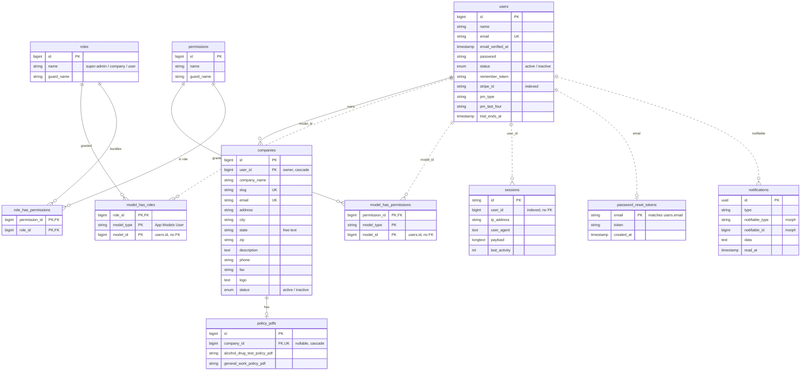
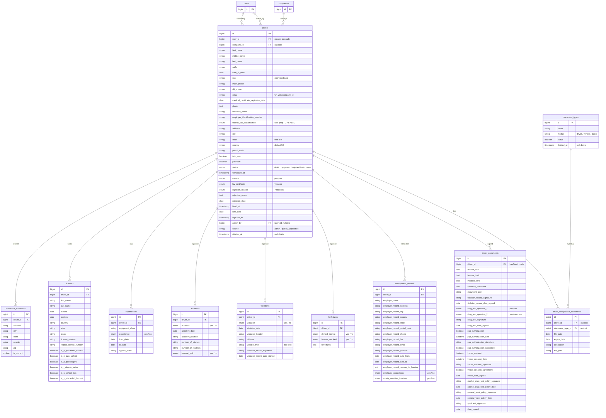
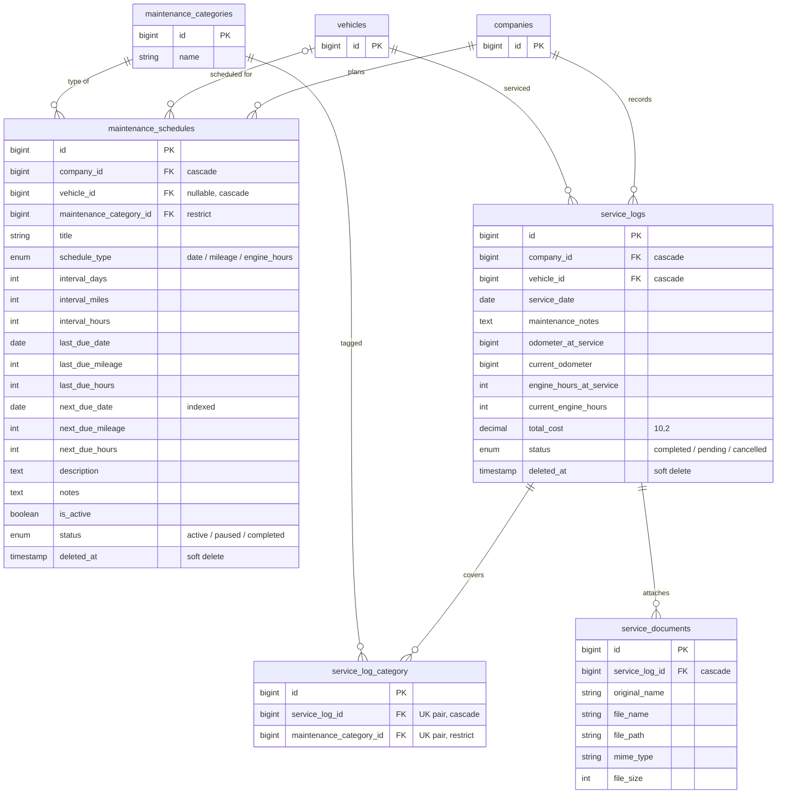
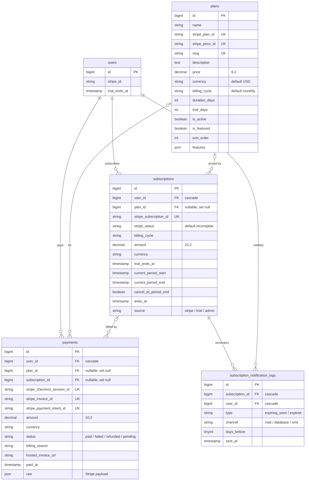
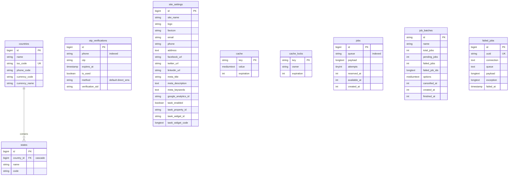

# DriverFilesHub data model

Entity-relationship diagrams for every table in the app, built from `database/migrations` and the relationships in `app/Models` (commit d1d4d8d, 11 October 2026). Update this file when you add or change a migration.

50 tables · 52 foreign keys · 9 soft-delete tables

## How it fits together

The tenant is the **company**. A user owns a company. The company owns drivers, vehicles, trailers, maintenance records and asset groups. Each driver owns their own qualification-file records. Billing hangs off the user. Hard-deleting a user cascades through all of it.

- `users` → `companies` → `drivers` → licenses, accidents, documents …
- `companies` → `vehicles` / `trailers` → documents, service logs, asset groups
- `users` → `subscriptions` → payments, reminder logs

## Reading the diagrams

| Notation | Meaning |
| --- | --- |
| `\|\|--o{` | one to zero-or-many (FK required) |
| `\|o--o{` | optional parent (FK nullable) |
| `\|\|--o\|` | one to zero-or-one (FK unique) |
| solid line | enforced by a foreign-key constraint |
| dotted line | logical link only: polymorphic, by email, or an index with no FK |
| `PK` `FK` `UK` | primary, foreign, unique key |

Every table also has `created_at` and `updated_at` unless its diagram shows otherwise. Those columns are left out to save space.

## Overview

All business tables, relationships only.

```mermaid
erDiagram
  users ||--o{ companies : "owns"
  users ||--o{ drivers : "created by"
  users |o--o{ drivers : "action_by"
  companies ||--o{ drivers : "employs"
  companies ||--o| policy_pdfs : "policies"
  companies ||--o{ company_document_type : "disables"
  document_types ||--o{ company_document_type : "disabled for"
  drivers ||--o{ residence_addresses : ""
  drivers ||--o{ licenses : ""
  drivers ||--o{ experiences : ""
  drivers ||--o{ accidents : ""
  drivers ||--o{ violations : ""
  drivers ||--o{ forfeitures : ""
  drivers ||--o{ employment_records : ""
  drivers ||--o{ driver_documents : ""
  drivers ||--o{ driver_compliance_documents : ""
  document_types ||--o{ driver_compliance_documents : "typed as"
  companies ||--o{ vehicles : "fleet"
  companies ||--o{ trailers : "fleet"
  vehicle_types |o--o{ vehicles : ""
  fuel_types |o--o{ vehicles : ""
  vehicle_groups |o--o{ vehicles : ""
  vehicle_groups |o--o{ trailers : ""
  equipment_types ||--o{ trailers : ""
  companies ||--o{ asset_groups : ""
  drivers ||--o{ asset_groups : "assigned"
  vehicles ||--o{ asset_groups : "assigned"
  trailers |o--o{ asset_groups : "assigned"
  vehicles ||--o{ vehicle_documents : ""
  trailers ||--o{ trailer_documents : ""
  document_types ||--o{ vehicle_documents : "typed as"
  document_types ||--o{ trailer_documents : "typed as"
  companies ||--o{ service_logs : ""
  vehicles ||--o{ service_logs : "serviced"
  service_logs ||--o{ service_log_category : ""
  maintenance_categories ||--o{ service_log_category : ""
  service_logs ||--o{ service_documents : ""
  companies ||--o{ maintenance_schedules : ""
  vehicles |o--o{ maintenance_schedules : ""
  maintenance_categories ||--o{ maintenance_schedules : ""
  users ||--o{ subscriptions : ""
  plans |o--o{ subscriptions : ""
  users ||--o{ payments : ""
  plans |o--o{ payments : ""
  subscriptions |o--o{ payments : ""
  subscriptions ||--o{ subscription_notification_logs : ""
  users ||--o{ subscription_notification_logs : ""
  roles ||--o{ model_has_roles : ""
  users ||..o{ model_has_roles : "morph"
  countries ||--o{ states : ""
```

## Accounts, roles & tenancy

_11 tables_

A **user** registers, is given the `company` role, and owns one **company**. That company is the tenant: almost every business table hangs off `company_id`. Roles come from Spatie Permission, which links to users polymorphically through `model_type` + `model_id`, so the database has no foreign key back to `users`. The three roles seeded are `super-admin`, `company` and `user`.

## Driver qualification file

_13 tables_

This is the core of the product: the driver qualification (DQ) file that 49 CFR §391.51 requires a motor carrier to keep for each driver. A **driver** belongs to a company. `drivers.user_id` holds the user who created the record (the company owner, or an admin). It is not a login for the driver. The application form fills the history tables (addresses, licenses with CDL endorsements, experience, accidents, violations, forfeitures, and employment records), and `driver_documents` holds the signatures and consents (PSP, FMCSA Clearinghouse, drug-test answers, policies). Files uploaded later go in `driver_compliance_documents`, typed by `document_types`.

## Fleet & assets

_13 tables_

Each company owns **vehicles** (power units) and **trailers**. Both are unique per company by unit number and VIN. Four lookup tables classify them. An **asset group** pairs one driver with one vehicle and, optionally, one trailer. `document_types` is a global list shared across modules. `company_document_type` is an opt-out list: each row is a document type that one company has switched off.

```mermaid
erDiagram
  companies {
    bigint id PK
  }
  drivers {
    bigint id PK
  }
  vehicles {
    bigint id PK
    bigint company_id FK "cascade"
    string unit_no "UK with company_id"
    string vin "UK with company_id"
    year year
    string make
    string model
    bigint vehicle_type_id FK "nullable, restrict"
    string owned_by
    string color
    string title_no
    string tire_size
    bigint odometer
    int engine_hours
    int gvw "lbs"
    bigint vehicle_group_id FK "nullable, restrict"
    bigint fuel_type_id FK "nullable, restrict"
    string engine_type
    string transmission
    string suspension
    int no_axles
    enum configuration "conventional / cabover"
    int wheel_base "inches"
    string size_dimension
    text notes
    timestamp deleted_at "soft delete"
  }
  trailers {
    bigint id PK
    bigint company_id FK "cascade"
    string unit_no "UK with company_id"
    string vin "UK with company_id"
    year year
    string make
    string model
    bigint equipment_types_id FK "restrict"
    string owned_by
    string color
    string title_no
    string tire_size
    int gvw "lbs"
    bigint vehicle_group_id FK "nullable, restrict"
    text notes
    timestamp deleted_at "soft delete"
  }
  vehicle_types {
    bigint id PK
    string name
  }
  fuel_types {
    bigint id PK
    string name
  }
  vehicle_groups {
    bigint id PK
    string name
  }
  equipment_types {
    bigint id PK
    string name
  }
  asset_groups {
    bigint id PK
    bigint company_id FK "cascade"
    string group_name
    bigint driver_id FK "cascade"
    string primary_driver_name "copied"
    string primary_driver_phone "copied"
    string primary_driver_email "copied"
    string second_driver_name
    string second_driver_phone
    string second_driver_email
    bigint vehicle_id FK "cascade"
    bigint trailer_id FK "nullable, cascade"
    enum status "active / inactive"
    timestamp deleted_at "soft delete"
  }
  document_types {
    bigint id PK
    string name
    string module "driver / vehicle / trailer"
    boolean status
    timestamp deleted_at "soft delete"
  }
  company_document_type {
    bigint id PK
    bigint company_id FK "UK pair, cascade"
    bigint document_type_id FK "UK pair, cascade"
  }
  vehicle_documents {
    bigint id PK
    bigint vehicle_id FK "cascade"
    bigint document_type_id FK "restrict"
    date expiry_date
    string description
    string file_path
    timestamp deleted_at "soft delete"
  }
  trailer_documents {
    bigint id PK
    bigint trailer_id FK "cascade"
    bigint document_type_id FK "restrict"
    date expiry_date
    string description
    string file_path
    timestamp deleted_at "soft delete"
  }
  companies ||--o{ vehicles : "owns"
  companies ||--o{ trailers : "owns"
  vehicle_types |o--o{ vehicles : "classifies"
  fuel_types |o--o{ vehicles : "fuels"
  vehicle_groups |o--o{ vehicles : "groups"
  vehicle_groups |o--o{ trailers : "groups"
  equipment_types ||--o{ trailers : "classifies"
  companies ||--o{ asset_groups : "owns"
  drivers ||--o{ asset_groups : "drives"
  vehicles ||--o{ asset_groups : "in"
  trailers |o--o{ asset_groups : "in"
  vehicles ||--o{ vehicle_documents : "files"
  trailers ||--o{ trailer_documents : "files"
  document_types ||--o{ vehicle_documents : "typed as"
  document_types ||--o{ trailer_documents : "typed as"
  companies ||--o{ company_document_type : "disables"
  document_types ||--o{ company_document_type : "disabled for"
```

## Maintenance

_7 tables_

**Maintenance schedules** set recurring service by date, mileage or engine hours. A schedule can cover one vehicle or none (company-wide). **Service logs** record completed work on a vehicle. Each log is tagged with one or more categories through the `service_log_category` pivot and can have receipts attached.

## Billing & subscriptions

_5 tables_

Billing is attached to the **user**, not the company. Stripe is the source of truth. `subscriptions` mirrors the Stripe subscription state, and `payments` records each checkout session or invoice. Deleting a plan does not delete history: the plan link is set to null. `subscription_notification_logs` keeps the same expiry reminder from being sent twice. Its unique key is subscription + type + channel + days before.

## Reference data & framework

_9 tables_

These tables stand alone. `countries` and `states` feed dropdowns, but no business table references them: every state and country column elsewhere stores the name as plain text. `otp_verifications` handles phone sign-in codes and `site_settings` is a single-row configuration table. The rest are Laravel's cache and queue tables.

## Foreign keys and delete rules

What the database does when a parent row is hard-deleted. Soft deletes are updates, so they never trigger these rules.

| Domain | Column | References | Null | On delete |
| --- | --- | --- | --- | --- |
| Accounts | `companies.user_id` | `users.id` | required | cascade |
| Accounts | `policy_pdfs.company_id` | `companies.id` | nullable | cascade |
| Accounts | `model_has_roles.role_id` | `roles.id` | required | cascade |
| Accounts | `model_has_permissions.permission_id` | `permissions.id` | required | cascade |
| Accounts | `role_has_permissions.role_id` | `roles.id` | required | cascade |
| Accounts | `role_has_permissions.permission_id` | `permissions.id` | required | cascade |
| Driver file | `drivers.user_id` | `users.id` | required | cascade |
| Driver file | `drivers.company_id` | `companies.id` | required | cascade |
| Driver file | `drivers.action_by` | `users.id` | nullable | no action |
| Driver file | `residence_addresses.driver_id` | `drivers.id` | required | cascade |
| Driver file | `licenses.driver_id` | `drivers.id` | required | cascade |
| Driver file | `experiences.driver_id` | `drivers.id` | required | cascade |
| Driver file | `accidents.driver_id` | `drivers.id` | required | cascade |
| Driver file | `violations.driver_id` | `drivers.id` | required | cascade |
| Driver file | `forfeitures.driver_id` | `drivers.id` | required | cascade |
| Driver file | `employment_records.driver_id` | `drivers.id` | required | cascade |
| Driver file | `driver_documents.driver_id` | `drivers.id` | required | cascade |
| Driver file | `driver_compliance_documents.driver_id` | `drivers.id` | required | cascade |
| Driver file | `driver_compliance_documents.document_type_id` | `document_types.id` | required | restrict |
| Fleet | `vehicles.company_id` | `companies.id` | required | cascade |
| Fleet | `vehicles.vehicle_type_id` | `vehicle_types.id` | nullable | restrict |
| Fleet | `vehicles.vehicle_group_id` | `vehicle_groups.id` | nullable | restrict |
| Fleet | `vehicles.fuel_type_id` | `fuel_types.id` | nullable | restrict |
| Fleet | `trailers.company_id` | `companies.id` | required | cascade |
| Fleet | `trailers.equipment_types_id` | `equipment_types.id` | required | restrict |
| Fleet | `trailers.vehicle_group_id` | `vehicle_groups.id` | nullable | restrict |
| Fleet | `asset_groups.company_id` | `companies.id` | required | cascade |
| Fleet | `asset_groups.driver_id` | `drivers.id` | required | cascade |
| Fleet | `asset_groups.vehicle_id` | `vehicles.id` | required | cascade |
| Fleet | `asset_groups.trailer_id` | `trailers.id` | nullable | cascade |
| Fleet | `vehicle_documents.vehicle_id` | `vehicles.id` | required | cascade |
| Fleet | `vehicle_documents.document_type_id` | `document_types.id` | required | restrict |
| Fleet | `trailer_documents.trailer_id` | `trailers.id` | required | cascade |
| Fleet | `trailer_documents.document_type_id` | `document_types.id` | required | restrict |
| Fleet | `company_document_type.company_id` | `companies.id` | required | cascade |
| Fleet | `company_document_type.document_type_id` | `document_types.id` | required | cascade |
| Maintenance | `maintenance_schedules.company_id` | `companies.id` | required | cascade |
| Maintenance | `maintenance_schedules.vehicle_id` | `vehicles.id` | nullable | cascade |
| Maintenance | `maintenance_schedules.maintenance_category_id` | `maintenance_categories.id` | required | restrict |
| Maintenance | `service_logs.company_id` | `companies.id` | required | cascade |
| Maintenance | `service_logs.vehicle_id` | `vehicles.id` | required | cascade |
| Maintenance | `service_log_category.service_log_id` | `service_logs.id` | required | cascade |
| Maintenance | `service_log_category.maintenance_category_id` | `maintenance_categories.id` | required | restrict |
| Maintenance | `service_documents.service_log_id` | `service_logs.id` | required | cascade |
| Billing | `subscriptions.user_id` | `users.id` | required | cascade |
| Billing | `subscriptions.plan_id` | `plans.id` | nullable | set null |
| Billing | `payments.user_id` | `users.id` | required | cascade |
| Billing | `payments.plan_id` | `plans.id` | nullable | set null |
| Billing | `payments.subscription_id` | `subscriptions.id` | nullable | set null |
| Billing | `subscription_notification_logs.subscription_id` | `subscriptions.id` | required | cascade |
| Billing | `subscription_notification_logs.user_id` | `users.id` | required | cascade |
| Reference | `states.country_id` | `countries.id` | required | cascade |

## Known mismatches between schema and code

As of commit d1d4d8d. Remove each item from this list once it is fixed.

- **Broken relation:** `MaintenanceSchedule::serviceLogs()` (`app/Models/MaintenanceSchedule.php`) uses `maintenance_schedule_id`, which `service_logs` doesn't have. Calling it fails with an unknown-column error.
- **Delete blocker:** `drivers.action_by` has no on-delete rule, so a user who approved or rejected a driver can't be hard-deleted while that driver exists.
- **hasOne without a unique constraint:** `User::company`, `Driver::driverDocument`, `Vehicle::assetGroup` and `Trailer::assetGroup` are `hasOne`, but the matching foreign-key columns aren't unique. If a duplicate row is created, Eloquent silently returns only one of them.
- **Unlinked lookups:** no table references `countries` or `states`. Country and state names are stored as text in `drivers`, `companies`, `licenses`, `residence_addresses` and `employment_records`. `violations.vehicle_type` is also free text.
- **Copied data:** `asset_groups` copies the primary driver's name, phone and email alongside `driver_id`.
- **FK without a model relation:** `Company` has no `drivers()`, `assetGroups()`, `serviceLogs()`, `maintenanceSchedules()` or `policyPdf()`, and `Driver` has no relation for `action_by`.
