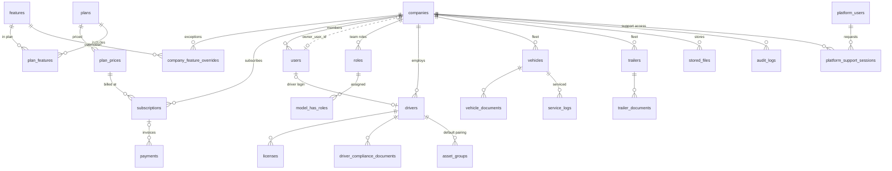
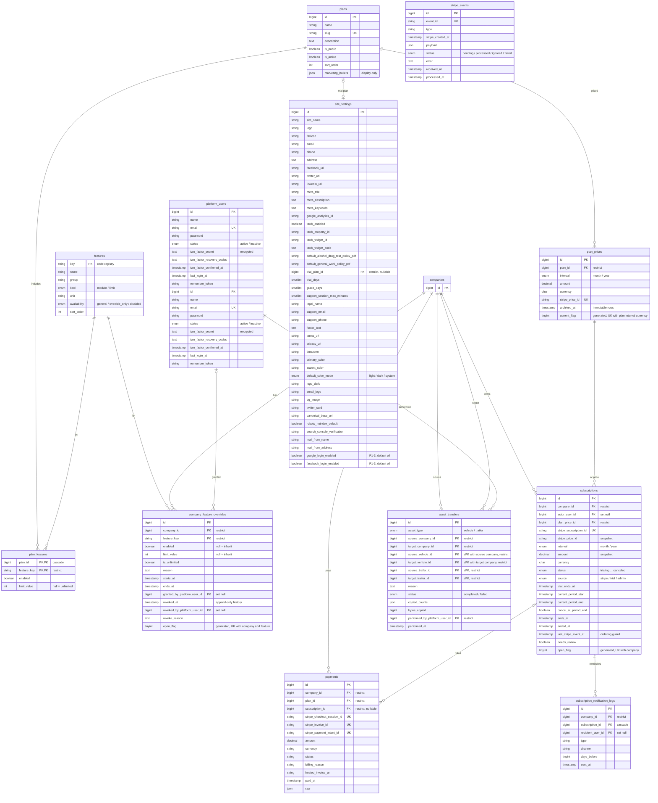
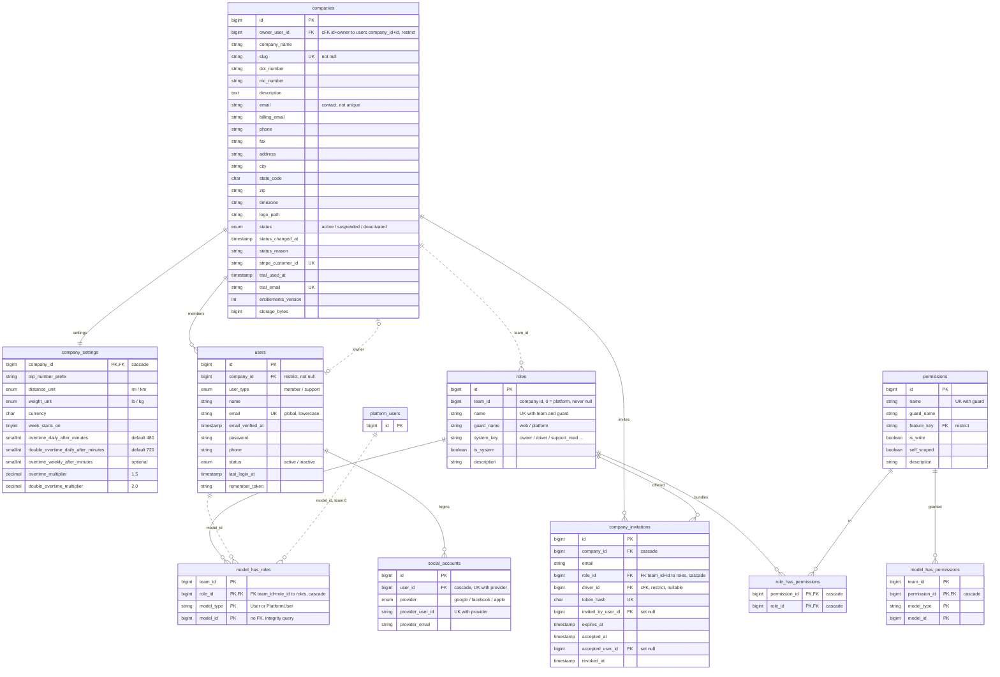
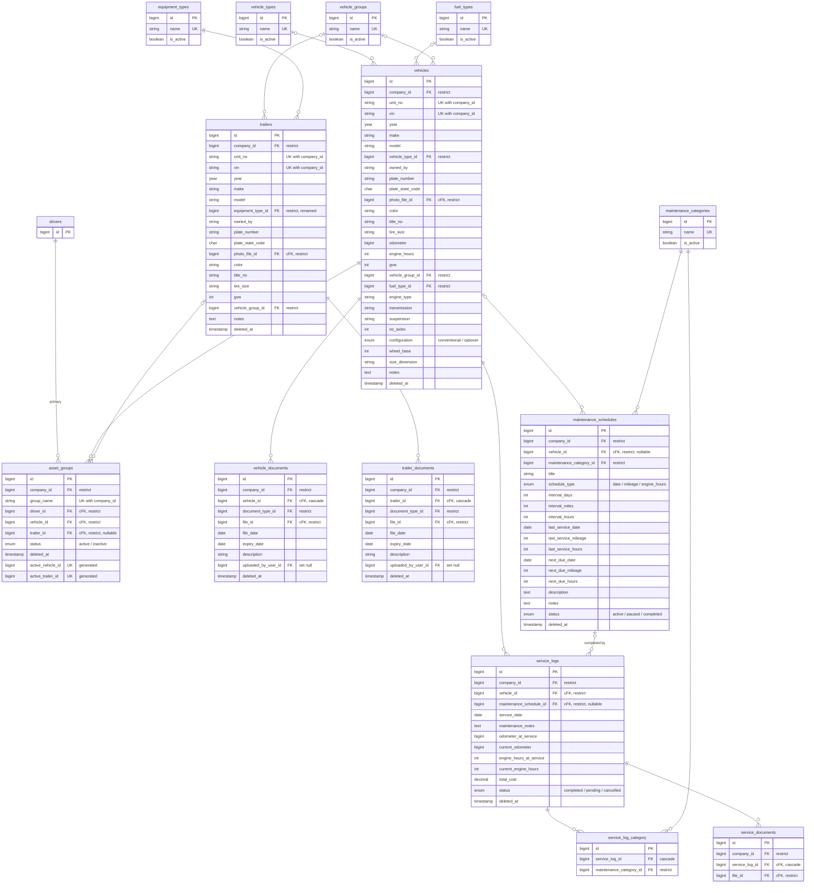
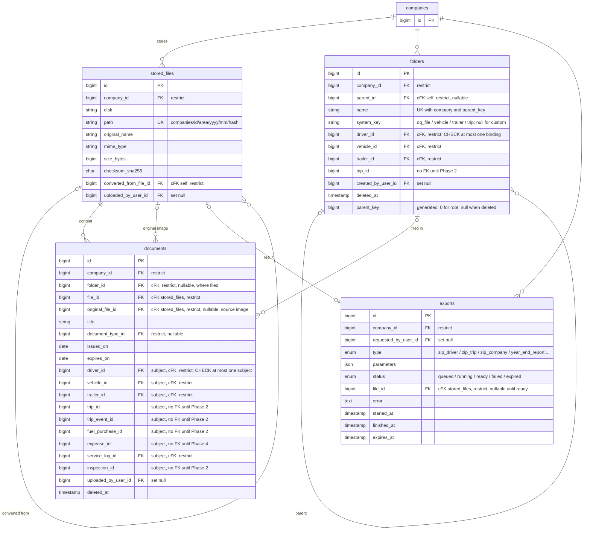
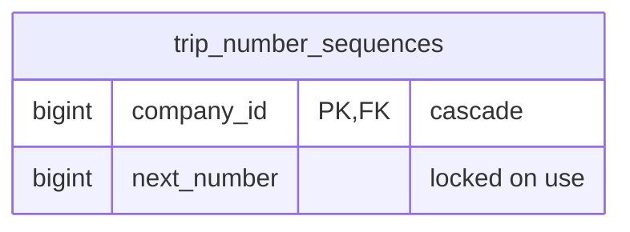
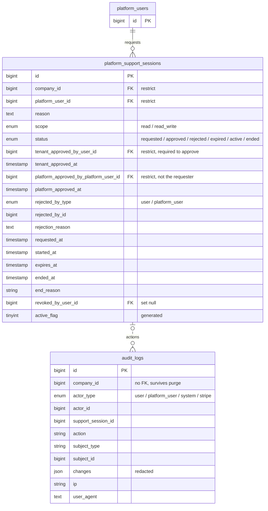
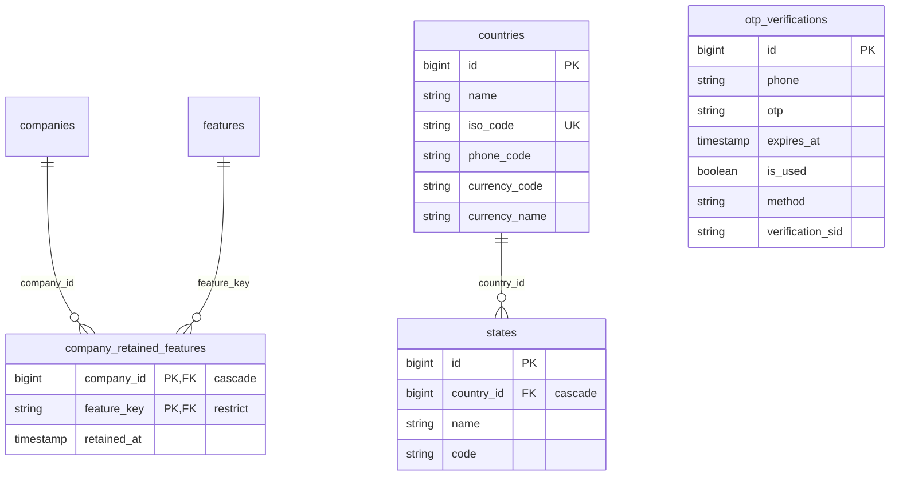

# DriverFilesHub data model

Entity-relationship diagrams for every table the migrations build, read from a migrated MySQL schema (`information_schema`, commit 82b0468, 15 October 2026; Phase 1 tables added from commit 2331008, 23 October 2026) and laid out like [erd-proposed.md](erd-proposed.md), the target design. Update this file when you add or change a migration.

76 tables (66 without the framework tables) · 133 foreign keys (131 listed below; the two of the public-site tables are not) · 12 soft-delete tables. The Phase 0 and Phase 1 tables of the redesign are built; the tables of later phases are listed under [Not built yet](#not-built-yet). The public-site tables (`pages`, `posts`, `faqs`, `testimonials`, `footer_settings`, `demo_requests`, 20–21 October 2026) are built but not drawn yet.

- Full column, constraint and index specifications are in [architecture/08-database-schema.md](architecture/08-database-schema.md).
- The reason for each change to an earlier table is in [architecture/09-erd-audit.md](architecture/09-erd-audit.md).

## How it fits together

- **Platform tables.** These belong to the SaaS operator, not to any tenant: platform staff, features, plans, prices, Stripe events, support sessions, asset transfers, audit.
- **The company is the tenant.** Every user, driver, asset, maintenance record and stored file belongs to exactly one company.
- **Billing belongs to the company:** subscription, payments and feature overrides. The plan's features and limits decide what the company can use.
- **Roles are Spatie roles in the company's team** (`team_id = company_id`). Platform roles live in team 0. Permission checks query these tables directly in the user's own team, with no global role cache.
- **Same-company references are enforced by the database.** References between tenant tables use composite foreign keys `(company_id, x_id)`, so a row cannot point at another company's record.
- **Files are rows.** Every upload is a `stored_files` row on the private disk, referenced by `*_file_id` with `restrict`, and counted in `companies.storage_bytes`.

## Reading the diagrams

| Notation | Meaning |
|---|---|
| `\|\|--o{` | one to zero-or-many (FK required) |
| `\|o--o{` | optional parent (FK nullable) |
| `\|\|--o\|` | one to zero-or-one |
| solid line | enforced by a foreign key |
| dotted line | logical link only (polymorphic, generated column, or no FK on purpose) |
| `cFK` in a comment | composite tenant FK `(company_id, x_id)` to `x(company_id, id)` |
| `PK` `FK` `UK` | primary, foreign, unique key |

Every table also has `created_at` / `updated_at` unless its diagram says otherwise. Every tenant parent has `UNIQUE(company_id, id)`. Neither is drawn.

Every column that the migrations create is drawn. A comment on an FK column gives its delete rule.

## Overview

The main business tables, relationships only.

## Platform, plans and billing

## Accounts, tenancy and authorization

## Drivers and the DQ file

```mermaid
erDiagram
  drivers {
    bigint id PK
    bigint company_id FK "restrict"
    bigint created_by_user_id FK "set null"
    bigint user_id FK, UK "cFK login, restrict"
    string first_name
    string middle_name
    string last_name
    string suffix
    date date_of_birth
    text ssn "encrypted"
    string main_phone
    string alt_phone
    string email "UK with company_id"
    bigint photo_file_id FK "cFK stored_files, restrict"
    string business_name
    string employer_identification_number
    enum federal_tax_classification "individual_sole_proprietor / c_corporation / s_corporation / llc"
    string address
    string city
    char state_code
    char country_code
    string postal_code
    boolean twic_card
    boolean passport
    boolean hazmat
    boolean lcv_certificate
    enum worker_type "employee / contractor"
    boolean overtime_exempt "company decides"
    enum overtime_exempt_basis "motor_carrier_act / other"
    enum application_status "draft ... withdrawn"
    enum employment_status "applicant / active / inactive / terminated"
    enum source "admin / public_application"
    timestamp withdrawn_at
    enum rejection_reason "not_good_fit / failed_drug_test / background_check_issues / cdl_issues / mvr_issues / psp_issues / other"
    text rejection_notes
    timestamp rejected_at
    timestamp hired_at
    date hire_date
    timestamp terminated_at
    date termination_date
    bigint decided_by_user_id FK "set null"
    timestamp deleted_at
  }
  licenses {
    bigint id PK
    bigint driver_id FK "restrict"
    string first_name "snapshot as printed"
    string last_name "snapshot as printed"
    date issued
    date expires
    char country_code
    char state_code
    string class
    string license_number
    boolean is_h_placarded_hazmat
    boolean is_n_tank_vehicle
    boolean is_p_passengers
    boolean is_t_double_trailer
    boolean is_s_school_bus
    boolean is_x_placarded_hazmat
    boolean is_current
    bigint current_driver_id UK "generated"
  }
  residence_addresses {
    bigint id PK
    bigint driver_id FK "cascade"
    string address
    string city
    char state_code
    char country_code
    string zip
    boolean is_current
  }
  experiences {
    bigint id PK
    bigint driver_id FK "cascade"
    string equipment_class
    boolean experience
    date from_date
    date to_date
    int approx_miles
  }
  accidents {
    bigint id PK
    bigint driver_id FK "cascade"
    date accident_date
    string accident_location
    smallint number_of_injuries
    smallint number_of_fatalities
    boolean hazmat_spill
  }
  violations {
    bigint id PK
    bigint driver_id FK "cascade"
    date violation_date
    string violation_location
    string offense
    string vehicle_type "snapshot text"
  }
  forfeitures {
    bigint id PK
    bigint driver_id FK "cascade"
    boolean denied_license
    boolean license_revoked
    text forfeitures
  }
  employment_records {
    bigint id PK
    bigint driver_id FK "cascade"
    string employer_name "external, snapshot"
    string employer_record_address
    string employer_record_city
    char employer_record_country_code
    char employer_record_state_code
    string employer_record_postal_code
    string employer_record_phone
    string employer_record_fax
    string employer_record_email
    string employer_record_position
    date employer_record_date_from
    date employer_record_date_to
    text employer_record_reason_for_leaving
    boolean employed_regulations
    boolean safety_sensitive_function
  }
  driver_documents {
    bigint id PK
    bigint driver_id FK, UK "FK cascade, one per driver"
    bigint license_front_file_id FK "restrict"
    bigint license_back_file_id FK "restrict"
    bigint medical_card_file_id FK "restrict"
    bigint forfeiture_document_file_id FK "restrict"
    boolean has_accidents
    boolean has_violations
    string violation_record_signature
    date violation_record_date_signed
    enum drug_test_question_1 "yes / no"
    enum drug_test_question_2 "yes / no / n/a"
    string drug_test_signature
    date drug_test_date_signed
    boolean psp_authorization
    timestamp psp_authorization_date
    string psp_authorization_signature
    boolean psp_authorization_agreement
    boolean fmcsa_consent
    timestamp fmcsa_consent_date
    string fmcsa_consent_signature
    boolean fmcsa_consent_agreement
    date fmcsa_date_signed
    string alcohol_drug_test_policy_signature
    date alcohol_drug_test_policy_date
    string general_work_policy_signature
    date general_work_policy_date
    string applicant_signature
    date date_signed
  }
  driver_compliance_documents {
    bigint id PK
    bigint company_id FK "restrict"
    bigint driver_id FK "cFK, cascade"
    bigint document_type_id FK "restrict"
    bigint file_id FK "cFK stored_files, restrict"
    date file_date
    date expiry_date
    string description
    bigint uploaded_by_user_id FK "set null"
    timestamp deleted_at
  }
  document_types {
    bigint id PK
    string name "UK with module"
    string module "driver / vehicle / trailer"
    string system_key UK
    boolean requires_expiry
    boolean status
    timestamp deleted_at
  }
  company_document_type {
    bigint id PK
    bigint company_id FK "cascade"
    bigint document_type_id FK "cascade"
  }
  policy_pdfs {
    bigint id PK
    bigint company_id FK, UK "FK restrict, not null"
    bigint alcohol_drug_test_policy_file_id FK "cFK"
    bigint general_work_policy_file_id FK "cFK"
  }
  companies {
    bigint id PK
  }
  users {
    bigint id PK
  }
  companies ||--o{ drivers : "employs"
  users |o--o| drivers : "login"
  users |o--o{ drivers : "created by"
  drivers ||--o{ licenses : "holds"
  drivers ||--o{ residence_addresses : "lived at"
  drivers ||--o{ experiences : ""
  drivers ||--o{ accidents : "declared"
  drivers ||--o{ violations : "declared"
  drivers ||--o{ forfeitures : ""
  drivers ||--o{ employment_records : ""
  drivers ||--o| driver_documents : "signed"
  drivers ||--o{ driver_compliance_documents : "files"
  document_types ||--o{ driver_compliance_documents : "typed"
  companies ||--o{ company_document_type : "opts out"
  document_types ||--o{ company_document_type : ""
  companies ||--o| policy_pdfs : "policies"
```

## Fleet and maintenance

## Files, folders and documents

`folders` and `documents` also reference `drivers`, `vehicles`, `trailers` (and `documents` `service_logs` and `document_types`) through the keys above; those links are in the delete-rule table below.

## Trips, inspections, events and tracking

## Communication, integrations and audit

## Built tables not in the proposal

Lookups and support tables that the build added beside the design.

Framework tables, not drawn: `cache`, `cache_locks`, `failed_jobs`, `job_batches`, `jobs`, `migrations`, `notifications`, `password_reset_tokens`, `platform_password_reset_tokens`, `sessions`.

## Foreign keys and delete rules

What the database does when a parent row is hard-deleted, as built. In normal use tenant data is soft-deleted or deactivated, so most of these rules only matter to the retention purge job. `cFK` is a composite tenant FK `(company_id, x_id)` to `x (company_id, id)`.

| Area | Column | References | Null | On delete |
|---|---|---|---|---|
| Accounts | `company_invitations.accepted_user_id` | `users.id` | nullable | set null |
| Accounts | `company_invitations.company_id` | `companies.id` | required | cascade |
| Accounts | `company_invitations` cFK `driver_id` | `drivers` | nullable | restrict |
| Accounts | `company_invitations` cFK `role_id` | `roles` | required | cascade |
| Accounts | `company_invitations.invited_by_user_id` | `users.id` | nullable | set null |
| Accounts | `company_settings.company_id` | `companies.id` | required | cascade |
| Accounts | `model_has_permissions.permission_id` | `permissions.id` | required | cascade |
| Accounts | `model_has_roles` cFK `role_id` | `roles` | required | cascade |
| Accounts | `permissions.feature_key` | `features.key` | nullable | restrict |
| Accounts | `role_has_permissions.permission_id` | `permissions.id` | required | cascade |
| Accounts | `role_has_permissions.role_id` | `roles.id` | required | cascade |
| Accounts | `users.company_id` | `companies.id` | required | restrict |
| Accounts | `social_accounts.user_id` | `users.id` | required | cascade |
| Communication | `platform_support_sessions.company_id` | `companies.id` | required | restrict |
| Communication | `platform_support_sessions.platform_approved_by_platform_user_id` | `platform_users.id` | nullable | restrict |
| Communication | `platform_support_sessions.platform_user_id` | `platform_users.id` | required | restrict |
| Communication | `platform_support_sessions.revoked_by_user_id` | `users.id` | nullable | set null |
| Communication | `platform_support_sessions.tenant_approved_by_user_id` | `users.id` | nullable | restrict |
| Drivers | `accidents.driver_id` | `drivers.id` | required | cascade |
| Drivers | `company_document_type.company_id` | `companies.id` | required | cascade |
| Drivers | `company_document_type.document_type_id` | `document_types.id` | required | cascade |
| Drivers | `driver_compliance_documents.company_id` | `companies.id` | required | restrict |
| Drivers | `driver_compliance_documents` cFK `driver_id` | `drivers` | required | cascade |
| Drivers | `driver_compliance_documents` cFK `file_id` | `stored_files` | required | restrict |
| Drivers | `driver_compliance_documents.document_type_id` | `document_types.id` | required | restrict |
| Drivers | `driver_compliance_documents.uploaded_by_user_id` | `users.id` | nullable | set null |
| Drivers | `driver_documents.driver_id` | `drivers.id` | required | cascade |
| Drivers | `driver_documents.forfeiture_document_file_id` | `stored_files.id` | nullable | restrict |
| Drivers | `driver_documents.license_back_file_id` | `stored_files.id` | nullable | restrict |
| Drivers | `driver_documents.license_front_file_id` | `stored_files.id` | nullable | restrict |
| Drivers | `driver_documents.medical_card_file_id` | `stored_files.id` | nullable | restrict |
| Drivers | `drivers.company_id` | `companies.id` | required | restrict |
| Drivers | `drivers` cFK `photo_file_id` | `stored_files` | nullable | restrict |
| Drivers | `drivers` cFK `user_id` | `users` | nullable | restrict |
| Drivers | `drivers.created_by_user_id` | `users.id` | nullable | set null |
| Drivers | `drivers.decided_by_user_id` | `users.id` | nullable | set null |
| Drivers | `employment_records.driver_id` | `drivers.id` | required | cascade |
| Drivers | `experiences.driver_id` | `drivers.id` | required | cascade |
| Drivers | `forfeitures.driver_id` | `drivers.id` | required | cascade |
| Drivers | `licenses.driver_id` | `drivers.id` | required | restrict |
| Drivers | `policy_pdfs.company_id` | `companies.id` | required | restrict |
| Drivers | `policy_pdfs` cFK `alcohol_drug_test_policy_file_id` | `stored_files` | nullable | restrict |
| Drivers | `policy_pdfs` cFK `general_work_policy_file_id` | `stored_files` | nullable | restrict |
| Drivers | `residence_addresses.driver_id` | `drivers.id` | required | cascade |
| Drivers | `violations.driver_id` | `drivers.id` | required | cascade |
| Files | `stored_files.company_id` | `companies.id` | required | restrict |
| Files | `stored_files` cFK `converted_from_file_id` | `stored_files` | nullable | restrict |
| Files | `stored_files.uploaded_by_user_id` | `users.id` | nullable | set null |
| Files | `folders.company_id` | `companies.id` | required | restrict |
| Files | `folders` cFK `parent_id` | `folders` | nullable | restrict |
| Files | `folders` cFK `driver_id` | `drivers` | nullable | restrict |
| Files | `folders` cFK `vehicle_id` | `vehicles` | nullable | restrict |
| Files | `folders` cFK `trailer_id` | `trailers` | nullable | restrict |
| Files | `folders.created_by_user_id` | `users.id` | nullable | set null |
| Files | `documents.company_id` | `companies.id` | required | restrict |
| Files | `documents` cFK `folder_id` | `folders` | nullable | restrict |
| Files | `documents` cFK `file_id` | `stored_files` | required | restrict |
| Files | `documents` cFK `original_file_id` | `stored_files` | nullable | restrict |
| Files | `documents` cFK `driver_id` | `drivers` | nullable | restrict |
| Files | `documents` cFK `vehicle_id` | `vehicles` | nullable | restrict |
| Files | `documents` cFK `trailer_id` | `trailers` | nullable | restrict |
| Files | `documents` cFK `service_log_id` | `service_logs` | nullable | restrict |
| Files | `documents.document_type_id` | `document_types.id` | nullable | restrict |
| Files | `documents.uploaded_by_user_id` | `users.id` | nullable | set null |
| Files | `exports.company_id` | `companies.id` | required | restrict |
| Files | `exports` cFK `file_id` | `stored_files` | nullable | restrict |
| Files | `exports.requested_by_user_id` | `users.id` | nullable | set null |
| Fleet | `asset_groups.company_id` | `companies.id` | required | restrict |
| Fleet | `asset_groups` cFK `driver_id` | `drivers` | required | restrict |
| Fleet | `asset_groups` cFK `trailer_id` | `trailers` | nullable | restrict |
| Fleet | `asset_groups` cFK `vehicle_id` | `vehicles` | required | restrict |
| Fleet | `maintenance_schedules.company_id` | `companies.id` | required | restrict |
| Fleet | `maintenance_schedules` cFK `vehicle_id` | `vehicles` | nullable | restrict |
| Fleet | `maintenance_schedules.maintenance_category_id` | `maintenance_categories.id` | required | restrict |
| Fleet | `service_documents.company_id` | `companies.id` | required | restrict |
| Fleet | `service_documents` cFK `file_id` | `stored_files` | required | restrict |
| Fleet | `service_documents` cFK `service_log_id` | `service_logs` | required | cascade |
| Fleet | `service_log_category.maintenance_category_id` | `maintenance_categories.id` | required | restrict |
| Fleet | `service_log_category.service_log_id` | `service_logs.id` | required | cascade |
| Fleet | `service_logs.company_id` | `companies.id` | required | restrict |
| Fleet | `service_logs` cFK `maintenance_schedule_id` | `maintenance_schedules` | nullable | restrict |
| Fleet | `service_logs` cFK `vehicle_id` | `vehicles` | required | restrict |
| Fleet | `trailer_documents.company_id` | `companies.id` | required | restrict |
| Fleet | `trailer_documents` cFK `file_id` | `stored_files` | required | restrict |
| Fleet | `trailer_documents` cFK `trailer_id` | `trailers` | required | cascade |
| Fleet | `trailer_documents.document_type_id` | `document_types.id` | required | restrict |
| Fleet | `trailer_documents.uploaded_by_user_id` | `users.id` | nullable | set null |
| Fleet | `trailers.company_id` | `companies.id` | required | restrict |
| Fleet | `trailers` cFK `photo_file_id` | `stored_files` | nullable | restrict |
| Fleet | `trailers.equipment_type_id` | `equipment_types.id` | required | restrict |
| Fleet | `trailers.vehicle_group_id` | `vehicle_groups.id` | nullable | restrict |
| Fleet | `vehicle_documents.company_id` | `companies.id` | required | restrict |
| Fleet | `vehicle_documents` cFK `file_id` | `stored_files` | required | restrict |
| Fleet | `vehicle_documents` cFK `vehicle_id` | `vehicles` | required | cascade |
| Fleet | `vehicle_documents.document_type_id` | `document_types.id` | required | restrict |
| Fleet | `vehicle_documents.uploaded_by_user_id` | `users.id` | nullable | set null |
| Fleet | `vehicles.company_id` | `companies.id` | required | restrict |
| Fleet | `vehicles` cFK `photo_file_id` | `stored_files` | nullable | restrict |
| Fleet | `vehicles.fuel_type_id` | `fuel_types.id` | nullable | restrict |
| Fleet | `vehicles.vehicle_group_id` | `vehicle_groups.id` | nullable | restrict |
| Fleet | `vehicles.vehicle_type_id` | `vehicle_types.id` | nullable | restrict |
| Platform | `asset_transfers.performed_by_platform_user_id` | `platform_users.id` | required | restrict |
| Platform | `asset_transfers.source_company_id` | `companies.id` | required | restrict |
| Platform | `asset_transfers (source_company_id, source_trailer_id)` | `trailers (company_id, id)` | nullable | restrict |
| Platform | `asset_transfers (source_company_id, source_vehicle_id)` | `vehicles (company_id, id)` | nullable | restrict |
| Platform | `asset_transfers.target_company_id` | `companies.id` | required | restrict |
| Platform | `asset_transfers (target_company_id, target_trailer_id)` | `trailers (company_id, id)` | nullable | restrict |
| Platform | `asset_transfers (target_company_id, target_vehicle_id)` | `vehicles (company_id, id)` | nullable | restrict |
| Platform | `companies (id, owner_user_id)` | `users (company_id, id)` | nullable | restrict |
| Platform | `company_feature_overrides.company_id` | `companies.id` | required | restrict |
| Platform | `company_feature_overrides.feature_key` | `features.key` | required | restrict |
| Platform | `company_feature_overrides.granted_by_platform_user_id` | `platform_users.id` | nullable | set null |
| Platform | `company_feature_overrides.revoked_by_platform_user_id` | `platform_users.id` | nullable | set null |
| Platform | `payments.company_id` | `companies.id` | required | restrict |
| Platform | `payments.plan_id` | `plans.id` | nullable | restrict |
| Platform | `payments.subscription_id` | `subscriptions.id` | nullable | restrict |
| Platform | `plan_features.feature_key` | `features.key` | required | restrict |
| Platform | `plan_features.plan_id` | `plans.id` | required | cascade |
| Platform | `plan_prices.plan_id` | `plans.id` | required | restrict |
| Platform | `site_settings.trial_plan_id` | `plans.id` | nullable | restrict |
| Platform | `subscription_notification_logs.company_id` | `companies.id` | required | restrict |
| Platform | `subscription_notification_logs.recipient_user_id` | `users.id` | nullable | set null |
| Platform | `subscription_notification_logs.subscription_id` | `subscriptions.id` | required | cascade |
| Platform | `subscriptions.actor_user_id` | `users.id` | nullable | set null |
| Platform | `subscriptions.company_id` | `companies.id` | required | restrict |
| Platform | `subscriptions.plan_price_id` | `plan_prices.id` | required | restrict |
| Reference | `company_retained_features.company_id` | `companies.id` | required | cascade |
| Reference | `company_retained_features.feature_key` | `features.key` | required | restrict |
| Reference | `states.country_id` | `countries.id` | required | cascade |
| Trips | `trip_number_sequences.company_id` | `companies.id` | required | cascade |

The tables with deliberately **no FK** are `audit_logs` (it outlives what it records) and the Spatie `model_id` columns. The reasons are in [architecture/08-database-schema.md](architecture/08-database-schema.md).

## Not built yet

Tables of the design in [erd-proposed.md](erd-proposed.md) that later phases build ([architecture/13-implementation-roadmap.md](architecture/13-implementation-roadmap.md)):

- **Accounts, tenancy and authorization:** `device_tokens`
- **Trips, inspections, events and tracking:** `shippers`, `trips`, `trip_stops`, `inspection_templates`, `inspection_template_items`, `inspections`, `inspection_results`, `trip_events`, `fuel_purchases`, `location_pings`, `vehicle_last_locations`
- **Money:** `driver_pay_rates`, `expenses`, `time_entries`, `timesheets`, `payroll_runs`, `payroll_run_lines`
- **Communication, integrations and audit:** `conversations`, `conversation_participants`, `messages`, `time_off_requests`, `integration_connections`, `external_references`, `integration_sync_logs`

## Open items that affect this diagram

| Item | Effect if decided differently |
|---|---|
